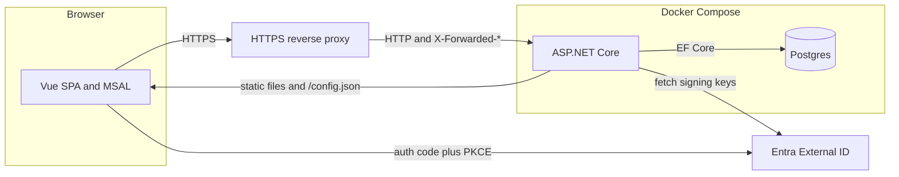
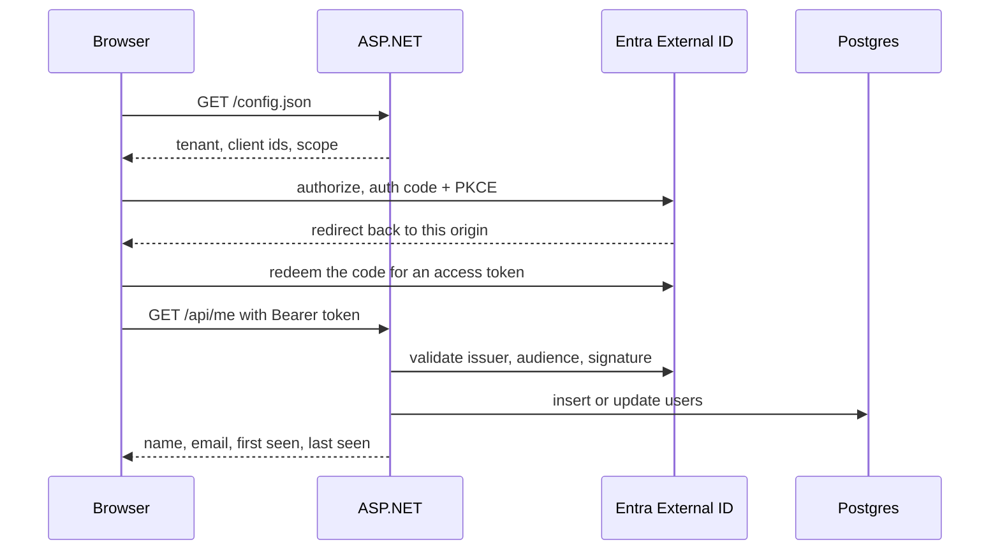

# Gym Bro

Gym Bro is a personal nutrition tracker. Phase 1 starts with profile, targets, and the food-data groundwork. The food log, Today, and Progress screens come in later pull requests.

You open the web app, sign in with Microsoft Entra External ID, and the first visit asks for a profile and a weigh-in before it shows any targets.

## Architecture

The browser is a Vue single-page app. It signs in with MSAL (authorization code + PKCE, no client secret) and calls the API with the access token. ASP.NET Core validates that token, upserts a `users` row, and in production also serves the built Vue files. Postgres is a separate container. TLS stops at a reverse proxy in front of the app (Tailscale serve, or anything else that sets `X-Forwarded-*`).





Sign-in settings are not baked into the JavaScript bundle. The API reads them from the environment and serves them at `/config.json`, so one image works everywhere.

## Layout

| Path | What it is |
| --- | --- |
| `backend/GymBro.Api` | ASP.NET Core minimal API. Serves `/api/*`, `/config.json`, and the built Vue files. |
| `backend/GymBro.Api/Program.cs` | Composition root: configuration, forwarded headers, auth, static files, startup migrations. |
| `backend/GymBro.Api/Auth` | Entra External ID token validation, the `access_as_user` scope check, and claim reading. |
| `backend/GymBro.Api/Users/UserDirectory.cs` | Upsert of the signed-in user, keyed by the token `oid`. |
| `backend/GymBro.Api/Data` | EF Core model and Postgres migrations. Phase 1 adds profiles, weigh-ins, target history, foods, log entries, entry groups, and day status. |
| `backend/GymBro.Api/Nutrition` | Mifflin-St Jeor, macro balance, the calorie floor, and trend weight. |
| `backend/GymBro.Api.Tests` | xUnit tests against Postgres (Testcontainers) and a test authentication handler. |
| `frontend` | Vue 3 + Vite + TypeScript. MSAL lives in `src/auth`. Playwright smoke tests live in `e2e`. Follows the design prototype. |
| `prototype` | Interactive design prototype. Not production code. Fictional data, `localStorage` only. See `prototype/README.md`. |
| `Dockerfile` | Multi-stage build. One runtime image, Node and the SDK are not in it. |
| `docker-compose.yml` | `app` and `postgres`. Every secret and id comes from the environment. |
| `.env.example` | The values you copy into `.env`. `.env` is gitignored. |
| `.github/workflows/tests.yml` | The `tests` job: backend tests, frontend checks, Chromium and WebKit smoke, axe, Docker image build. A separate `prototype` job builds `prototype/`. |

## Endpoints

| Method | Path | Auth | What it does |
| --- | --- | --- | --- |
| `GET` | `/api/health` | anonymous | `{ "status": "ok", "databaseReachable": true }` while the process is up. The flag is false when Postgres cannot be reached. |
| `GET` | `/api/me` | bearer token with scope `access_as_user` | Upserts `users` by `oid` and returns the row, including `firstSeenAt` and `lastSeenAt`. |
| `GET` | `/api/profile` | bearer | Profile, weight, the targets in effect today, and the Matvaretabellen citation. `profile` is null on first run. |
| `PUT` | `/api/profile` | bearer | Saves the profile. Requires a weigh-in on or before today. Upserts today's `target_history` row when something changed. |
| `POST` | `/api/targets/preview` | bearer | Same maths, nothing stored. |
| `GET` | `/api/targets?date=` | bearer | The target row in effect on that date. |
| `PUT` | `/api/weigh-ins/{date}` | bearer | Create or replace that day's weigh-in. One decimal, 30–300 kg. A comma or a point is accepted. A new date has to be from 7 days ago through today in the user's local time; an existing row can still have its value edited. `confirm: true` saves a value farther from the reference trend than the typo threshold. |
| `GET` | `/api/weigh-ins` | bearer | The caller's weigh-ins. Each row includes `canDelete`, which is false when it is the only weigh-in. |
| `DELETE` | `/api/weigh-ins/{date}` | bearer | Deletes that day's weigh-in when another one remains. The only weigh-in returns 409 `only_weigh_in`. The trend is computed again; `target_history` is left as it was. |
| `GET` | `/api/weight/trend?date=` | bearer | Trend for that local day (today when `date` is omitted), plus `trendState`, `reasons`, `goalReached`, and `freshStart`. |
| `GET` | `/api/weight/chart?date=&days=` | bearer | Daily series ending on that day. `days` defaults to 30 (1–366). Real weigh-ins are flagged; other days are estimated. `gap: true` and `trendKg: null` mark a fresh-start break (no line across a gap over 28 days). |
| `POST` | `/api/weight/fresh-start` | bearer | `{ "accept": true }` upserts today's `target_history` row and appends `fresh_start` to its `reasons`. `{ "accept": false }` writes nothing. |
| `GET` | `/api/foods/search?q=` | bearer | Local foods only. This never calls Open Food Facts. |
| `POST` | `/api/foods/search/open-food-facts` | bearer | On-demand Open Food Facts search, throttled to 10 a minute. Local matches are always returned. |
| `POST` `/GET` `/PUT` `/DELETE` | `/api/foods` | bearer | Custom foods. Private to the owner. Nutrients are per 100 g/ml, or per serving with no gram weight. Labels over 80 characters are 400. |
| `GET` | `/api/about` | bearer | Food-data credits, including the Matvaretabellen citation. |
| `GET` | `/config.json` | anonymous | Runtime Entra settings for the SPA. `Cache-Control: no-store`. |
| other `/api/*` | | same as `/api/me` | Unknown routes are not anonymous. |

`firstSeenAt` is set on the first request and left alone after that. A later token updates `lastSeenAt`, and updates the name and email when the token actually contains them.

## Entra External ID

Use an **external** tenant (External ID / CIAM), not a workforce tenant. You need two app registrations in that tenant. Neither one gets a client secret.

### 1. API app

1. App registrations → New registration. Name it something like `Gym Bro API`. Supported account type: this tenant only. No redirect URI. Register.
2. Copy the **Application (client) ID**. That is `ENTRA_API_CLIENT_ID`.
3. Expose an API → Application ID URI → accept the default `api://<that-client-id>`. The API builds the scope from that form. A different URI will not match.
4. Add a scope:
   - Scope name: `access_as_user`
   - Who can consent: Admins and users
   - Admin consent display name: `Access Gym Bro as the signed-in user`
   - Admin consent description: `Allows the app to call the Gym Bro API as the signed-in user.`
   - State: Enabled
5. You do not need a secret, a certificate, or a redirect URI on this app.

The API accepts access tokens whose `aud` is either the client id (typical for access token version 2) or `api://<client-id>` (version 1), so you can leave `accessTokenAcceptedVersion` at its default.

### 2. SPA app

1. App registrations → New registration. Name it something like `Gym Bro Web`. This tenant only. Register.
2. Copy the **Application (client) ID**. That is `ENTRA_SPA_CLIENT_ID`.
3. Authentication → Add a platform → **Single-page application**. The platform type has to be SPA. A "Web" redirect URI will not allow the auth-code + PKCE token request from the browser, and the token endpoint will fail CORS.
4. Redirect URIs, exactly, with no path and no trailing slash:
   - `http://localhost:5173` for the Vite dev server
   - `https://<your-production-origin>` for the HTTPS proxy (for example the Tailscale serve URL)
5. Leave the implicit-grant checkboxes (access tokens, ID tokens) **off**. MSAL uses the authorization code flow with PKCE.
6. Do not create a client secret.
7. API permissions → Add a permission → My APIs → `Gym Bro API` → Delegated → `access_as_user` → Add permission → **Grant admin consent**.

The SPA uses `window.location.origin` as the redirect URI. Register whatever origin the browser is actually on.

### 3. Sign-up and sign-in user flow

1. In the external tenant, open User flows (External Identities) → New user flow → **Sign up and sign in**.
2. Email with password is enough for a personal app. Include Display Name if you want a name stored on the user.
3. Create the flow, then open it and add the **Gym Bro Web** app. A SPA that is not on a user flow cannot sign in.

The directory (tenant) id is `ENTRA_TENANT_ID`. The tenant subdomain is the label in `https://<subdomain>.ciamlogin.com`. If that host is `https://contoso.ciamlogin.com/<tenant-id>`, `ENTRA_TENANT_SUBDOMAIN` is `contoso`.

After sign-in the app loads `/api/profile`. With no profile it stays on setup until a profile and a first weigh-in are saved. `oid` is the user key on every row. Name and email are stored when the token contains them (`name`, `email`, or an email-shaped `preferred_username`).

### Reopening the app

The API does not keep a cookie session. The SPA keeps the MSAL account in `localStorage` and sends the bearer access token. Entra keeps its own session cookie on `*.ciamlogin.com`. Those are different.

On startup, a saved MSAL account is used as-is (`acquireTokenSilent`, then an interactive redirect only if that renewal needs a person). If the cache is empty, the person has not chosen Sign out, and this page load has not already been told that a prompt is required, the SPA starts one top-level `loginRedirect` with `prompt=none`. That still uses PKCE, state, and nonce. It does not show a password and it does not grant consent. If Entra returns `login_required`, `interaction_required`, `consent_required`, or `access_denied`, the error is consumed and the Sign in button stays. A second silent redirect is not started in the same page session.

Sign out writes `gymbro-explicit-logout` in `localStorage` and then runs `logoutRedirect`, which ends the Entra session as well. The next open shows Sign in and does not call `prompt=none` until the person taps Sign in. Tapping Sign in clears that flag and uses the normal interactive redirect.

This does not lengthen refresh tokens or the Data Protection key lifetime (that key ring is for the server, not for a user session). A shared browser signs in as whoever already has the Entra cookie, which is the same account the Sign in button would use. Cross-site cookie blocking can still stop `prompt=none`; the button remains. iOS can still drop the MSAL cache, and a refresh token can still expire (about a day is the previously observed iOS limit). Playwright does not complete a real CIAM redirect, and a desktop browser is not a home-screen iPhone.

## Configure

```bash
cp .env.example .env
```

Fill in:

| Variable | Meaning |
| --- | --- |
| `ENTRA_TENANT_SUBDOMAIN` | Subdomain only, not the full host. |
| `ENTRA_TENANT_ID` | Directory (tenant) id. |
| `ENTRA_SPA_CLIENT_ID` | Gym Bro Web application id. |
| `ENTRA_API_CLIENT_ID` | Gym Bro API application id. |
| `POSTGRES_PASSWORD` | Database password. Also used by the API. |
| `BIND_ADDRESS` | Host address the app is published on. Default `127.0.0.1`. |
| `BIND_PORT` | Host port. Default `8100`. |
| `OPENFOODFACTS_USER_AGENT` | Product string sent to Open Food Facts. Keep it generic. |
| `MATVARETABELLEN_URL` | Official foods.json used by the import. |

`POSTGRES_HOST=localhost` is for `dotnet run` on the host. Compose overrides the app container's host to `postgres` so the container does not try to talk to itself.

The API refuses to start outside tests if the Entra values or the database password are missing.

## Run locally

Needs the .NET 10 SDK, Node.js 22, and Docker (for Postgres).

```bash
docker compose up -d postgres
dotnet run --project backend/GymBro.Api
```

In another terminal:

```bash
cd frontend
npm install
npm run dev
```

Open <http://localhost:5173>. Vite proxies `/api` and `/config.json` to `http://127.0.0.1:$BIND_PORT` (8100 unless you changed it). The browser only talks to port 5173, which is also the redirect URI.

`dotnet run` listens on `BIND_ADDRESS`:`BIND_PORT` from `.env` when `ASPNETCORE_URLS` is not set. Stop the Compose app container first if it is already bound to that port.

## Run with Docker Compose

```bash
docker compose up --build
```

This builds one app image (Vue build, then `dotnet publish`) and starts Postgres with the named volume `gymbro-postgres`. Data Protection keys use the named volume `gymbro-dataprotection`. The app container listens on `0.0.0.0` inside the network. Compose publishes that port on the host at `BIND_ADDRESS:BIND_PORT`, which defaults to `127.0.0.1:8100`. Open that URL on the machine, or put the HTTPS proxy in front of it.

On startup the API applies EF Core migrations, retrying for a few seconds if Postgres is still coming up. `docker compose down` keeps the volume. `docker compose down -v` drops it.

There is no TLS inside the app. Do not turn on `UseHttpsRedirection`. The proxy terminates HTTPS and must send `X-Forwarded-Proto`, `X-Forwarded-Host`, and `X-Forwarded-For`. The app trusts those headers from whoever can connect, which is safe while the publish address is loopback. If you set `BIND_ADDRESS` to a public interface, anyone who can reach it can spoof the original host.

Point the proxy at `http://127.0.0.1:8100`. Register the HTTPS origin it presents (no path, no trailing slash) as a SPA redirect URI, then open that HTTPS URL and sign in.

## Food data

Open Food Facts is not searched as you type. `GET /api/foods/search` reads the local table. `POST /api/foods/search/open-food-facts` calls Open Food Facts, at most 10 searches a minute from this server, and returns the local rows plus `ok`, `rate_limited`, or `unavailable`. The User-Agent is `OPENFOODFACTS_USER_AGENT`.

Kassalapp products can be copied from an offline file. The app does not call `https://kassal.app` and does not store an API key. The public docs are at `https://kassal.app/api/docs`. The free personal key is described as 60 requests a minute for non-commercial use, with a suggested 6 hour cache. Those docs do not say whether keeping a catalogue is allowed or forbidden. This command does not call the API.

The file may be one JSON document (`{"data":[...]}` from search, or `{"data":{"ean","products":[...]}}` from an EAN lookup) or JSONL with one product object per line. A minimal line is:

```json
{"ean":"007394376620799","name":"Havredrikk","brand":"Oatly","updated_at":"2026-11-07T08:00:00Z","nutrition":[{"code":"energi_kcal","unit":"kcal","amount":48},{"code":"protein","unit":"g","amount":1.1},{"code":"fett_totalt","unit":"g","amount":1.5},{"code":"karbohydrater","unit":"g","amount":7}]}
```

`ean` must be a string of digits so leading zeros stay. The store listing `id` is not the barcode and is not stored. Several store rows for one EAN keep the newest `updated_at` that has kcal, protein, fat, and carbs. Those four numbers come from that one row. Two rows with the same time and different numbers are skipped as `conflicting-nutrition` and are not mixed. A missing macro stays missing; it is not stored as zero. `energi_kj` is not converted into kilocalories. `weight` and `weight_unit` are the package, not the nutrition basis, so they are ignored. Images, prices, and price history are not stored.

A kept row has `source` `kassalapp`, `source_id` and `barcode` equal to the EAN, and `nutrient_basis` `unconfirmed` with `basis` null. Search can find the name and brand. It cannot be logged until that signed-in person chooses per 100 g or per 100 ml. The choice is stored only for them and does not change the shared row or anyone else's log. If a later import changes the four numbers, that person has to choose again. Nothing is selected for them in advance. The detail shows the numbers as reported, with a note that Kassalapp did not say the basis. Existing Matvaretabellen foods stay loggable. A confirmed millilitre food is logged in millilitres and does not store a gram weight. A stopped file does not retire rows. To hide the import, set `retired_at` where `source` is `kassalapp`. Do not delete those rows, because `log_entries.food_id` is `ON DELETE SET NULL`.

```bash
dotnet run --project backend/GymBro.Api -- --import-kassalapp --file norway.jsonl
```

Matvaretabellen is imported from the official foods.json, not committed as a dump. The import also downloads the English file beside it (`/api/en/` when the configured URL contains `/api/nb/`) and stores that name on `foods.name_en`. Search matches the Norwegian name and the English name, so "kylling" and "chicken" find the same rows. Running the import again upserts by source id and does not insert a second copy. On the host:

```bash
dotnet run --project backend/GymBro.Api -- --import-matvaretabellen
```

With the Compose app image, against the Compose database:

```bash
docker compose run --rm app --import-matvaretabellen
```

That one-off container applies migrations, imports, prints the citation, and exits. Run it again for the yearly refresh. The command prints `Matvaretabellen 2026. Mattilsynet. www.matvaretabellen.no`, and the app shows the same line from `/api/about` and the profile payload. Label kilocalories are stored as published. USDA is not used.

Search matches the Norwegian name, the English name, or one stored phrase on that same food. The typed text is composed to Unicode NFC, lower-cased with invariant rules, and punctuation becomes spaces, then split into words. That same text is stored on the food (`search_name`, `search_name_en`) when the row is saved. Startup fills rows that do not have it yet. Search reads those columns, so Postgres does not fold accents a second time. A precomposed "é" and an "e" plus a combining accent are the same letter. The accent is kept, so `cafe` does not match `café`. Every word has to occur in that one string. Words shorter than four letters stay on a boundary: words before the last one must be whole words, and the last word may be only the start of a word, so `chicken br` finds `chicken breast` while the person is still typing, and it does not return every chicken or every breast. A word of four letters or more may also sit inside a compound, so `bryst` still finds `kyllingbryst` and `filet` still finds `kyllingfilet`. `raw chicken br` stays on the raw fillet phrase. `fried chicken br` stays on the fried fillet phrase. Word order can vary (`fillet chicken`). A barcode of digits still matches the barcode exactly. Another person's private food is still excluded.

Results are ordered so an exact name or phrase comes first, then a name or phrase that starts with what was typed (`chicken breast` before `chicken burger, breaded` for `chicken br`), then whole-word matches, then a last word that only starts a word, then a compound that merely contains the word. The list still stops at 25. At least two characters are required, and more than eight words is rejected, so a keystroke does not scan an open-ended predicate. The search box waits 200 ms and drops a response if the text has already changed.

Phrases stay in `food_aliases`, keyed by Matvaretabellen source id, and match only while that row's English name is still the name the phrase was written for. Official names, nutrients, and logged snapshots are not changed. Phrases are not returned by the API. Custom foods are not given phrases. Running the import again adds any missing phrases and does not delete ones already stored. The phrase list does not need its own migration. Folded search text does: `search_name` and `search_name_en` are filled on save, and startup fills any row that is still missing them.

Lexicon v1 lives in `backend/GymBro.Api/Foods/food-alias-lexicon.v1.json`. It was checked against the public foods.json files (English sha256 `89b8f5f494a79731bf7d8d98065ee66c55263ccdbb519e7c87941218be6c948d`, Norwegian sha256 `7c7ebb52109433ea15032a29f495843a5da229313bbcf4a4fe7ebcc45b9c9b33`, 2121 foods). On that snapshot the backfill stores 5903 phrases. 137 foods get an everyday synonym or one of the original preserved phrases. 1808 more get only a punctuation or word-order phrase, such as `raw salmon` for `Salmon, farmed, raw`. 176 foods get nothing new because the official name is already a single searchable phrase. A phrase is not a nutrition match. Elk is not aliased to moose, shrimp is not aliased to king prawn, and plant drinks are not aliased to milk.

The original seven foods and their 25 phrases are still included:

| Source id | English name that must still match | Phrases |
| --- | --- | --- |
| 03.205 | Chicken, fillet, without skin, raw | chicken breast; chicken breast fillet; chicken fillet; kyllingbryst; kylling bryst |
| 03.242 | Chicken fillet, fried in fat | chicken breast; chicken breast fillet; chicken fillet; kyllingbryst; kylling bryst |
| 03.418 | Chicken, fillet, simmered | chicken breast; chicken breast fillet; chicken fillet; kyllingbryst; kylling bryst |
| 03.481 | Chicken fillet, fried without fat | chicken breast; chicken breast fillet; chicken fillet; kyllingbryst; kylling bryst |
| 03.224 | Hen, fillet, raw | hen breast; hen fillet; hønebryst |
| 03.204 | Turkey, breast, without skin, raw | turkey fillet |
| 03.241 | Turkey breast, without skin, roasted | turkey fillet |

`03.224` is included because the Norwegian name is "Høne, bryst, filet, uten skinn, rå". "Høne, filet, kokt" is not. Turkey fillet is only the two breast rows, not "Kalkunfilet, naturell/røkt". The same backfill also adds the lexicon: eggplant for aubergine, courgette for the zucchini squash row, garbanzo and chickpeas for the chick pea rows but not falafel, bell pepper and capsicum for sweet pepper but not the powder, cilantro only for raw coriander leaf, canola only for rapeseed oil that is not a sunflower or margarine blend, coley for saithe but not Alaska pollock, filet mignon only for beef tenderloin, brown cheese for the brunost whey cheeses but not prim, and the other rules in the lexicon file.

An import applies phrases for every catalogue row already in the database. It does not need a second full download to add phrases to foods imported earlier. Web startup does not write them. For a database that already has the foods:

```bash
dotnet run --project backend/GymBro.Api -- --backfill-food-aliases
```

With Compose, against the database that already has the foods:

```bash
docker compose run --rm app --backfill-food-aliases
```

Run it again and it prints the phrases as already present. It does not rewrite nutrients or log rows. Search still returns at most 25 rows, so a broad phrase such as `whole wheat` does not list every matching food. No new migration is required; the `food_aliases` table from the earlier release is reused.

## Targets and trend weight

BMR is Mifflin-St Jeor. Daily burn is BMR times the activity factor. The calorie target moves off that burn by the weekly rate times 7,700 divided by 7, and is never below BMR. Protein is grams per kilogram, fat is a percent of the target, and carbs fill the rest (never below 0).

`target_history` has one row per user per effective date. A later change the same day updates that row: the numbers are the latest calculation, and `reasons` (`text[]`) keeps every reason in the order it first applied (`profile_change`, `macro_balance_change`, `weekly_recalculation`, `fresh_start`). The JSON field `reason` is the last of those. `PUT /api/profile`, the weekly job, and a fresh-start accept all use that upsert. Accept appends `fresh_start` and does not drop the reasons already on today's row.

The hosted job adds `weekly_recalculation` to today's row. On Monday that row is dated Monday. If the process was off on Monday, the catch-up merges into the day the job actually runs and does not backdate a Monday row. A second run that week does nothing. A profile created today on a day other than Monday does not also get a weekly reason that same day.

Trend weight is one server series (`TrendWeight.Compute`), from the first real weigh-in through the user's local today. The setup weight is that first weigh-in, and the trend that day is the weigh-in itself. Each later day keeps the previous trend (Part A has no intake step) unless the day has a real weigh-in or a gap reading, in which case the trend moves 10 percent of the way toward that reading (`TrendWeight.SmoothingShare`). A gap of 2 to 28 days is a straight line between the two real weigh-ins. A gap longer than 28 days is a fresh start: that day's trend equals the new weigh-in. Profile, targets, BMR, the weekly job, and the weight API all use this published figure, rounded to two decimal places, half away from zero. The weight stored on a target row is `numeric(5,2)`. Past `target_history` rows are not rewritten when a weigh-in changes.

`trendState` is `normal`, `low_accuracy` (fewer than 2 real weigh-ins in the last 7 days; the weight `reasons` includes `fewer_than_2_weighins_7d`), or `fresh_start` (the latest weigh-in followed a gap longer than 28 days, until the next weigh-in). `freshStart.weeksSincePrevious` is the whole weeks in that gap. `freshStart.recalculatePending` stays true until the prompt is accepted or the next Monday job writes a `weekly_recalculation` row after the fresh-start day. `goalReached` is true only on the latest real weigh-in's own day (lose: trend at or under the goal, gain: at or over). A later day that only carries the trend is not goal reached, and an earlier weigh-in cannot trigger it while a later one exists. Nothing switches the goal on its own. The profile shows the published kilograms from the first weigh-in, with “trend · low accuracy” when the window has fewer than two weigh-ins.

A new or edited weigh-in farther from the reference trend than the threshold returns `409` with `code: "confirm_weigh_in"`. The threshold is 3 kg plus 1 kg per full week since the previous real weigh-in, capped at 10 kg (`limitKg`). The reference is the published trend on the day before that date. A new weigh-in dated before the setup weigh-in is compared with the setup weigh-in the same way. The first weigh-in is not checked. Example: `error: "Is 38.6 kg right? That's 45.0 kg below your trend (83.6 kg). Nothing is saved until you choose."` The kilograms in that sentence are shown to one decimal. `previousTrendKg` stays the full published trend. Sending `confirm: true` saves it. A future date is `400` with `error: "That date is in the future."` A new date older than 7 days, including `2000-01-01`, is `400` with `error: "A new weigh-in has to be from 7 days ago through today."` A weight outside 30–300 kg is `400`. Deleting the only weigh-in returns `409` `{ "error": "This is your only weigh-in, so it can't be deleted. Edit it instead.", "code": "only_weigh_in" }`. A list row looks like `{ "localDate": "2026-10-24", "kg": 83.6, "canDelete": false }`. `POST /api/weight/fresh-start` with `accept: true` upserts today's target row and appends `fresh_start` to `reasons`. `accept: false` writes nothing. A back-dated weigh-in that closes the gap ends the fresh-start state and the open prompt, and leaves an already-written `fresh_start` row in place. The weekly job still uses the same trend and the same upsert. `day_status.fasting` defaults to false and is unused until learned burn.

## Custom foods and log references

A custom food can be per serving only: `nutrientBasis` is `per_serving`, the kcal and macro fields are for one serving, and there is no gram weight. `log_entries.grams` stays nullable. Adding a serving weight later stores nutrients per 100 g for future logs (`value * 100 / grams`). Rows already logged keep the snapshot that was copied onto them. Omitted `nutrientBasis` means per 100 g, which is what Matvaretabellen (`source` `mvt`) and Open Food Facts use. Serving and piece labels longer than 80 characters are rejected with 400.

Catalogue foods have no owner, so a foreign key of `(log.user_id, food_id)` cannot point at them. `foods.owner_key` is a stored `COALESCE(user_id, '')` (`''` is the catalogue). `log_entries.food_owner_key` must be `''` or that row's `user_id`. The foreign key is `(food_owner_key, food_id)` → `foods (owner_key, id)`. A null `food_id` skips the key. Groups always have an owner, so `(user_id, group_id)` → `entry_groups (user_id, id)`. Deleting a food or a group sets only `food_id` or `group_id` to null. EF models those relationships as `NO ACTION` because `food_owner_key` and `user_id` are not nullable; the migration SQL uses PostgreSQL's `ON DELETE SET NULL (food_id)` and `ON DELETE SET NULL (group_id)`. A later `migrations add` compares the model to the snapshot, so it will not rewrite that SQL.

## Open Food Facts and response headers

The Open Food Facts client does not follow redirects. A 3xx, a network failure, or a body over 2 MiB comes back as `unavailable`. Every response, including static files and errors, sends a Content-Security-Policy that allows the built SPA and MSAL calls to `https://*.ciamlogin.com` (no script inline or eval; style attributes stay allowed for the sheet drag). Silent renewal needs `frame-src 'self' https://*.ciamlogin.com` and `frame-ancestors 'self'`, with `X-Frame-Options: SAMEORIGIN`, so the hidden iframe can load CIAM and the same-origin redirect page. Responses also send `X-Content-Type-Options: nosniff` and `Referrer-Policy: strict-origin-when-cross-origin`. The Playwright smoke checks those headers on `http://127.0.0.1:8100/api/health` and walks the e2e sign-in flag. It does not complete a real CIAM redirect.

## Data Protection keys

ASP.NET Data Protection keys are stored on disk so a new container does not mint a new key ring. Compose sets `DataProtection__KeysPath=/var/lib/gymbro/keys` and mounts the named volume `gymbro-dataprotection` there. The image creates that directory as root and `chown`s it to the non-root app user before `USER`, so a fresh volume is writable. Development, tests, and the e2e host use `.data/keys` under the content root (gitignored). Sign-in uses bearer tokens, not Data Protection cookies; the keys are still persisted. The first deploy after this change writes a new ring into the volume. Later rebuilds reuse it.

## Deploy

Take a database backup before deploying this release. The migration merges same-day `target_history` rows (latest numbers, every reason kept), adds per-serving nutrient basis, and replaces the food and group foreign keys. A log row that pointed at another person's food or group has that reference cleared so the new keys can be created. Bring the new image up with Compose so `gymbro-dataprotection` is mounted. Do not use `docker compose down -v` if you need the database or the key ring. The first start writes Data Protection keys into the volume; rebuilding the image after that keeps them.

## Tests

```bash
dotnet test
cd frontend && npm run typecheck && npm test && npm run build && npm run e2e
```

Backend tests use Testcontainers Postgres 17 and `TestAuthHandler`. They do not call Entra. The end-to-end smoke test starts the API with `ASPNETCORE_ENVIRONMENT=E2e` and `E2E_AUTH=true` (both are required; that handler is not registered otherwise) and a browser session flag. It needs Postgres on `127.0.0.1:5432` with user, password, and database `gymbro`.

CI is `.github/workflows/tests.yml`. The required job name is `tests`. It runs backend tests, the frontend checks, the Playwright smoke test on Chromium and WebKit (each at 390, 820, and 1440), then the axe spec (`npx playwright test --config e2e/retro.config.ts`) on Chromium and WebKit. The smoke step and the axe step both bind ports 8100 and 5173, so CI runs them one after the other. The Docker image build is last. A separate `prototype` job runs `npm ci && npm run build && node scripts/unit-trend.mjs` in `prototype/` and is not part of the `tests` check.

New migrations, when you need one:

```bash
dotnet tool restore
dotnet tool run dotnet-ef -- migrations add <Name> --project backend/GymBro.Api --output-dir Data/Migrations
```

## Later pull requests

Search and food detail are in the app. A Matvaretabellen or custom food opens with an amount, live calories and macros, quick amount chips, and grams, millilitres, a serving, or a piece when that food has one. Adding from the detail keeps the sheet open, confirms the add, clears the search, and shows today's calorie total; closing is the Close or Done button. Editing an amount scales the entry's stored snapshot. Recents, Open Food Facts inside the sheet, past days, creating a food from search, your own serving sizes, copy, and saved groups are still later. Workouts are out of scope. There is no meal field on a log entry. When the server can't be reached at all (for example, the host machine is asleep), Safari shows its own error page instead of the app's banner. A local search was not timed on an iPhone over Tailscale.
