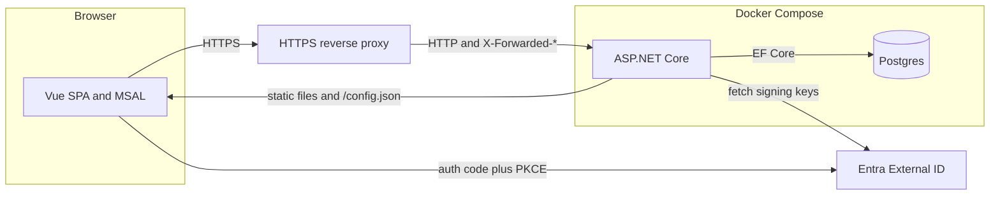
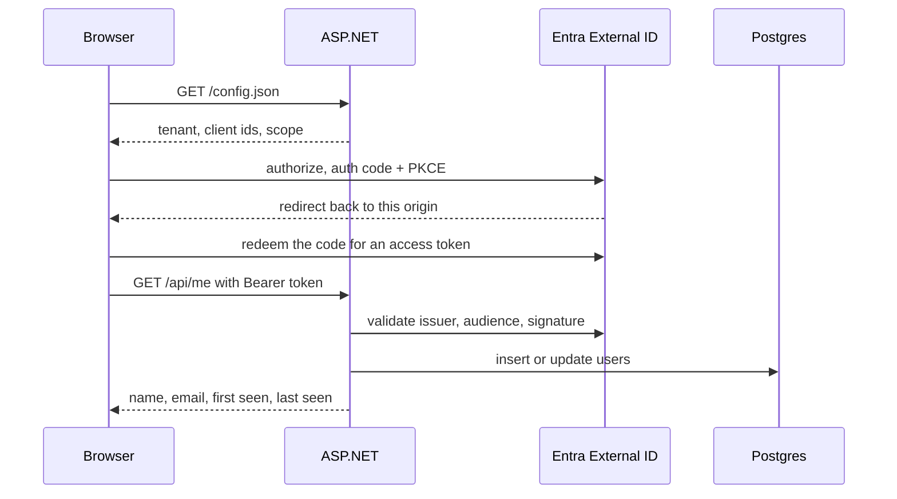

# Gym Bro

Gym Bro is a personal nutrition tracker. You open the web app, sign in with Microsoft Entra External ID, and log food against a target. Today, the food log, Progress, saved groups, recipes, and recalculate are in the app. The first visit asks for a profile and a weigh-in before it shows any targets.

## Architecture

The browser is a Vue single-page app. It signs in with MSAL (authorization code + PKCE, no client secret) and calls the API with the access token. ASP.NET Core validates that token, upserts a `users` row, and in production also serves the built Vue files. Postgres is a separate container. TLS stops at a reverse proxy in front of the app (Tailscale serve, or anything else that sets `X-Forwarded-*`).





Sign-in settings are not baked into the JavaScript bundle. The API reads them from the environment and serves them at `/config.json`, so one image works everywhere.

## Layout

| Path | What it is |
| --- | --- |
| `backend/GymBro.Api` | ASP.NET Core minimal API. Serves `/api/*`, `/config.json`, and the built Vue files. |
| `backend/GymBro.Api/Program.cs` | Composition root: configuration, forwarded headers, auth, static files, startup migrations. |
| `backend/GymBro.Api/Auth` | Entra External ID token validation, the `access_as_user` scope check, and claim reading. |
| `backend/GymBro.Api/Users/UserDirectory.cs` | Upsert of the signed-in user, keyed by the token `oid`. |
| `backend/GymBro.Api/Data` | EF Core model and Postgres migrations: profiles, weigh-ins, target history, recalculation declines, foods, aliases, own servings, log entries, entry groups, recipes, day status, push subscriptions, and in-app notifications. |
| `backend/GymBro.Api/Endpoints` | One file per area. Each maps its routes under `/api` and reads the caller from the token `oid`. |
| `backend/GymBro.Api/Nutrition` | Mifflin-St Jeor, macro balance, the calorie floor, trend weight, the adaptive recalculate review, and local dates. |
| `backend/GymBro.Api/Profiles` | Profile validation, the `target_history` upsert (`TargetBook`), and the weight snapshot used by targets. |
| `backend/GymBro.Api/Logging` | Log entry, saved group and recipe rules: units, nutrient snapshots, scaling, and the setup-through-today date window. |
| `backend/GymBro.Api/Foods` | Search, aliases, the food-table importer (`FoodTable.cs`) with the Matvaretabellen, Livsmedelsverket, Fineli and USDA tables and their countries (`FoodSources.cs`), the Kassalapp import, the Open Food Facts client and throttle, and the nutrient panel. |
| `backend/GymBro.Api/Progress` | Range and average maths for `GET /api/progress`. |
| `backend/GymBro.Api/Training` | The exercise library (`ExerciseCatalog.cs`), free-exercise-db at a pinned commit, and our own exercises. |
| `backend/GymBro.Api/Hosting` | Startup migrations, security headers, and the Monday push reminder. |
| `backend/GymBro.Api/Notifications` | The weekly in-app recalculate notification. |
| `backend/GymBro.Api.Tests` | xUnit tests against Postgres (Testcontainers) and a test authentication handler. |
| `frontend` | Vue 3 + Vite + TypeScript. MSAL lives in `src/auth`. Playwright smoke tests live in `e2e`. Follows the design prototype. |
| `frontend/sw` | The service worker template (`worker.js`) and the Vite plugin that writes `/sw.js` with the files the app needs to open offline. |
| `prototype` | Interactive design prototype. Not production code. Fictional data, `localStorage` only. See `prototype/README.md`. |
| `Dockerfile` | Multi-stage build. One runtime image, Node and the SDK are not in it. |
| `docker-compose.yml` | `app` and `postgres`. Every secret and id comes from the environment. |
| `.env.example` | The values you copy into `.env`. `.env` is gitignored. |
| `.github/workflows/tests.yml` | Parallel `checks` (backend tests, frontend checks, Docker image) and `e2e` jobs (Chromium and WebKit in four parts each, plus axe), gathered by the required `tests` job. A separate `prototype` job builds `prototype/`. |

## Endpoints

| Method | Path | Auth | What it does |
| --- | --- | --- | --- |
| `GET` | `/api/health` | anonymous | `{ "status": "ok", "databaseReachable": true }` while the process is up. The flag is false when Postgres cannot be reached. |
| `GET` | `/api/me` | bearer token with scope `access_as_user` | Upserts `users` by `oid` and returns the row, including `firstSeenAt` and `lastSeenAt`. |
| `GET` | `/api/profile` | bearer | Profile, weight, the targets in effect today, and the Matvaretabellen citation. `profile` is null on first run. |
| `GET` | `/api/profile/history?offset=&limit=` | bearer | `target_history` rows and recalculation declines, newest first, 20 at a time (at most 100): `{ rows, total, more }`. Each row has `kind` (`target` or `declined`), `date`, `kcal`, the macros, `burn`, `previousKcal` and `previousBurn` (the row before it, over all rows), `reasons`, and its saved details: `recalculation` (period, counted and low days, weigh-ins, weight rate, average eaten, measured burn and spread, the burn before, and the percent it moved) or `changes` (`[{ field, from, to }]` for a profile edit, in kg, cm, g/kg and %). A decline has the reason `recalculation_declined`, the kept kcal in `kcal`, the suggestion in `suggestedKcal`, and its date in the profile's time zone. |
| `PUT` | `/api/profile/settings` | bearer | `{ timeZone?, timeZoneFollowsDevice?, foodCountry?, foodCountryFollowsZone?, weightUnit?, heightUnit?, foodUnit?, fatLimits?, sodiumLimit?, homeHidden?, macrosHidden?, progressHidden?, macrosOrder?, progressOrder?, fanPages? }`. Preferences that don't touch the targets: no `target_history` row is written. An unknown zone, or one over 64 characters, is 400 "That time zone is not known." `foodCountry` is an ISO code picked by hand (sent with `foodCountryFollowsZone: false`; any case, stored upper case); a code that is no time zone's country is 400 "That country is not known." The response and the profile payload give `foodCountry` as the country in use, which is the time zone's while `foodCountryFollowsZone` is true. `weightUnit` is `kg` or `lb` (else 400 "Weight is shown in kg or lb."), `heightUnit` is `cm` or `ftin` (else 400 "Height is shown in cm or ftin."). `foodUnit` is `g` or `oz` (else 400 "Food is shown in g or oz."). All three are display units only: every weight and height in the API stays in kilograms and centimetres, and every food amount in grams or millilitres. `fatLimits` is `normal` or `lower` (else 400 "Fat limits are normal or lower."); it only changes the limits drawn on the Fats card. `sodiumLimit` is `normal` (2,300 mg) or `lower` (1,500 mg) (else 400 "The sodium limit is normal or lower."); it only changes the sodium limit on the Carbs card and the Progress Sodium page. `homeHidden`, `macrosHidden` and `progressHidden` are the Home cards and card pages switched off: up to 32 ids of letters, digits and `-`, up to 32 characters each (else 400 "Hidden cards are a list of up to 32 short ids."), kept in order without repeats. `macrosOrder` and `progressOrder` are each card's pages in swipe order, hidden ones included, under the same id rules (else 400 "A page order is a list of up to 32 short ids."); an empty list is the default order. `fanPages` is the + fan's layout, one string per page with the action ids joined by commas: up to 4 pages of 1 to 5 ids, each of letters, digits and `-` up to 32 characters, none repeated (else 400 "The + fan is up to 4 pages of 1 to 5 actions."); an empty list is the default fan. The server doesn't know the ids, so a new card or fan action needs no server change. A list left out stays as it was; each is `null` until first saved. The profile payload returns all of them. Needs a profile. |
| `PUT` | `/api/profile` | bearer | Saves the profile. Requires a weigh-in on or before today. Upserts today's `target_history` row when something changed, keeping the measured burn (see Targets) and recording which fields changed. |
| `POST` | `/api/targets/preview` | bearer | Same maths, nothing stored. `?fresh=true` previews a fresh start instead: the formula at the restarted trend, which is what accepting one saves. |
| `GET` | `/api/targets?date=` | bearer | The target row in effect on that date. |
| `PUT` | `/api/weigh-ins/{date}` | bearer | Create or replace that day's weigh-in. 30–300 kg with at most two decimals, so a weight typed in pounds (180.0 lb = 81.65 kg) comes back as typed. A comma or a point is accepted. A new date has to be from 7 days ago through today in the user's local time; an existing row can still have its value edited. `confirm: true` saves a value farther from the reference trend than the typo threshold. |
| `GET` | `/api/weigh-ins` | bearer | The caller's weigh-ins. Each row includes `canDelete`, which is false when it is the only weigh-in. |
| `DELETE` | `/api/weigh-ins/{date}` | bearer | Deletes that day's weigh-in when another one remains. The only weigh-in returns 409 `only_weigh_in`. The trend is computed again; `target_history` is left as it was. |
| `GET` | `/api/weight/trend?date=` | bearer | Trend for that local day (today when `date` is omitted), plus `trendState`, `reasons`, `goalReached`, and `freshStart`. |
| `GET` | `/api/weight/chart?date=&days=` | bearer | Daily series ending on that day. `days` defaults to 30 (1–366). Real weigh-ins are flagged; other days are estimated. `gap: true` and `trendKg: null` mark a fresh-start break (no line across a gap over 28 days). |
| `POST` | `/api/weight/fresh-start` | bearer | `{ "accept": true }` upserts today's `target_history` row from the formula and appends `fresh_start` to its `reasons`. `{ "accept": false }` writes no target; it stores the fresh-start date on the profile (`fresh_start_declined_on`) so the prompt stays settled on every device. |
| `GET` | `/api/foods/search?q=` | bearer | Local foods only. This never calls Open Food Facts. `correctedQuery` is the spelling help's words when they added foods, else null (see *Spelling help*). |
| `GET` | `/api/foods/recents` | bearer | Foods this person logged, newest first, with the last amount and unit. Soft-deleted entries are left out. Another person's logs are not included. |
| `POST` | `/api/foods/search/open-food-facts` | bearer | On-demand Open Food Facts search, throttled to 10 a minute. Local matches are always returned. Products with no label kcal are counted in `missingKcal` and not stored. |
| `POST` `/GET` `/PUT` `/DELETE` | `/api/foods` | bearer | Custom foods. Private to the owner. Nutrients are per 100 g/ml, or per serving with no gram weight. Labels over 80 characters are 400. |
| `GET` | `/api/foods/barcode/{code}` | bearer | `{ code, status, food }` for a scanned or typed barcode. `status` is `found`, `not_found`, `rate_limited` or `unavailable`; a miss is still 200. Spaces and dashes are dropped; anything but 8 to 14 digits is 400. See *Barcode scanning*. |
| `POST` | `/api/foods/label` | bearer | `{ photo: { mediaType, data } }`: Claude reads the nutrition table in a label photo and returns the values to fill New food (`name, brand, basis, servingName, servingGrams, kcal, protein, fat, carbs, saturatedFat, sugars, fiber, salt, left`). Nothing is saved but a usage row, which counts toward Describe's daily limit. 404 without an Anthropic key, 422 when no table can be read, 429 at the limit, 503 when Claude can't be reached. See *New food from a label photo*. |
| `GET` | `/api/foods/mine` | bearer | The caller's custom foods that are not retired, by name. At most 500. |
| `GET` | `/api/foods/{id}` | bearer | One catalogue food or one of the caller's own foods, with the caller's servings. An Open Food Facts row that is due for a refresh is fetched again first. Another person's food is 404. |
| `POST` | `/api/foods/{id}/basis` | bearer | `{ "basis": "g" }` or `"ml"`. Stores this person's reading of an `unconfirmed` Kassalapp food. A food that does not need it is 404. |
| `POST` `/PUT` `/DELETE` | `/api/foods/{id}/servings` and `/api/foods/{id}/servings/{servingId}` | bearer | The caller's own named servings for a food (`name`, `grams`). A name is unique per food, at most 16 characters, and cannot be a unit such as `g` or `serving`. |
| `POST` | `/api/log-entries` | bearer | Logs one entry. Needs `idempotencyKey`, `localDate`, and `timeZone`; `time` defaults to now. With `foodId`, `amount`, and `unit` the server computes the nutrients from the food and ignores any sent. Without a food it is a quick add from `name`, `kcal`, `protein`, `fat`, and `carbs`. A repeated key returns the stored row with 200. A later day plans food: it works like any other day, up to a year ahead of the caller's today. A date more than a year ahead is 400 (`Plan at most a year ahead.`), and so is a date before setup or a time zone more than a day from the server. |
| `GET` | `/api/log-entries?date=` | bearer | That day's entries, in time order, with day totals. Deleted entries are left out. |
| `PATCH` | `/api/log-entries/{id}` | bearer | Edits name, date, time, amount, unit, or the numbers. A new date follows the same window as adding: setup through a year ahead. An amount or unit change scales the stored snapshot; it does not read the food again. Another person's entry is 404. |
| `DELETE` | `/api/log-entries/{id}` | bearer | Soft delete (`deleted_at`). |
| `POST` | `/api/log-entries/{id}/restore` | bearer | Undo for a delete. |
| `GET` | `/api/day-status?date=&timeZone=` | bearer | `{ fasting, complete }` for that day, including a planned later day. `complete` is no longer written. |
| `PUT` | `/api/day-status/{date}` | bearer | `{ "fasting": true, "timeZone": "..." }` sets or clears the fasting mark. Logging food does not clear it, and recalculate does not treat it differently. A later day can't be marked until it comes (400). |
| `GET` | `/api/log-days?from=&to=&timeZone=` | bearer | Dates in that range (two weeks at most) that have a log, planned later days included, plus `setupDate`, `today`, and `firstTargetDate`. Used by the week strip. |
| `GET` | `/api/nutrients/week?date=` | bearer | `{ from, to, loggedDays, average }` for the seven days ending on `date` (`yyyy-MM-dd`, else 400). `average` is the daily nutrient panel averaged over the days with at least one entry; each day is what is known, with an unknown value counted as 0, like the Home card. No logged day: `loggedDays` 0 and an empty `average`. Only the caller's entries. |
| `GET` | `/api/nutrients/{key}/sources` | bearer | `{ nutrient, foods }`: up to five foods the caller has logged (and not deleted) with the most of `key` per 100 g or ml, largest first, as `{ id, name, brand, basis, per100 }`. Per-serving foods, retired foods, and foods without the nutrient (or with 0) are left out. An unknown key, or a macro such as `kcal`, is 404 "That nutrient is not known." |
| `GET` | `/api/progress?range=` | bearer | `7d`, `30d` (default), `90d`, `6m` (182 days), or `all`. Each day has intake (only days with a log), including `fiber` and `saturatedFat` (grams) and `sodiumMg` (each entry's sodium, or its salt ÷ 2.5 when only salt is known); a food without the figure counts as 0. Also the target in effect that day, the trend, and the burn in effect that day: `burnKcal` (TDEE), `bmrKcal`, `burnSdKcal` and `burnMeasured` (null and false before the first target). `burn` is today's: `kcal`, `bmrKcal`, `sdKcal`, `measured` and `setOn`, the last recalculation or fresh start (else the first target); null without a target. The spread starts at the row's `burn_sd_kcal` on `setOn` and widens 60 kcal a week, as a recalculation assumes, up to the formula's 350 (`Progress/BurnSeries.cs`). Averages count logged days only. Weight change is between the first and last weigh-in in the range. |
| `POST` | `/api/log-entries/copy` | bearer | Copies the caller's entries onto a date from setup through a year ahead. Each copy keeps the stored name, source, amount, unit, kcal, protein, fat, carbs, grams and time of day, with a new id, a new idempotency key and no group. The same day makes a duplicate. A date more than a year ahead or before setup is 400. A missing, deleted, or another person's entry is 404 and nothing is written. A day marked complete stays complete. |
| `GET` | `/api/groups` | bearer | The caller's saved groups, newest first. Each item keeps its food (if any), amount, unit and gram equivalent. Quick-add items keep the calories and macros that were saved. Another person's groups are not listed. |
| `POST` | `/api/groups` | bearer | Saves a named group from the caller's log entries. At least two are required. A soft-deleted entry is left out. A missing entry or another person's entry is 404 and nothing is saved. |
| `GET` | `/api/groups/{id}` | bearer | One group and its items. Another person's group is 404. |
| `DELETE` | `/api/groups/{id}` | bearer | Deletes that group. It is soft-deleted (`deleted_at`): it leaves the list, `GET`, log and export, and log entries keep their group link so Undo brings it back exactly. Another person's group is 404 and is left as it was. |
| `POST` | `/api/groups/{id}/restore` | bearer | Undo for a delete: clears `deleted_at` and returns the group with its items, the same shape as `GET /api/groups/{id}`. A group that is not deleted is returned as it is. Another person's group, or an unknown id, is 404. |
| `POST` | `/api/groups/{id}/log` | bearer | Adds the group's items as new log entries at one time: now on today, or a picked time on any other day, earlier or planned. Another day without a time is 400. Food items use the food's current values. A retired food is skipped and named in `notice`; the other items are still added. A quick-add item is logged from its stored calories and macros. A named serving that no longer exists uses the stored grams when the food is measured in grams; otherwise that item is skipped. Millilitres stay millilitres. A date more than a year ahead or before setup is 400. A complete day, including a fasting day, stays as it was. Each new entry in the reply carries its `nutrients` panel, like `POST /api/log-entries`. Another person's group is 404 and nothing is written. |
| `GET` | `/api/recipes` | bearer | The caller's recipes, newest edit first. Retired recipes are left out. Totals are the saved snapshot. `perPortion` is that snapshot divided by the portion count. `perGram` is present only when a finished weight was saved. Each recipe and each ingredient carries `saturatedFat`, `sugars`, `fiber`, `salt` and a `nutrients` panel (the 29 values past the label basics, null where unknown), so the app's nutrient pages fill in. Another person's recipes are not listed. |
| `POST` | `/api/recipes` | bearer | Creates a recipe from foods and amounts. The server sums each food's current kcal and macros. A name and a portion count above 0 are required. Finished weight in grams is optional. Quick add is not an ingredient. Another person's food is 404 and nothing is saved. |
| `GET` | `/api/recipes/{id}` | bearer | One recipe and its ingredients, with the same panels as the list. A retired recipe, or another person's recipe, is 404. An ingredient whose food was later retired stays in the list with `available: false` and is named in `notice`. The saved totals stay. |
| `PUT` | `/api/recipes/{id}` | bearer | Replaces the name, portions, finished weight and ingredients. Live foods are recalculated from their current values. A retired ingredient keeps its saved nutrients, or scales them when only the amount changes. Another person's recipe is 404. |
| `DELETE` | `/api/recipes/{id}` | bearer | Sets `retired_at`. The row stays, so past log entries stay. It disappears from `GET /api/recipes`. Another person's recipe is 404. |
| `POST` | `/api/recipes/{id}/restore` | bearer | Undo for a delete: clears `retired_at` and returns the recipe with its ingredients, the same shape as `GET /api/recipes/{id}`. A recipe that is not deleted is returned as it is. Another person's recipe, or an unknown id, is 404. |
| `POST` | `/api/recipes/import` | bearer | `{ url }` or `{ text }`: reads a recipe page's ingredients, or pasted ones, and matches each to a food the way Describe does. Returns `{ name, portions, site, items, left }` with `items` in Describe's shape. Nothing is saved but a usage row, which counts toward Describe's daily limit. 400 for a link that can't be opened or text over 4,000 characters, 404 without an Anthropic key, 422 when the page can't be read, has no recipe, or nothing matches, 429 at the limit, 503 when Claude can't be reached. See *Import a recipe*. |
| `POST` | `/api/recipes/{id}/log` | bearer | Writes one log entry named after the recipe, using the saved snapshot. `unit` is `portion` (or `portions`) or `g`. Grams are accepted only when the recipe has a finished weight, and the entry is that share of the finished weight. Any day but today needs a time. A date more than a year ahead or before setup is 400. A complete day, including a fasting day, stays as it was. A later edit of the recipe does not change this entry. The reply carries the entry's `nutrients` panel, so Home is right without a reload. A retired or another person's recipe is 404. |
| `GET` | `/api/describe` | bearer | `{ available, limit, left, nextAt, recent }`. `available` is false when the server has no Anthropic key, and the app hides Describe (`limit` and `left` are then 0). `left` is how many of `limit` descriptions are left in the rolling 24 hours; `nextAt` is when the next one frees up, set only when none are left. `recent` is up to six of the caller's logged descriptions, newest first, one per text (each photo one of its own): `{ id, text, photo, seen, foods, kcal, loggedAt }`, where `photo` says one was sent and `seen` lists the foods found ("Kylling, ris kokt"). See *Describe a meal*. |
| `POST` | `/api/describe` | bearer | `{ text, retryOf?, photo?, time? }`. `time` is the phone's clock as `HH:mm`, passed to Claude as a hint; anything else is ignored. `text` is up to 500 characters and may be empty when there is a photo; neither is 400. `photo` is `{ mediaType, data }`: base64 JPEG, PNG or WebP of up to 3.5 MB whose bytes match the type, else 400 "That photo couldn't be read." or "That photo is too large."; it is passed to Claude and not stored. Claude splits it into foods and picks each from the local food list; nothing is logged. Returns `{ id, text, photo, seen, items, left }`, where each item is `{ phrase, name, guessed, food, amount, unit }`, `food` is null when nothing matched, and `left` is how many descriptions are left. `retryOf` is the id of the attempt this one replaces (edited words); another person's id is 404. 20 a rolling 24 hours per person, then 429; an attempt that failed to reach Claude doesn't count. Nothing found, or Claude declined, is 422 (a photo alone with no food: "No foods in that photo. Try another, or write what you ate."); Claude unreachable is 503. Every attempt is saved, these too, but only a found one can be fetched or marked logged. With no key the route is 404. |
| `GET` | `/api/describe/{id}` | bearer | A saved description with the foods and amounts it was logged with, for "use again". A food since retired comes back as no match (`food` null). Another person's id, or an attempt that found nothing, is 404. |
| `POST` | `/api/describe/{id}/logged` | bearer | `{ items: [{ phrase, name, guessed, foodId, amount, unit }] }`: what was actually added, so "use again" brings back those amounts. Items with a food the caller can't see, or an amount that can't be logged, are left out; none left is 400 "None of those foods can be logged." Another person's id is 404. |
| `GET` | `/api/recalculate` | bearer | Review from the day after the last period start through yesterday, never before the latest fresh start and never more than 56 days back (`capped`, with `lastUpdate`). `calendar` is every day: `kcal` is null when nothing was logged, `status` is `low`, `over`, `normal`, or `nolog`. A logged day at 80% or less of that day's target is `low`: it counts unless left out, and `lowDays` lists them with `countedKcal` and `leftOutKcal` (the target with all of them counted, and with all left out). A day over its target is counted and cannot be left out. A day with no log is left out. `measured` says whether the burn could be measured; if not, `blocked` says why and `weighInsNeeded` how many more weigh-ins it needs. `fit` is the weight line (`weighIns`, `first`, `last`, `rateKgPerWeek`), `step` the move from the old burn (`prior`, `measured`, `measuredSd`, `burn`, `gain`), and `settledFrom` the first day the slope reads after the settling week. `burn`, `proposed`, and `formula` are always present. Nothing is saved. |
| `POST` | `/api/recalculate/preview` | bearer | The same review. `exclude` drops low days. `includeZero` counts no-log days as 0 kcal, and those days count toward the 7-day minimum. |
| `GET` | `/api/recalculate/banner` | bearer | `{ show, weekStart }`. Shown for the Monday–Sunday week until the person recalculates or dismisses it. |
| `POST` | `/api/recalculate/banner/dismiss` | bearer | Marks this week's recalculate notification read. |
| `POST` | `/api/recalculate/decline` | bearer | Stores the suggestion and the period start. The target in effect does not change, and the next period still starts the day after the last accepted recalculation. Each decline is its own row. |
| `POST` | `/api/recalculate` | bearer | Saves today's target and always writes a row, even when the numbers are the same. `mode` `adaptive` uses the measured burn (reason `recalculation_adaptive`), or keeps the current burn when it can't be measured (`recalculation_kept`); `formula` goes back to Mifflin (`recalculation_formula`). The row keeps how the burn was measured for the history. Returns `{ reason, burn, targets }`. |
| `GET` `/PUT` | `/api/notifications` | bearer | Push reminder setting. `{ "enabled": true }` is the master switch and needs VAPID keys. `{ "type": "recalculate", "enabled": false }` turns that type off and is stored even without keys. Missing VAPID keys leave `configured` false and the app still runs. |
| `GET` | `/api/notifications/inbox` | bearer | This person's in-app notifications, newest first, with `unread` and `badge` (unread minus the types shown on Home). The weekly reminder is created for the current Monday–Sunday week even when push is off; its text explains what to do. A new week's reminder marks an older one that was never acted on as read, so at most one is open. |
| `GET` | `/api/notifications/inbox/unread` | bearer | `{ count, badge }`. `badge` leaves out the recalculate reminder (it shows on Home) and drives the bell's dot and the Profile tab's dot. |
| `POST` | `/api/notifications/inbox/{id}/read` and `/api/notifications/inbox/read` | bearer | Marks one, or all, of this person's notifications read. Mark-all leaves the types shown on Home (the recalculate reminder) open; they close when acted on there. Another person's id is 404. |
| `POST` `/DELETE` | `/api/notifications/subscription` | bearer | Stores or removes this person's push subscription. `endpoint` is unique. |
| `GET` | `/api/export` | bearer | The caller's own data as `application/zip`: one CSV per table and `gym-bro.json`. See *Export* under Screens. |
| `GET` | `/api/exercises` | bearer | `{ version, photos, exercises }`: the whole exercise library without steps, by name, each `{ id, name, category, equipment, level, mechanic, force, measure, primaryMuscles, secondaryMuscles, images }`. The same for everyone. It sends `ETag: "<version>"` and `Cache-Control: private, no-cache`, and a matching `If-None-Match` gets 304. See *Exercise library*. |
| `GET` | `/api/exercises/{id}` | bearer | One exercise in full: the list fields plus `instructions`, `photos` (the photo folder, or null when it has none), `source` and `licence`. An unknown id is 404 "That exercise is not known." |
| `PUT` | `/api/workouts/{id}` | bearer | Saves a whole workout under the app's own id (a UUID): `{ date, timeZone, kind?, name?, status?, startedAt?, endedAt?, notes?, planWorkoutId?, sequencePosition?, sets: [{ exerciseId, block, type?, reps?, kg?, rir?, seconds?, metres?, calories?, doneAt? }] }`. 201 when new, 200 when it replaces one (its sets are replaced in the order sent). Someone else's id is 404. See *Workouts*. |
| `GET` | `/api/workouts/{id}` | bearer | One of your workouts with its sets in order, or 404 "That workout is not known." |
| `GET` | `/api/workouts?from=&to=` | bearer | `{ workouts }`: your workouts from one date through another (up to 366 days), newest first, each `{ id, kind, date, name, status, startedAt, endedAt, planWorkoutId, sequencePosition, updatedAt, exercises, sets, volumeKg }`. `exercises` are ids in the order done; `sets` and `volumeKg` count ticked sets that aren't warm-ups. |
| `GET` | `/api/workouts/previous?exercise=&except=` | bearer | `{ exercises: { <id>: { workoutId, date, sets } } }`: for each exercise asked about (up to 30, `exercise` repeated), its sets in the latest done workout that had it, `earlier` (`{ workoutId, date, sets }` or null) for the one before, and `best` (`{ workoutId, date, kg, reps, rir, estimatedMax }` or null), its best working set by estimated max in any done workout, leaving out `except`. An exercise never done is left out. |
| `GET` | `/api/workouts/strength?range=` | bearer | Progress → Strength. `range` as `/api/progress` (`7d`, `30d` default, `90d`, `6m`, `all`; `all` starts at the first done workout). `{ range, from, to, workouts, sets, lifts }`: done workouts and non-warm-up sets in the range, and per lift with a weight `{ exerciseId, current, best, change, points }`, where `points` are each day's best set (`date`, `estimatedMax`, `kg`, `reps`), `current` the last day's, `change` last minus first (null with one day). Lifts done on more days come first (`Training/StrengthProgress.cs`). |
| `GET` | `/api/workouts/muscles` | bearer | Progress → Strength's This week, Monday to today in the caller's time zone. `{ from, to, workouts, experience, target: { low, high }, muscles }`: `experience` is the plan's (null with no plan) and `target` its weekly sets a muscle (new 8–10, some or no plan 10–14, experienced 14–18). Each muscle is `{ muscle, sets, direct, helping, days }`: a non-warm-up set counts 1 for each main muscle and ½ for each helping one; cardio and stretches don't count. `days` is days worked as a main muscle. Most sets first (`Training/MuscleVolume.cs`). |
| `DELETE` | `/api/workouts/{id}` | bearer | Deletes one of your workouts and its sets. 204 even when it was already gone, so a resend is harmless. |
| `GET` | `/api/plan` | bearer | `{ plan }`: your training plan, or `null`, with `lastPosition`, the highest place in the sequence done or skipped from its workouts. See *Training plans*. |
| `POST` | `/api/plan/preview` | bearer | What the answers would make, not saved: `{ split, easeIn, blockWeeks, workouts }`. |
| `PUT` | `/api/plan` | bearer | Makes your plan from the setup's answers, or remakes it: `{ goal, weekdays, minutes, experience, equipment, goEasy?, easeIn?, split?, timeZone }`. 201 when new, 200 when it replaces yours. |
| `DELETE` | `/api/plan` | bearer | Ends your plan. Workouts done from it stay. 204. |
| `GET` | `/api/about` | bearer | Food-data credits: the Matvaretabellen citation and “Data from Open Food Facts.”, plus `sources`: one `{ source, name, country, citation, importedAt, foodCount }` per imported food table. |
| `GET` | `/config.json` | anonymous | Runtime Entra settings for the SPA. `Cache-Control: no-store`. |
| other `/api/*` | | same as `/api/me` | Unknown routes are not anonymous. |

`firstSeenAt` is set on the first request and left alone after that. A later token updates `lastSeenAt`, and updates the name and email when the token actually contains them.

Monday reminders use Web Push. Set `VAPID_PUBLIC_KEY`, `VAPID_PRIVATE_KEY`, and `VAPID_SUBJECT` (see `.env.example` and `docker-compose.yml`). Leave them blank and the Notifications sheet says push is not set up. The private key is never committed. A scheduled job sends “Time to recalculate your target” on Monday at or after 09:00 in the person's time zone, once that day, and the notification opens `/today?recalculate=1`.

There is no automatic target rewrite. Profile and macro changes still write today's target immediately. Recalculate is a button on Today and Profile. Progress averages already use logged days. The `day_status.complete` column stays in the database and is no longer written; fasting is its own mark.

## Entra External ID

Use an **external** tenant (External ID / CIAM), not a workforce tenant. You need two app registrations in that tenant. Neither one gets a client secret.

### 1. API app

1. App registrations → New registration. Name it something like `Gym Bro API`. Supported account type: this tenant only. No redirect URI. Register.
2. Copy the **Application (client) ID**. That is `ENTRA_API_CLIENT_ID`.
3. Expose an API → Application ID URI → accept the default `api://<that-client-id>`. The API builds the scope from that form. A different URI will not match.
4. Add a scope:
   - Scope name: `access_as_user`
   - Who can consent: Admins and users
   - Admin consent display name: `Access Gym Bro as the signed-in user`
   - Admin consent description: `Allows the app to call the Gym Bro API as the signed-in user.`
   - State: Enabled
5. You do not need a secret, a certificate, or a redirect URI on this app.

The API accepts access tokens whose `aud` is either the client id (typical for access token version 2) or `api://<client-id>` (version 1), so you can leave `accessTokenAcceptedVersion` at its default.

### 2. SPA app

1. App registrations → New registration. Name it something like `Gym Bro Web`. This tenant only. Register.
2. Copy the **Application (client) ID**. That is `ENTRA_SPA_CLIENT_ID`.
3. Authentication → Add a platform → **Single-page application**. The platform type has to be SPA. A "Web" redirect URI will not allow the auth-code + PKCE token request from the browser, and the token endpoint will fail CORS.
4. Redirect URIs, exactly, with no path and no trailing slash:
   - `http://localhost:5173` for the Vite dev server
   - `https://<your-production-origin>` for the HTTPS proxy (for example the Tailscale serve URL)
5. Leave the implicit-grant checkboxes (access tokens, ID tokens) **off**. MSAL uses the authorization code flow with PKCE.
6. Do not create a client secret.
7. API permissions → Add a permission → My APIs → `Gym Bro API` → Delegated → `access_as_user` → Add permission → **Grant admin consent**.

The SPA uses `window.location.origin` as the redirect URI. Register whatever origin the browser is actually on.

### 3. Sign-up and sign-in user flow

1. In the external tenant, open User flows (External Identities) → New user flow → **Sign up and sign in**.
2. Email with password is enough for a personal app. Include Display Name if you want a name stored on the user.
3. Create the flow, then open it and add the **Gym Bro Web** app. A SPA that is not on a user flow cannot sign in.

The directory (tenant) id is `ENTRA_TENANT_ID`. The tenant subdomain is the label in `https://<subdomain>.ciamlogin.com`. If that host is `https://contoso.ciamlogin.com/<tenant-id>`, `ENTRA_TENANT_SUBDOMAIN` is `contoso`.

After sign-in the app loads `/api/profile`. With no profile it stays on setup until a profile and a first weigh-in are saved. `oid` is the user key on every row. Name and email are stored when the token contains them (`name`, `email`, or an email-shaped `preferred_username`).

### Reopening the app

The API does not keep a cookie session. The SPA keeps the MSAL account in `localStorage` and sends the bearer access token. Entra keeps its own session cookie on `*.ciamlogin.com`. Those are different.

On startup, a saved MSAL account is used as-is (`acquireTokenSilent`, then an interactive redirect only if that renewal needs a person). If the cache is empty, the person has not chosen Sign out, and this page load has not already been told that a prompt is required, the SPA starts one top-level `loginRedirect` with `prompt=none`. That still uses PKCE, state, and nonce. It does not show a password and it does not grant consent. If Entra returns `login_required`, `interaction_required`, `consent_required`, or `access_denied`, the error is consumed and the Sign in button stays. A second silent redirect is not started in the same page session.

Sign out writes `gymbro-explicit-logout` in `localStorage` and then runs `logoutRedirect`, which ends the Entra session as well. The next open shows Sign in and does not call `prompt=none` until the person taps Sign in. Tapping Sign in clears that flag and uses the normal interactive redirect.

This does not lengthen refresh tokens or the Data Protection key lifetime (that key ring is for the server, not for a user session). A shared browser signs in as whoever already has the Entra cookie, which is the same account the Sign in button would use. Cross-site cookie blocking can still stop `prompt=none`; the button remains. iOS can still drop the MSAL cache, and a refresh token can still expire (about a day is the previously observed iOS limit). Playwright does not complete a real CIAM redirect, and a desktop browser is not a home-screen iPhone.

## Configure

```bash
cp .env.example .env
```

Fill in:

| Variable | Meaning |
| --- | --- |
| `ENTRA_TENANT_SUBDOMAIN` | Subdomain only, not the full host. |
| `ENTRA_TENANT_ID` | Directory (tenant) id. |
| `ENTRA_SPA_CLIENT_ID` | Gym Bro Web application id. |
| `ENTRA_API_CLIENT_ID` | Gym Bro API application id. |
| `POSTGRES_PASSWORD` | Database password. Also used by the API. |
| `BIND_ADDRESS` | Host address the app is published on. Default `127.0.0.1`. |
| `BIND_PORT` | Host port. Default `8100`. |
| `OPENFOODFACTS_USER_AGENT` | Product string sent to Open Food Facts. Keep it generic. |
| `MATVARETABELLEN_URL` | Official foods.json used by the import. |
| `ANTHROPIC_API_KEY` | Optional. Turns on Describe a meal. Blank hides it. Never committed. |
| `DESCRIBE_MODEL` | Optional. The Claude model Describe uses. Default `claude-haiku-5-5`. |

`POSTGRES_HOST=localhost` is for `dotnet run` on the host. Compose overrides the app container's host to `postgres` so the container does not try to talk to itself.

The API refuses to start outside tests if the Entra values or the database password are missing.

## Run locally

Needs the .NET 10 SDK, Node.js 22, and Docker (for Postgres).

```bash
docker compose up -d postgres
dotnet run --project backend/GymBro.Api
```

In another terminal:

```bash
cd frontend
npm install
npm run dev
```

Open <http://localhost:5173>. Vite proxies `/api` and `/config.json` to `http://127.0.0.1:$BIND_PORT` (8100 unless you changed it). The browser only talks to port 5173, which is also the redirect URI.

`dotnet run` listens on `BIND_ADDRESS`:`BIND_PORT` from `.env` when `ASPNETCORE_URLS` is not set. Stop the Compose app container first if it is already bound to that port.

## Run with Docker Compose

```bash
docker compose up --build
```

This builds one app image (Vue build, then `dotnet publish`) and starts Postgres with the named volume `gymbro-postgres`. Data Protection keys use the named volume `gymbro-dataprotection`. The app container listens on `0.0.0.0` inside the network. Compose publishes that port on the host at `BIND_ADDRESS:BIND_PORT`, which defaults to `127.0.0.1:8100`. Open that URL on the machine, or put the HTTPS proxy in front of it.

On startup the API applies EF Core migrations, retrying for a few seconds if Postgres is still coming up. `docker compose down` keeps the volume. `docker compose down -v` drops it.

There is no TLS inside the app. Do not turn on `UseHttpsRedirection`. The proxy terminates HTTPS and must send `X-Forwarded-Proto`, `X-Forwarded-Host`, and `X-Forwarded-For`. The app trusts those headers from whoever can connect, which is safe while the publish address is loopback. If you set `BIND_ADDRESS` to a public interface, anyone who can reach it can spoof the original host.

Point the proxy at `http://127.0.0.1:8100`. Register the HTTPS origin it presents (no path, no trailing slash) as a SPA redirect URI, then open that HTTPS URL and sign in.

## Food data

Open Food Facts is not searched as you type. `GET /api/foods/search` reads the local table. `POST /api/foods/search/open-food-facts` calls Open Food Facts, at most 10 requests a minute from this server (a product refresh uses the same budget), and returns the local rows plus `ok`, `rate_limited`, or `unavailable`. `missingKcal` counts named products that had no label kilocalories; those are not stored and are not estimated from 4/9/4. Opening a cached product older than 30 days fetches it again and updates that food row. Log entries already saved keep the snapshot they were written with. The User-Agent is `OPENFOODFACTS_USER_AGENT`. The contact address, if you set one, stays in that local value and is not written into About.

Kassalapp products can be copied from an offline file. The app does not call `https://kassal.app` and does not store an API key. The public docs are at `https://kassal.app/api/docs`. The free personal key is described as 60 requests a minute for non-commercial use, with a suggested 6 hour cache. Those docs do not say whether keeping a catalogue is allowed or forbidden. This command does not call the API.

The file may be one JSON document (`{"data":[...]}` from search, or `{"data":{"ean","products":[...]}}` from an EAN lookup) or JSONL with one product object per line. A minimal line is:

```json
{"ean":"007394376620799","name":"Havredrikk","brand":"Oatly","updated_at":"2026-11-07T08:00:00Z","nutrition":[{"code":"energi_kcal","unit":"kcal","amount":48},{"code":"protein","unit":"g","amount":1.1},{"code":"fett_totalt","unit":"g","amount":1.5},{"code":"karbohydrater","unit":"g","amount":7}]}
```

`ean` must be a string of digits so leading zeros stay. A digit string is kept as written. It is not padded, stripped, or dropped because the length or check digit is not a GTIN-8, GTIN-12, GTIN-13, or GTIN-14. In the finished file, 481 EANs start with zero and 2,845 are not a valid GTIN of those lengths. The store listing `id` is not the barcode and is not stored. Several store rows for one EAN keep the newest `updated_at` that has kcal, protein, fat, and carbs. Those four numbers come from that one row. Two rows with the same time and different numbers are skipped as `conflicting-nutrition` and are not mixed. A missing macro stays missing; it is not stored as zero. `energi_kj` is not converted into kilocalories. A stored kcal above 900 is `kcal-out-of-range`. A protein, fat, or carbohydrate figure above 100 g is `macro-out-of-range`. 900 kcal and 100 g are kept. When both limits fail, the EAN is counted once, as `kcal-out-of-range`. The number is not rescaled, and the package is not used to guess a unit. If that newest complete listing is out of range, an older in-range listing is not used instead. `weight` and `weight_unit` are the package, not the nutrition basis, so they are ignored. Images, prices, and price history are not stored.

A kept row has `source` `kassalapp`, `source_id` and `barcode` equal to the EAN, and `nutrient_basis` `unconfirmed` with `basis` null. Search can find the name and brand. The detail says the numbers are as reported, not per 100 g. Logging uses the unit chosen for that entry: grams or millilitres scale the stored per-100 numbers by amount/100, and millilitres leave grams empty. The shared row stays unconfirmed. Existing Matvaretabellen foods stay as they are. A food whose basis is millilitres is logged in millilitres and does not store a gram weight. A stopped file does not retire rows. To hide the import, set `retired_at` where `source` is `kassalapp`. Do not delete those rows, because `log_entries.food_id` is `ON DELETE SET NULL`.

```bash
dotnet run --project backend/GymBro.Api -- --import-kassalapp --file norway.jsonl --dry-run
dotnet run --project backend/GymBro.Api -- --import-kassalapp --file norway.jsonl
```

Do not run the second command on a production database until the file's sha256 matches a manifest the operator has checked. The command prints that sha256. Take a database backup first. A dry run parses and counts and does not insert or update catalogue foods. The process still opens the database, applies pending migrations, and fills any null `search_name` or `search_name_en`, so point a trial at a copy when that backfill must not touch the live database. After a real import, count `foods` where `source` is `kassalapp` and `retired_at` is null, and run the same file again: a repeat reports those rows unchanged and does not insert a second copy.

The import reads JSONL one line at a time and keeps one candidate per EAN. It stops if that map would pass 400,000 EANs. A single JSON array is only for a small file: more than 32 MB of unfinished JSON is rejected, so the large file should be one product per line.

On this machine, an isolated database and a generated JSONL of 250,000 lines (80,638,890 bytes, sha256 `662c9eed7c73fa1ae0965f75385b7e8b1aa60b5a9d17c1db7941603a6c1ffda1`, every name starting `SYNTHETIC NOT A REAL PRODUCT`) finished a dry run in about 4.5 seconds with a peak resident set of 345,848 KB. The food count did not change. That file is not a Kassalapp download and this is not a production measurement. After those 250,000 rows were loaded and search text was filled, `pg_total_relation_size('foods')` was 167,337,984 bytes.

Warm `EXPLAIN ANALYZE` of the search the app runs (JIT off, `ORDER BY` name, `LIMIT` 25, Norwegian name or English name or alias, every token on the same string) was about 66 ms for a two-word brand query (21,391 rows), 58 ms for `bryst` (16,453), 68 ms for the short word `ost` (28,207), 58 ms for `filet` (14,706), 59 ms for `kylling` plus `br` (no row contains both tokens), and 54 ms for an unknown food. A confirmation read by user and food id was 0.02 ms on a one-row table. A trigram index on the padded name makes one `LIKE` faster (`bryst` about 14 ms, an unknown food about 0.03 ms), but the planner does not use it for the query above, and forcing an index plan took about 300 ms. No search index was added. The match, the rank, and the private-food filter are unchanged. This is not a measurement of the real catalogue or of a phone.

`dotnet ef database update` down to the migration before `AddKassalappBasisConfirmation` is not a safe rollback. `Down` stops if any food has a null basis or `nutrient_basis` `unconfirmed`, because making `basis` required again would fail and deleting those foods would clear `log_entries.food_id`. To take the catalogue out of search, retire it:

```sql
UPDATE foods SET retired_at = now() WHERE source = 'kassalapp' AND retired_at IS NULL;
```

Leave the schema in place. Retiring the rows does not make `Down` succeed: the basis is still null. Revert the application code if you need the previous behaviour, and do not delete the rows.

The finished file is 91,279,792 bytes, sha256 `41a1f4f73192783c7b558256a3290d316c1f507c6f67b354da70c4aced4b7b03`, 154,596 JSONL rows. Its gzip is 9,251,152 bytes, sha256 `bf05e203b4a5d639cdd9ee42361f67dbe98b5926cb990186322055e018b25f99`. It is not in this repository. No API key was used.

On this machine, an empty isolated database (not production) accepted 66,919 foods. The dry run took about 4 seconds, peak resident set 237,960 KB, and wrote no foods. The import took 34 seconds, peak 365,320 KB, and upserted 66,919. The same file again took 26 seconds and reported 66,919 unchanged, 0 upserted, 0 reconfirm. Skips: `bad-barcode` 188, `nutrition-incomplete` 74,956, `conflicting-nutrition` 3, `kcal-out-of-range` 78, `macro-out-of-range` 32. Those five counts plus the 66,919 accepted foods are the 141,988 digit EANs. Every stored row has `nutrient_basis` `unconfirmed` and a null `basis`. The import wrote no confirmation rows and no log rows. The highest stored figures are 900 kcal and 100 g. Seven stored barcodes still start with zero, and 1,996 stored barcodes are not a valid GTIN of the lengths above. A 61,000 kcal mousetrap listing was not stored. A flour whose newest listing is 1,262 kcal was not stored either, even though an older listing was 301 kcal. `pg_total_relation_size('foods')` was 28,246,016 bytes (heap 14,663,680, indexes 13,541,376). There is no trigram index.

Warm `EXPLAIN ANALYZE` of the search the app runs, JIT off, second run: `Oatly` 19 ms (70 rows), `chicken` 17 ms (236), the short prefix `chi` 24 ms (1,799), `ost` 21 ms (913), and an unknown food 16 ms. These are database times on this machine. They are not a phone and not a network.

The app's connections run with JIT off (`Options=-c jit=off`, `PostgresOptions.ToConnectionString`). Search's cost estimate grows with the catalogue, and once it passed Postgres's JIT thresholds every search spent about 1 s compiling: production searched in about 1.1 s with Kassalapp, Matvaretabellen and Livsmedelsverket loaded, and about 50 ms with JIT off. Locally, with the three Nordic tables, `chicken` through the API went from about 1 s to 20 ms.

An independent tally that required the newest row itself to carry the four numbers reported 66,552 in-range candidates, 75,319 incomplete, and 7 ties. This import keeps an older complete listing when a later row has no four numbers, which is 366 EANs, and it conflicts only when the four stored numbers differ.

Matvaretabellen is imported from the official foods.json, not committed as a dump. The import also downloads the English file beside it (`/api/en/` when the configured URL contains `/api/nb/`) and stores that name on `foods.name_en`. Search matches the Norwegian name and the English name, so "kylling" and "chicken" find the same rows. The import also keeps each food's household measures that have a weight (`skive` 10 g, `ss` 15 g, `glass_stort` 300 g), once per measure id, with the English file's name for it, as a JSON list on `foods.portions` (migration `20261125090000_AddFoodPortions`). Describe a meal offers them as amounts; see *Describe a meal*. After deploying that migration, run the import once to fill the list. Running the import again upserts by source id and does not insert a second copy. On the host:

```bash
dotnet run --project backend/GymBro.Api -- --import-matvaretabellen
```

With the Compose app image, against the Compose database:

```bash
docker compose run --rm app --import-matvaretabellen
```

That one-off container applies migrations, imports, prints the citation, and exits. Run it again for the yearly refresh. The command prints `Matvaretabellen 2026. Mattilsynet. www.matvaretabellen.no`, and the app shows the same line from `/api/about` and the profile payload. Label kilocalories are stored as published. USDA's SR Legacy is the United States' table, used after the home table and its neighbours (see *Other countries' food tables*).

The same import fills saturated fat (`Mettet`), total sugars (`Mono+Di`, not added sugar), fibre (`Fiber`), and salt (`NaCl`) on each Matvaretabellen food. A published 0 stays 0. A missing constituent stays null. Sodium is not converted into salt. Running it again updates those columns in place and does not rewrite `log_entries`, recipes, or saved groups. It prints a coverage line, for example `Matvaretabellen: 2118 foods, saturated fat 99.0% (2097), ...`. On a Mac, from the repo, with the API's database environment:

```bash
dotnet run --project backend/GymBro.Api -- --import-matvaretabellen
```

Kassalapp uses the same offline JSONL as the original import. No API call and no key. Codes read, only when the unit is grams, are `mettede_fettsyrer` / `mettede` / `mettet_fett` / `fett_mettede`, `sukkerarter`, `kostfiber` / `fiber`, and `salt`. `natrium` is ignored.

```bash
dotnet run --project backend/GymBro.Api -- --import-kassalapp --file /path/to/the-offline.jsonl
```

Open Food Facts reads `saturated-fat_100g`, `sugars_100g`, `fiber_100g`, and `salt_100g` the next time a product is fetched. There is no bulk Open Food Facts backfill. A branded product is never filled from a Matvaretabellen row. New logs, recipe ingredients, and saved-group items copy the four numbers as they stand. Older snapshots stay null. A day's total for each of the four adds the entries that have a number and counts a missing one as 0, so it is always a number.

The same three imports also fill the rest of the panel, still per 100 g, still nullable, and still snapshotted onto new logs, recipe ingredients, and saved-group items. Migration `20261114140000_AddNutrientPanel` adds mono and poly fat, omega-3, omega-6, trans fat, cholesterol, added sugar, sodium, and the vitamins and minerals on the Home panels (A, D, E, thiamin, riboflavin, niacin, B6, folate, B12, C, calcium, iron, zinc, magnesium, potassium, phosphorus, selenium, iodine). A missing constituent stays null. A published 0 stays 0. On a single food or entry, a measured 0 is 0 and a missing value is a dash (`—`), never a guessed 0. Totals are different: a day's total adds what is known and counts a missing value as 0 (`knownSum`, `Micronutrients.KnownSum`), so the Home panels always show a number, possibly an undercount. Every panel is shown on a day with nothing logged, on Home and in the food sheet, so the card keeps its pages and dots (Home's cog can hide panels you don't want, see *Choosing a card's pages*): the day reads 0, and a coverage note ("from 0 of 2 foods") says when the logged foods know nothing of a panel. A single food in the sheet shows a dash where its value is missing. A recipe's total works the same way across its ingredients, but stays null for a nutrient that none of its ingredients has. Recipes saved before this rule keep their old totals until they are saved again.

Migration `20261115230000_AddCopperStarchEpaDha` adds copper (mg, Matvaretabellen `Cu`), starch (g, `Stivel`), and EPA + DHA (g, the sum of `C20:5n-3Eikosapentaensyre` and `C22:6n-3Dokosaheksaensyre`; null unless both are published) to foods and to the same snapshots. Open Food Facts reads `copper_100g`, `starch_100g`, and `eicosapentaenoic-acid_100g` + `docosahexaenoic-acid_100g`. Open Food Facts gives every `_100g` value in grams, so vitamins and minerals are scaled to mg or µg before rounding (iron `0.0021` is 2.1 mg); before this they were stored as grams and rounded to 0. A cached product is corrected the next time it is refreshed. After deploying, run the Matvaretabellen import once (`docker compose run --rm app --import-matvaretabellen`) to fill the new columns on the catalogue. Entries logged earlier keep their snapshot, so the new rows count them as 0 in a day's total.

Vitamin A is stored only from Matvaretabellen `Vit A RE` with unit `RE`, the retinol equivalents NNR 2023 uses. `Vit A` in `RAE` is a different unit and is left null. Vitamin E is stored only from `Vit E` with unit `mg-ATE`. Any other unit for those two stays null. Nothing is converted between them. Niacin prefers `NIAEQ` and falls back to preformed niacin. Sodium is stored as the source's own sodium in milligrams. Salt is never written into the sodium column. The screen shows that sodium in mg when the column is present, including a measured 0. Only when sodium is null does it use salt: milligrams = salt grams ÷ 2.5 × 1000. Missing salt and sodium stay a dash. Open Food Facts publishes sodium and cholesterol in grams, so those two are multiplied by 1000 into the milligram columns. The backfill is the same two commands above. They print a coverage line and do not rewrite old snapshots. Open Food Facts fills on the next product fetch.

The percent beside a number is the integer share of the NNR 2023 / Helsedirektoratet reference for that sex and age, in the nutrient's display unit. Adequate intakes, such as vitamin E, use that same percent. An unknown sex or age, or an age under 18, has no percent, except male iron at 11–17, which uses 11 mg. Thiamin and niacin are not in that age table. They are 0.1 mg and 1.6 mg per MJ of the day's calorie target, with 1 MJ = 239 kcal. Without a calorie target those two percents stay blank.

Search matches the Norwegian name, the English name, or one stored phrase on that same food. The typed text is composed to Unicode NFC, lower-cased with invariant rules, and punctuation becomes spaces, then split into words. That same text is stored on the food (`search_name`, `search_name_en`) when the row is saved. Startup fills rows that do not have it yet. Search reads those columns, so Postgres does not fold accents a second time. A precomposed "é" and an "e" plus a combining accent are the same letter. The accent is kept, so `cafe` does not match `café` (spelling help, below, finds it). Every word has to occur in that one string. Words shorter than four letters stay on a boundary: words before the last one must be whole words, and the last word may be only the start of a word, so `chicken br` finds `chicken breast` while the person is still typing, and it does not return every chicken or every breast. A word of four letters or more may also sit inside a compound, so `bryst` still finds `kyllingbryst` and `filet` still finds `kyllingfilet`. `raw chicken br` stays on the raw fillet phrase. `fried chicken br` stays on the fried fillet phrase. Word order can vary (`fillet chicken`). An inflected word also matches by its base form, so `tomater hermetiske` finds `Tomat, hermetisk`, `poteter kokte` finds boiled potatoes, and `canned tomatoes` finds the English name. One common Norwegian or English ending is cut (`-ene`, `-er`, `-ar`, `-en`, `-et`, `-e`, `-ies`, `-oes`, `-es` after ch/sh, and `-s` on words of six letters or more), and the base form must keep at least three letters (four for `-et` and `-e`, so `filet` and `cafe` stay as typed). A food that matches the words as typed always ranks before one that only matches a base form, so `tomater` lists the sun-dried `Tomater` first. A barcode of digits still matches the barcode exactly. Another person's private food is still excluded.

Results are ordered by where the words sit in each name or phrase, as a level:

- 0: the exact name or phrase.
- 1: the name's head. The name starts with the words as whole words and goes on only after a comma, a bracket or a semicolon, or not at all: `Laks, røkt` for `laks`, `Apples, raw` for `apple` (a plural `-s` or `-es` counts as the word).
- 2: the name starts with the words and goes on: `Laks i olje`, `Ris jasmin okokt`.
- 3: a longer word starts with them (`Laksepålegg`), or a hyphen compound does (`Juusto-kasviskeitto`).
- 4: the last word is whole anywhere. 5: the last word starts a word anywhere. 6: any other match.

Levels fall into bands: 0–3, 4–5, 6, and base forms. Within a band, foods from the home country's table come before another country's (see *Other countries' food tables*), then the lower level, then, for a food found by a later word, one that is a kind of it (a name that is one word and then the words: `Cereals, corn grits` read as `corn grits`, but not `Cereals, QUAKER, hominy grits` or `Liver paste with bacon`), then the shorter name. So `grits` opens with plain corn grits rather than six QUAKER packets, `ris` in Sweden opens with plain rice (`Ris avorio okokt`, `Ris jasmin okokt`) rather than `Ris à la Malta`, and `chicken br` lists `chicken breast` before `chicken burger, breaded`. A table's keyword ranks one level below a name, and a USDA name in everyday word order half a level below (see *Food words across languages* and the USDA section). The list still stops at 25. At least two characters are required, and more than eight words is rejected, so a keystroke does not scan an open-ended predicate. The search box waits 200 ms and drops a response if the text has already changed.

**Spelling help.** When the search box finds fewer than five foods, each word of four letters or more (no digits) is matched to the words the catalogue uses: trigram indexes (`pg_trgm`) over the names, English names and phrases, folded by the database function `food_fold`, which drops accents and Nordic letters (`kjøttdeig` is `kjottdeig`). The person's own foods count too; nobody else's are read. A typed word that no row has takes the most alike word, by trigram similarity (at least 0.5) or by edit distance (at least 0.75, where two swapped letters are one edit, so `lasange` is `lasagne`). A word that some rows have is kept unless a word five times as common is alike both ways, so `kesam` does not become `sesam`. A word that starts a longer word in the catalogue (`kyllingbr`) is left as typed, since the search already finds it. Among equally alike words the home table's spelling wins (`brod` is `brød` in Norway and `bröd` in Sweden), then the more common word. The corrected words are searched, and their foods follow the ones found as typed, still at most 25. `correctedQuery` in the response holds the words used, only when they added foods. The food sheet then shows them beside the Results title, where Recent shows its hint ("Including “kjøttdeig”"), so the list does not move; a long one ends in an ellipsis. Offline search and a search that fails show no note. Describe a meal does not use spelling help: the model writes its own search words.

In a list of 62 searches with Norway as home, mixing misspellings with real words that look like them, 28 misspellings were corrected (`bannana`, `brocolli`, `kjottdeig`, `smor`, `jordbaer`, `chiken`, `mozarella`, `lasange`, `hamburguer`, `potetmoss`, `leverpostej`, `tunfish`). Real words were left alone (`kesam`, `rømmegrøt`, `kneipp`), and so was `cheeze`, which Matvaretabellen uses (`Cheeze doodles with lentils`). A search that finds five foods or more takes no extra time; one that takes spelling help took a median of 29 ms and at most 94 ms locally. Migration `20261128090000_AddFoodSpelling` adds the extension, `food_fold` and three indexes, and widens search phrases to 300 characters for USDA's word-order names.

Phrases stay in `food_aliases`, keyed by source and source id, and match only while that row's English name is still the name the phrase was written for. Official names, nutrients, and logged snapshots are not changed. Phrases are not returned by the API. Custom foods are not given phrases. Running the import again adds any missing phrases and does not delete ones already stored. The phrase list does not need its own migration. Folded search text does: `search_name` and `search_name_en` are filled on save, and startup fills any row that is still missing them.

The lexicon lives in `backend/GymBro.Api/Foods/food-alias-lexicon.v2.json` (v2 adds food words across the Nordic languages; see *Food words across languages* below). Its v1 rules were checked against the public foods.json files (English sha256 `89b8f5f494a79731bf7d8d98065ee66c55263ccdbb519e7c87941218be6c948d`, Norwegian sha256 `7c7ebb52109433ea15032a29f495843a5da229313bbcf4a4fe7ebcc45b9c9b33`, 2121 foods). On that snapshot the backfill stored 5903 phrases. `kyllingfilet` was added later to the chicken fillet rule (`chicken-breast`), so the one-word Norwegian spelling finds `Kylling, filet, …`; run `--backfill-food-aliases` once to add it to an existing database. 137 foods get an everyday synonym or one of the original preserved phrases. 1808 more get only a punctuation or word-order phrase, such as `raw salmon` for `Salmon, farmed, raw`. 176 foods get nothing new because the official name is already a single searchable phrase. A phrase is not a nutrition match. Elk is not aliased to moose, shrimp is not aliased to king prawn, and plant drinks are not aliased to milk.

The original seven foods and their 25 phrases are still included:

| Source id | English name that must still match | Phrases |
| --- | --- | --- |
| 03.205 | Chicken, fillet, without skin, raw | chicken breast; chicken breast fillet; chicken fillet; kyllingbryst; kylling bryst |
| 03.242 | Chicken fillet, fried in fat | chicken breast; chicken breast fillet; chicken fillet; kyllingbryst; kylling bryst |
| 03.418 | Chicken, fillet, simmered | chicken breast; chicken breast fillet; chicken fillet; kyllingbryst; kylling bryst |
| 03.481 | Chicken fillet, fried without fat | chicken breast; chicken breast fillet; chicken fillet; kyllingbryst; kylling bryst |
| 03.224 | Hen, fillet, raw | hen breast; hen fillet; hønebryst |
| 03.204 | Turkey, breast, without skin, raw | turkey fillet |
| 03.241 | Turkey breast, without skin, roasted | turkey fillet |

`03.224` is included because the Norwegian name is "Høne, bryst, filet, uten skinn, rå". "Høne, filet, kokt" is not. Turkey fillet is only the two breast rows, not "Kalkunfilet, naturell/røkt". The same backfill also adds the lexicon: eggplant for aubergine, courgette for the zucchini squash row, garbanzo and chickpeas for the chick pea rows but not falafel, bell pepper and capsicum for sweet pepper but not the powder, cilantro only for raw coriander leaf, canola only for rapeseed oil that is not a sunflower or margarine blend, coley for saithe but not Alaska pollock, filet mignon only for beef tenderloin, brown cheese for the brunost whey cheeses but not prim, and the other rules in the lexicon file.

An import applies phrases for every catalogue row already in the database. It does not need a second full download to add phrases to foods imported earlier. Web startup does not write them. For a database that already has the foods:

```bash
dotnet run --project backend/GymBro.Api -- --backfill-food-aliases
```

With Compose, against the database that already has the foods:

```bash
docker compose run --rm app --backfill-food-aliases
```

Run it again and it prints the phrases as already present. It does not rewrite nutrients or log rows. Search still returns at most 25 rows, so a broad phrase such as `whole wheat` does not list every matching food. No new migration is required; the `food_aliases` table from the earlier release is reused.

### Other countries' food tables

Each national table is a source with a country (`Foods/FoodSources.cs`): Matvaretabellen (`mvt`, Norway), Kassalapp (`kassalapp`, Norway), Livsmedelsverket (`slv`, Sweden), Fineli (`fineli`, Finland), and USDA FoodData Central's SR Legacy (`usda`, United States). One importer stores any of them (`Foods/FoodTable.cs`): it upserts by source id, retires rows the table no longer has, replaces the table's keywords and names in another word order, and writes the citation, import time, and food count to `food_source_credits`. Each table's own code only reads its format.

Home is the person's **food country** (see *Food country* below). Search keeps its match bands (exact or phrase, start of a name, whole words, a last word that is only begun, base forms) and, inside each band, lists the home table first, then a Nordic neighbour's (Sweden, Finland, Denmark, Iceland), then any other country's. Own foods and Open Food Facts products always count as home; Kassalapp is Norway's, like Matvaretabellen. The list still stops at 25, so `chicken` shows only Norwegian rows while Matvaretabellen has 25 of them, and a Swedish dish that Matvaretabellen does not have (`kåldolmar`, `Janssons frestelse`) is found. Describe a meal offers another country's foods only for a search the home table has nothing for: given both, the model chose `Hallon` for `bringebær` and a Swedish granola over the Norwegian one, so `kåldolmar` and `semla` come from Livsmedelsverket while `granola` stays Norwegian. The prompts are written for Matvaretabellen and say Norwegian first; for any other food country the note carries one line saying which language to search first (Swedish for Sweden, Finnish for Finland, English elsewhere), in the split and in the pick's retry searches (`MealNote.HomeHint`), so the prompts themselves stay the same for everyone.

A food from another country's table is shown by its English name, with the country as a tag ("Sweden") and the table on the second line ("Livsmedelsverket · per 100 g · …"). The food JSON has `country` (`SE`, null for own and Open Food Facts foods). A log entry, recipe ingredient, or saved-group item from such a food stores that same English name (`FoodSources.DisplayName`), so the Today list reads the way the search did. A food without an English name keeps its own name.

Livsmedelsverket is read from its open API (`https://dataportal.livsmedelsverket.se/livsmedel/api/v1/`, CC BY 4.0): the food list in Swedish and in English, then each food's nutrients, three requests at a time, each retried up to five times. A full import is about 2,600 requests and took several minutes here; the API drops connections now and then. The 2026 table has 2,606 foods, all stored, with saturated fat, sugars, fibre, the vitamins, and the minerals on all or all but one of them. On the host or with the Compose image:

```bash
dotnet run --project backend/GymBro.Api -- --import-livsmedelsverket
docker compose run --rm app --import-livsmedelsverket
```

It prints the counts, a coverage line, and `Livsmedelsdatabasen. Livsmedelsverket (Swedish Food Agency). CC BY 4.0. www.livsmedelsverket.se`, and exits non-zero if nothing was stored. A food needs a name and kilocalories (`ENERC` in kcal), or it is skipped. The rest maps by EuroFIR code, only when the unit is the one expected: protein `PROT`, fat `FAT`, carbohydrate `CHO`, saturated fat `FASAT`, sugars `SUGAR`, fibre `FIBT`, salt `NACL`, mono and poly fat `FAMS` / `FAPU`, cholesterol `CHORL`, added sugar `SUGAD`, vitamins A (`VITA`, RE µg), D, E, thiamin, riboflavin, niacin (`NIAEQ`, NE mg, else `NIA`), B6, folate, B12, C, and sodium, calcium, iron, zinc, magnesium, potassium, phosphorus, selenium, iodine. A unit that does not match is logged and left empty. Omega-3 is the sum of `F18:3`, `F20:5`, `F22:5` and `F22:6`, and omega-6 of `F18:2` and `F20:4`, only when every part is published. The table has no trans fat, copper, or starch, so those stay empty, and it has no household measures (common foods get reviewed ones; see *Measures for Swedish foods*). Running it again updates in place. To take it out of search, retire it (`UPDATE foods SET retired_at = now() WHERE source = 'slv' AND retired_at IS NULL`); do not delete the rows.

Fineli (THL, Finland, CC BY 4.0) is read from its open-data package, because fineli.fi sits behind a bot check: download the zip with 74 components by hand (`Fineli_Rel20__74_ravintotekij__.zip`, release 20, sha256 `e7e6bd8d4b9261d751229e763dad436b297d36d48fe853faf49e1fd2a116d262`) and pass it with `--file`. The smaller packages lack foods or components. With Compose, mount the file into the one-off container:

```bash
dotnet run --project backend/GymBro.Api -- --import-fineli --file Fineli_Rel20__74_ravintotekij__.zip
docker compose run --rm -v "$PWD/Fineli_Rel20__74_ravintotekij__.zip:/import/fineli.zip:ro" app --import-fineli --file /import/fineli.zip
```

It prints the counts, a coverage line, and `Fineli. Finnish food composition database. Release 20. Finnish Institute for Health and Welfare (THL). CC BY 4.0. www.fineli.fi`. The package is semicolon-separated Latin-1 with decimal commas, and an empty value is unknown. It lists 4,238 foods; 4,232 have values and are stored, with every panel figure on 96–100% of them except added sugar, which Fineli does not publish. Names come in capitals and are stored in sentence case (`Karjalanpiirakka, riisipiirakka, moilas`), so brands lose their capitals. Energy is published in kJ only and stored as kJ / 4.184 kcal; carbohydrate is available carbohydrate `CHOAVL` (without fibre, as the other tables count it), fibre `FIBC`, salt `NACL` from mg, mono fat `FAMCIS`, omega-3 and omega-6 `FAPUN3` / `FAPUN6`, trans fat `FATRN`, copper `CU`, starch `STARCH`, B6 `VITPYRID`, and EPA + DHA from `F20D5N3` + `F22D6N3` in mg. Vitamin A is rebuilt as retinol equivalents (`RETOL` + `CARTB` / 6), the unit Matvaretabellen uses, because Fineli's `VITA` is retinol activity equivalents; other provitamin carotenoids are left out, which reads slightly low for some vegetables. Fineli's measures become the food's serving (medium portion, `PORTM`, "portion") and piece (`KPL_M`, "piece"), and the rest become household measures for Describe a meal: small and large portion, small and large piece, the maker's piece, decilitre, tablespoon, teaspoon. Retire `fineli` rows to take it out of search.

USDA FoodData Central's SR Legacy (U.S. Department of Agriculture, CC0) is read from its JSON package. Download `https://fdc.nal.usda.gov/fdc-datasets/FoodData_Central_sr_legacy_food_json_2018-04.zip` (13 MB, sha256 `0fe8ae486a2c8eb42cb96413f058deb51863a46c8fb8eeb4b1fb45006dd338ef`) and pass it with `--file`:

```bash
dotnet run --project backend/GymBro.Api -- --import-usda --file FoodData_Central_sr_legacy_food_json_2018-04.zip
docker compose run --rm -v "$PWD/FoodData_Central_sr_legacy_food_json_2018-04.zip:/import/usda.zip:ro" app --import-usda --file /import/usda.zip
```

It prints the counts, a coverage line, and `U.S. Department of Agriculture, Agricultural Research Service. FoodData Central: SR Legacy, April 2018. CC0 1.0. fdc.nal.usda.gov`. SR Legacy is the last release of the old Standard Reference and is no longer updated. It is still the broad one: the Foundation Foods package (October 2026) has 424 foods, and only 95 of them publish energy in kcal. Branded Foods are products, which Open Food Facts already covers. The package lists 7,793 foods. The 345 baby foods are skipped, and 7,448 are stored. Saturated fat is on 96% of them, sugars on 77%, fibre on 93%, salt on 99%, vitamin A on 67%, omega-3 on 72%, trans fat on 56% and starch on 15%. Iodine is on none.

Names are stored as published, in English and in USDA's order, group first (`Fish, salmon, Atlantic, farmed, raw`), without the note `(Includes foods for USDA's Food Distribution Program)` that 57 names carry. Each name also gets a search phrase in everyday word order (alias kind `name`), which ranks half a level below a name:

- After a food group (a first part that starts five or more names: `Fish`, `Cheese`, `Crustaceans`) or a brand, the second part is the food and comes first: `salmon, Fish, Atlantic, farmed, raw`, `Hamburger, McDONALD'S`. So `salmon` finds it as a name's head.
- After a food, the two parts read as one English phrase: `dark Chocolate, 70-85% cacao solids`, `red wine Vinegar`. So `dark chocolate` finds it as a name's head, but `red wine` only as the start of one.
- A brand in second place (`Cereals, QUAKER, …`) gets none. 6,957 foods get one. Each import replaces them.

Values map by nutrient id:

- energy in kcal (1008), protein and fat;
- carbohydrate by difference less fibre (1005 − 1079), so it counts the way the other tables do;
- total sugars (2000) and saturated fat;
- salt as sodium × 2.5.

Some values are rebuilt from parts:

- Vitamin A is retinol equivalents: retinol + β-carotene / 6 + (α-carotene + β-cryptoxanthin) / 12. It is empty when both retinol and β-carotene are missing.
- Omega-3 is 18:3 n-3 (or all 18:3 when it isn't split), EPA, DPA and DHA.
- Omega-6 is 18:2 n-6 and 20:4 n-6, or their unsplit totals.

Both omegas are set only when every part is published. Folate is total folate.

USDA's household measures become three things:

- The food's serving is the NLEA serving, or a measure that starts with "serving".
- Its piece is the medium size. Without one, it is the first measure that is one whole thing (large, each, patty, link and the like).
- Up to eight household measures for Describe a meal (cup, tablespoon, slice and the rest).

A measure for several is stored per one: `0.5 cup, mashed` of 112.5 g becomes a cup of 225 g. Weights (oz, lb) are left out. 1,769 foods get a piece, 636 a serving and 4,670 measures. The table has no keywords, and the lexicon does not cover it. Retire `usda` rows to take it out of search.

In Norway, Sweden and Finland, USDA rows come after the home table and its neighbours. Describe a meal offers them only when nothing nearer is found. A search of 128 everyday words with Norway as home changed the first hit for 11 of them:

- Nine found nothing before: `english muffin`, `grits`, `maple syrup`, `greek yogurt`, `jerky`, `bison`, `kimchi`, `sriracha`, `cola`.
- One new hit is wrong: `coca cola` opens with a Powerade.

With the United States as home, the word-order phrases and the levels above open with the food itself: `salmon` with `Salmon, sockeye, …` and then `Fish, salmon, …` (Salmonberries used to come first), `crab` with `Crustaceans, crab, blue, raw`, `shrimp` with `Crustaceans, shrimp, raw`, `beer` with `Alcoholic beverage, beer, light`, and `greek yogurt`, `ground beef` and `cheddar` with the plain rows. Where USDA has no row by the name, a product that uses it can still come first: `hot dog` opens with `Pickle relish, hot dog`, `red wine` with `Vinegar, red wine`, and `oatmeal` with `Bread, oatmeal`.

#### Measures for Swedish foods

Livsmedelsverket publishes no piece, serving or spoon weights, so a Swedish row had no piece to log by (only grams or the person's own serving), and Describe a meal guessed what "2 boiled eggs" weigh (200 g in one eval run, against 112 g). `backend/GymBro.Api/Foods/food-measures.v1.json` gives 42 common Swedish rows the weights Matvaretabellen 2026 publishes for the same food in the same state: eggs (boiled 56 g, raw 55 g, fried 48 g, yolk 18 g, white 37 g, organic too), banana, apples, orange, pear, kiwi, peach, plum, mango, avocado, tomato and cherry tomato, cucumber, carrot, onion, peppers, and raw and boiled potatoes. Each row names the Matvaretabellen row it was copied from (`"from": "mvt 02.026 Egg, kokt"`). The piece is the medium size where Matvaretabellen gives one (apple 125 g, potato 55 g), otherwise its own piece; the other sizes, slices, wedges and decilitres become measures (`small piece`, `large piece`, `slice`, `wedge`, `decilitre`), and Matvaretabellen's potato portion (170 g) becomes the serving. The amount screen offers the piece and the serving as it does for any food. The other sizes are for Describe a meal, as Matvaretabellen's own measures are. Livsmedelsverket's own weight report (PM 2024, *Volymvikter, viktförändringsfaktorer och avfall*) was checked first; it has about 200 measured foods but no whole egg, fruit or potato.

A row gets its weights only while its Swedish name is still the reviewed one, so a renamed row is left in grams until someone checks it. Only tables with no measures of their own are listed (`FoodMeasures.Sources`), so a table's own measure is never replaced. The tests pin every row to the Swedish and Norwegian name fixtures. `--import-livsmedelsverket` applies the file after storing the rows. For a database that already has the Swedish table, run this once:

```bash
docker compose run --rm app --backfill-food-measures
```

It prints how many rows got measures, how many already had them, and how many were skipped because the name changed. Running it again changes nothing.

Matvaretabellen's own search keywords (`searchKeywords` in foods.json, Norwegian and English) are stored as search phrases too. A keyword is split on commas, must fold to at least four letters, and is dropped when the food's names already contain it. A keyword more than three foods share (`fisk`, `frukt`, `grønnsaker`) is a category: it still finds those foods, but never ranks them as an exact or starting match, so `fisk` still opens with `Fiskeboller` and `Fiskeburger` rather than any of the 76 foods tagged with it. Nynorsk spellings shared by many foods (`kaffi`, `mjølk`) are categories too. The rest are synonyms and spellings of one or two foods (`sylteagurk`, `semulegraut`, `kjøtkaker`) and rank one level below a name, so `smør` lists the butters before the spreads tagged with it and `pølse` lists sausages before `Pølsebrød`. The 2026 file gives 487 keyword phrases and 1,328 category phrases. Each import replaces the table's keyword and category phrases. A lexicon phrase is never removed, and when a keyword is also a lexicon phrase the lexicon's wins. Migration `20261126090000_AddFoodAliasKind` adds `food_aliases.kind` (`lexicon`, `keyword`, `category`; existing rows become `lexicon`). Run `--import-matvaretabellen` once after deploying it to add the keywords. Its `Down` deletes keyword and category rows and drops the column; the lexicon stays.

#### Food words across languages

Lexicon v2 gives a table's foods the words the other two Nordic tables use for the same food, so a neighbour's word finds the home table's row first. In Norway the Swedish `kyckling` lists Matvaretabellen's `Kylling, …` rows first; in Finland the Norwegian `kylling` lists Fineli's `Broileri, …` rows first, and in Sweden Livsmedelsverket's `Kyckling …` rows. The phrase only adds a match: the row stays in its normal band, and the home table still comes first inside it, so the neighbour's own row is listed too. The `words` list in the lexicon file has 151 concepts (meats and cuts, fish, dairy, eggs, grains and bread, vegetables, fruit and berries, drinks, sweets and condiments), each with its Norwegian (`nb`, Matvaretabellen), Swedish (`sv`, Livsmedelsverket) and Finnish (`fi`, Fineli) words. It was checked by hand against the 2026 tables (2,121, 2,606 and 4,232 foods); the names are pinned in the tests (`Fixtures/slv-names.v2.json`, `Fixtures/fineli-names.v2.json`).

A word matches the first word of the row's own name (up to a space, comma, bracket or slash; a hyphenated word stays whole). Plain `smør` matches that word only. `kylling*` also matches a compound that starts with it (`kyllingbryst`), unless the compound ends in a dish (`dishEnds`: soup, pie, casserole, pasta, purée and the like), so `porokeitto` is reindeer soup, not reindeer, and `kinkkupiirakka` is not ham. `*makkara` matches a compound that ends with it (`grillimakkara`). Vegetables, fruit and berries match the whole first word only, so `Gulrotkake` is cake, not carrot. A concept can list extra forms that only match (`broilerin*` for the Finnish genitive), first words that block it (`unless`), and words anywhere in the name that block it (`unlessWords`: a plant-fat cream substitute is not cream). Baltic herring (`strömming`, `silakka`) is kept apart from Atlantic herring (`sild`, `sill`). A word is added alone, never joined to the rest of the name, and it is not added where the row's own language already uses it (Swedish `tomater` is Norwegian too, so it does not make `Tomat, hermetisk` an exact match for `tomater`), nor where the name already has it.

Every import now applies the lexicon to the table it imports (Matvaretabellen, Livsmedelsverket, Fineli), and `--backfill-food-aliases` applies it to all three. The English v1 rules (eggplant, garbanzo and the rest) reach the Swedish and Finnish rows through their English names; the seeds, word-order and hyphen phrases stay Matvaretabellen's. On the local tables the backfill added 6,683 phrases: about 740 Norwegian, 910 Swedish and 1,400 Finnish rows get a word. Run `docker compose run --rm app --backfill-food-aliases` once after deploying it; no migration is needed.

`/api/about` lists each imported table under `sources` with its name, country, citation, import time, and food count.

## Targets and trend weight

BMR is Mifflin-St Jeor. Daily burn is BMR times the activity factor. The calorie target moves off that burn by the weekly rate times 7,700 divided by 7, and is never below BMR. Protein is grams per kilogram, fat is a percent of the target, and carbs fill the rest (never below 0).

`target_history` has one row per user per effective date. A later change the same day updates that row: the numbers are the latest calculation, and `reasons` (`text[]`) keeps every reason in the order it first applied. The reasons written today are `profile_change`, `macro_balance_change`, `fresh_start`, `recalculation_adaptive`, `recalculation_kept`, and `recalculation_formula`. Older rows can also carry `weekly_recalculation`, `manual_changed`, or `mode_switch`; they still show in the history. The JSON field `reason` is the last of those. `PUT /api/profile`, `POST /api/recalculate`, and a fresh-start accept all use that upsert. Accept appends `fresh_start` and does not drop the reasons already on today's row. Each row also stores the burn behind it (`tdee`), the formula's burn on that day (`formula_tdee`), how sure the burn is (`burn_sd_kcal`, 350 for the formula), and `details` (JSON for the history: how a recalculation measured the burn, or which profile fields changed).

**Measured burn.** Recalculate measures the burn from real data and steps toward it (`Nutrition/BurnEstimate.cs`):
- The weight line is a least-squares slope through the real weigh-ins from 3 days before the period through today. It needs at least 3 weigh-ins spanning at least 6 days. The first 7 days after setup or a fresh start are skipped, since early water weight would read as fat.
- Measured burn = the average counted intake − the slope × 7,700 kcal/kg. Its spread is 7,700 × the slope's standard error, with the residual floored at 0.3 kg (0.5 kg with exactly 3 weigh-ins), so a few lucky points can't look certain.
- The new burn is a confidence-weighted step (a Kalman update): the current burn's spread grows by 60 kcal a week since it was set, capped at 350, and the step's share is that spread squared over both spreads squared. Few or noisy weigh-ins move it a little; a clean month moves it most of the way. It is never below BMR.
- It also needs at least 7 counted days. Without enough data the burn is kept, saving writes `recalculation_kept`, and the period keeps running: the next one starts after the last measured, formula, or fresh-start row, not after a kept one.
- A profile edit keeps the measured burn: the new burn is the new formula plus the gap the last row had between its burn and its formula (`TargetBook.CarriedBurn`). Only a fresh start or choosing the formula goes back to Mifflin.

The period runs from the day after the latest `recalculation_adaptive`, `recalculation_formula`, `fresh_start`, or legacy `weekly_recalculation` row through yesterday. With none it starts on the setup date, or the first log if that is earlier. It never starts before the latest fresh start, and never more than 56 days back; the sheet then says "Last 8 weeks · your last update was <date>".

Trend weight is one server series (`TrendWeight.Compute`), from the first real weigh-in through the user's local today. The setup weight is that first weigh-in, and the trend that day is the weigh-in itself. Profile, targets, BMR, recalculate, and the weight API all use this published figure, rounded to two decimal places, half away from zero. The weight stored on a target row is `numeric(5,2)`. Past `target_history` rows are not rewritten when a weigh-in changes.

**How the trend is worked out** (`Nutrition/TrendFilter.cs`). The trend is a damped Kalman filter with two numbers per day: your true weight and how fast it is changing. Each day it moves the weight by the change, and keeps 99% of the change (`SlopeDamping`), so a diet that stops does not carry on in the line. A weigh-in is treated as the true weight plus about ±0.6 kg of scale noise (water, salt, food; `ReadingVariance`). How far a weigh-in pulls the trend depends on how sure the trend already is: the second weigh-in pulls about halfway, after a few weeks of regular weigh-ins one pulls about a tenth, and after a long gap one pulls more. Days without a weigh-in add nothing; there are no made-up readings for gaps. A steady loss is followed without the lag the old 10% smoothing had (it ran about 0.6 kg behind at 0.5 kg a week, 1.3 kg at 1 kg a week).
- **Today never uses hindsight.** Today's trend comes from the weigh-ins up to today. Past days on the charts are smoothed again backwards (Rauch–Tung–Striebel) once later weigh-ins exist, so the line through a gap is the best guess with both ends known. That is why a past day's trend can shift a little after a new weigh-in.
- **After the last weigh-in** the trend stays where it was, and its band keeps widening.
- **Band** (`bandKg`): one standard deviation around the trend. It is about ±0.6 kg on the first day and narrows to about ±0.2 kg with daily weigh-ins.
- **Rate** (`rateKgPerWeek`): how far the trend moved over the 14 days up to the latest weigh-in, per week. It needs at least 4 weigh-ins over at least 14 days since the last fresh start; before that it is null.
- **Measured** days are between real weigh-ins at most 7 days apart. Charts draw the trend solid there and dashed across longer gaps and after the last weigh-in.
- A gap longer than 28 days (`FreshStartGapDays`) is a fresh start: the filter starts again at the new weigh-in, and the days in the gap have no trend on the charts.

`GET /api/weight/trend`, `/api/profile`'s `weight`, and the weigh-in write response carry `bandKg` and `rateKgPerWeek`. Each `GET /api/weight/chart` point has `bandKg` and `measured`. `GET /api/progress` days have `trendBandKg` and `trendMeasured`, and its `weight` has today's `trendKg`, `bandKg`, and `rateKgPerWeek`.

`trendState` is `normal`, `low_accuracy` (fewer than 2 real weigh-ins in the last 7 days; the weight `reasons` includes `fewer_than_2_weighins_7d`), or `fresh_start` (the latest weigh-in followed a gap longer than 28 days, until the next weigh-in). `freshStart.weeksSincePrevious` is the whole weeks in that gap. `freshStart.recalculatePending` stays true until the prompt is answered: accepted, declined (the profile keeps the declined date), or settled by any recalculation dated on or after the fresh-start day, including a kept one. `goalReached` is true only on the latest real weigh-in's own day (lose: trend at or under the goal, gain: at or over), and not after "Keep my goal" (`POST /api/weight/keep-goal`, 204) for that weigh-in and that goal weight; a new goal or the next weigh-in that reaches it brings it back. A later day that only carries the trend is not goal reached, and an earlier weigh-in cannot trigger it while a later one exists. Nothing switches the goal on its own. The profile shows the published kilograms from the first weigh-in, with “trend · low accuracy” when the window has fewer than two weigh-ins.

A new or edited weigh-in farther from the reference trend than the threshold returns `409` with `code: "confirm_weigh_in"`. The threshold is 3 kg plus 1 kg per full week since the previous real weigh-in, capped at 10 kg (`limitKg`). The reference is the published trend on the day before that date. A new weigh-in dated before the setup weigh-in is compared with the setup weigh-in the same way. The first weigh-in is not checked. Example: `error: "Is 38.6 kg right? That's 45.0 kg below your trend (83.6 kg). Nothing is saved until you choose."` The kilograms in that sentence are shown to one decimal. `previousTrendKg` stays the full published trend. Sending `confirm: true` saves it. A future date is `400` with `error: "That date is in the future."` A new date older than 7 days, including `2000-01-01`, is `400` with `error: "A new weigh-in has to be from 7 days ago through today."` A weight outside 30–300 kg is `400`. Deleting the only weigh-in returns `409` `{ "error": "This is your only weigh-in, so it can't be deleted. Edit it instead.", "code": "only_weigh_in" }`. A list row looks like `{ "localDate": "2026-10-24", "kg": 83.6, "canDelete": false }`. `POST /api/weight/fresh-start` with `accept: true` upserts today's target row from the formula and appends `fresh_start` to `reasons`. `accept: false` writes no target and remembers the answer on the profile. A back-dated weigh-in that closes the gap ends the fresh-start state and the open prompt, and leaves an already-written `fresh_start` row in place. `day_status.fasting` defaults to false and is unused until learned burn.

## Barcode scanning

The Scan button (a small button with the barcode icon and the word Scan, so it reads as a button rather than part of the field) sits at the right end of the Add food search field while it is empty, on the Recent and My foods pages; once you type, the clear × takes its place. It opens the scanner over the list; Back returns to the list. The scanner shows the back camera in a square with a frame and the line "Hold the barcode inside the frame", a Type the number button, and a note that a food we know opens on its amount and codes we don't have are looked up on Open Food Facts.

- **Reading.** Only EAN-13, EAN-8, UPC-A and UPC-E count, and only with a correct check digit. A UPC-E code is written out as its UPC-A code. A code is taken once it is read twice in a row (about 8 frames a second), so one misread frame on a curved pack doesn't open the wrong food. The camera is released as soon as a code is taken, when the scanner closes, and when the app goes to the background; it starts again on return.
- **Decoder.** Chrome on Android and macOS use the browser's own barcode reader. Everywhere else, including Safari on iPhone, ZXing compiled to WebAssembly (`barcode-detector` with `zxing-wasm`) reads the frames. The WebAssembly file is bundled with the app and loaded the first time someone scans, never from a CDN.
- **Typing.** Type the number takes 8 to 14 digits, with or without spaces or dashes. Shorter or longer says "A barcode is 8 to 14 digits." Use the camera goes back.
- **Lookup** (`GET /api/foods/barcode/{code}`, `Foods/BarcodeLookup.cs`). The person's own food with that code wins, then a catalogue food whose numbers are known to be per 100 g or ml (Open Food Facts) over a Kassalapp row whose basis is unconfirmed, then the newest. Another person's food is never found, and a deleted own food is skipped. A 12-digit UPC-A code also matches the same code stored with a leading zero as EAN-13, and the other way round. With no local match, the server asks Open Food Facts for that product (within the same 10-a-minute budget as search) and stores it as a catalogue row, so the next scan finds it locally.
- **Found.** The food opens on its amount screen, the same one search opens. Back returns to the search list.
- **Not found.** A card shows the code grouped as printed (7 038010 009457) and "Not in the food list or on Open Food Facts.", with Scan again and Create food. When Open Food Facts was busy or couldn't be reached, or the server couldn't be reached, the line says so and Scan again becomes Try again, which repeats the lookup. Create food opens New food with the barcode filled in and the values per 100 g, the way packs print them. The note under the buttons says the new food keeps the code, so the next scan finds it.
- **Camera problems.** If camera access is refused, the square says to allow it in the browser settings or type the number. With no camera, or one that won't start, it says to type the number.
- **Into New food.** New food's top bar has a scan button too. There the scanner skips the lookup: the code it reads (or the number typed, under a Use button) goes into the Barcode field and the form comes back with everything typed so far. Back from the scanner returns to the form.
- **Native apps later.** Only `frontend/src/scanner/camera.ts` touches the camera. A native shell (Capacitor) would replace `startCameraScan` with its barcode plugin (ML Kit) and keep the code rules (`lib/barcode.ts`), the lookup, and the screens.

## Describe a meal

Add food has a Describe tab between Search and Quick add: write what you ate the way you'd say it ("2 eggs, toast with butter, coffee with milk"), add a photo of the meal, or both, and Claude finds the foods. It only shows when the server has an Anthropic key (`ANTHROPIC_API_KEY`); without one the tab and Home's Describe button are hidden and the app works as before.

- **Writing.** A text box (up to 500 characters) with a hint that amounts help and anything without one gets a usual portion. Like Search, opening Describe keeps the phone keyboard down so "Add a photo" and Recent are in view; tapping the box raises it. Empty, the box is three lines tall, so the hint still shows above the keyboard, and it grows as you write. Edit and try again does focus the words. Enter finds the foods; Shift+Enter is a new line. Under it, Recent lists up to six descriptions you've logged before ("3 foods · 412 kcal · yesterday"); tapping one brings back the foods and amounts you added that time, without asking Claude again. A note says Claude picks the foods and guesses amounts, the calories come from Matvaretabellen and your own foods, and photos aren't kept.
- **Photo.** Inside the box, under the words, "Add a photo" (a small secondary button with a camera) opens the phone's camera or photo library. Words, a photo or both are enough, so Find foods is on with either. The photo shows as a square thumbnail on the left of the box, as tall as the empty box's contents so adding it doesn't change the box's height, with a × to remove it (then "Add a photo" is back for another), and the words sit in a column beside it: long words wrap in that column, never under the photo, and the box grows so every line shows; the placeholder becomes "Anything the photo doesn't show? For example: "fried in butter", "I ate half"" and the hint under the box says words help with how it was cooked, how much you ate, or what's hidden. Before sending, the app turns it upright and shrinks it to 1568 px on the long edge as a JPEG (quality 0.85), a few hundred KB (`src/photo/mealPhoto.ts`, the one place a native camera would plug in; the sizes are in `src/lib/photo.ts`). Only the first Claude call sees it, as an image before the words; Claude judges each amount from the plate, so those amounts are marked guessed, and the words win where they say more ("I ate half the rice"). The second call is only told the note was a photo. In the review, your words sit next to a 44px thumbnail of the photo ("Your photo" when there are no words); a description used again from Recent shows a camera tile instead, with what Claude saw. Edit and try again keeps the photo, which can be removed or swapped. The photo is never stored: the server keeps only that one was sent (`has_photo`), so Recent shows a camera tile and what Claude saw followed by your words ("Kylling, ris kokt · I ate half"), and using one again brings back its foods without the photo. Each photo is its own Recent row. A photo is about 1,600 extra input tokens.
- **Finding.** Find foods shows "Finding foods…" over placeholder rows. The server (`Describe/MealDescriber.cs`) asks Claude twice, sometimes three times. First it splits the text into foods, each with the words it came from, a plain name, up to three catalogue searches, a gram estimate, and whether the amount was guessed. The searches are Norwegian, in the table's own words: a Norwegian word from the note itself first ("bolle", "brunost"), then "ris kokt", "brød grovt", a particular kind before the plain food ("sosisser" for cocktail sausages, "pølsebrød" or "lompe" for hot dog bread), a brand or package as written, and a dish by its usual name or with its filling ("pasta bolognese", "taco kjøttdeig"). A sandwich or a hot dog is split into bread and fillings; a dish, a latte, or porridge made with milk stays whole. When something was clearly fried and the note doesn't name the fat, Claude adds "oil for frying" (about a tablespoon a portion, guessed); a food it added is left out of the list when nothing fits or the matched food is already fried in fat, so it never shows as "No match". The app sends the time on the phone's clock with the note, so "a bowl" at 07:30 can lean towards breakfast.

  Then it runs those searches against the same local search as Add food. Candidates are the person's own foods first, then the closest match (the whole name, a name that starts with the search, then one whose last word matches), then the shortest name, which in Matvaretabellen is the everyday one: "gulost" lists "Gulost, uspesifisert" before "Edamer, gulost". That is six hits a search and twelve candidates a food. It then asks Claude to pick the closest candidate and an amount in one of its units: pieces for counted things, the table's own measures by name ("3 skiver gulost" is 3 slices of 10 g, not the 20 g on a slice of bread; "a large glass" is `glass_stort`), and grams when that many pieces would weigh far from the estimate (three small sausages aren't three grill sausages). A table measure is logged as grams. The note's words win over a plainer name, a raw or dry form isn't picked for a food eaten cooked, and plain parts are picked when a dish is listed in parts. When the words are vaguer than the catalogue it picks the everyday form (plain cooked rice, bought bread, unspecified milk); it says no match only when no candidate is that kind of food. For a food with no match it may suggest up to three other searches; the server runs them once, and asks again about only the foods that turned up new candidates (the third call). Each answer names its food by number, so a skipped one can't shift the rest onto the wrong food. Claude never invents calories: every number comes from a food row. A pick in a unit the food doesn't have, an amount that can't be logged, or a weight more than three times off the gram estimate ("15" meant as grams of honey, sent as 15 tablespoons) falls back to the gram estimate (or one serving for a per-serving food).
- **Reviewing.** Nothing is logged yet. The list is titled "3 foods", or "2 of 3 found" when something didn't match. Each found row has a check circle, the food's name, a "guessed" tag when you gave no amount, the amount and kcal, and your words in quotes. The circle leaves a row out; tapping the row opens the usual amount screen, whose button reads "Use · 196 kcal" and goes back to the list with the new amount. A row with no match says "No match for “mum's lasagne”" with Search (filled in with Claude's name for it; the list waits on the Describe tab) and Quick add (the name filled in). The button reads "Add 3 foods · 458 kcal".
- **Trying again.** Under the list, "Not what you meant?" has an Edit and try again button; the pencil on your words does the same. Your words become a text box above the list, which stays, dimmed, until the new one comes. The tray becomes Cancel (back to the same list) and Find again (Enter works too; Escape cancels). The new attempt is saved pointing at the one it replaces. If it fails, the old list is still there and the button reads Try again; the same goes for Find foods when Claude couldn't be reached.
- **Adding.** Each checked row is logged as its own entry, at the sheet's time, like adding them one by one: each has its own idempotency key, so a retry never doubles one, and offline adds wait on the phone like any other. The added card lists them ("3 added · 458 kcal"), and the sheet goes back to Search. There is no toast: the card is the confirmation. If one fails, the ones already added leave the list and the error shows, so Add again sends only the rest. The description is then saved with the foods and amounts actually added, for Recent.
- **Home.** The Foods card's add button is a pill with three parts: + (Add food), a barcode (opens the scanner) and a sparkle (Describe a meal, only when it's available). Each part is a full 44 pt target, drawn at the small-button height (30px, like Done) with a 16px icon. On an empty day the prompt card carries the same pill in place of its chevron, and its line reads "Search, scan or describe a meal".
- **Limits and errors.** 20 descriptions a rolling 24 hours per person (`Describe:DailyLimit`). Every attempt counts, edits and tries again included, except one that failed to reach Claude. From five left the tray says "3 of 20 left today"; at none, Find is off and it says "That's all 20 for now. Describe is back at 14:30" (or "tomorrow at 09:10"), when the oldest counted attempt is 24 hours old. Past the limit the server answers 429 "That's the limit for Describe for now. Search still works." Text that isn't food, or where nothing matched, is 422 with a line to name the foods. Claude unreachable, slow (30 s) or cut off is 503 "Couldn't reach Claude just now. Try again, or use Search." Offline, the tab says it needs a connection and points at recent foods, My foods and Quick add.
- **Model and cost.** `DESCRIBE_MODEL` picks the model; the default is Claude Haiku 5.5 (`claude-haiku-5-5`) at low effort with structured JSON output. Each description is two short calls, or three when a food got a second search (about 2,200 input tokens a call for words). Only the text you typed, the photo if you added one, the time on your phone's clock, and the candidate food names and units are sent; no account details. The key is read from `.env` on the server and never reaches the browser. Usage is billed to the Anthropic account that owns the key.
- **Usage per person.** Every attempt is a row in `meal_descriptions`, found or not: `kind` (`meal`, `label` for *New food from a label photo*, or `recipe` for *Import a recipe*; all three share the limit), `outcome` (`found`, `nothing`, `declined`, `failed`), `has_photo`, `model`, `calls`, `input_tokens`, `output_tokens`, `duration_ms` and `retry_of`. The server also logs one line per attempt with the person's `oid`, the outcome, foods matched, calls, tokens, time and how many are left; the typed text is never logged. Usage per person over the last week:

  ```sql
  select user_id, count(*) as attempts, count(*) filter (where outcome = 'found') as found,
         sum(input_tokens) as input_tokens, sum(output_tokens) as output_tokens
  from meal_descriptions where created_at > now() - interval '7 days'
  group by user_id order by attempts desc;
  ```

- **Tests.** Testing and E2e use `RuleMealModel` instead of Claude: it splits on commas, "and" and "with", reads a leading number ("2 eggs", "80 g bread") and takes the first candidate. In any photo it "sees" `150 g kylling, ris kokt` (`RuleMealModel.PhotoMeal`), ahead of the words. No test calls the Claude API. The prompt text for the second call is checked in `DescribeMealTests` (`The_pick_prompt_numbers_candidates_and_lists_their_units`), and a scripted model checks the second search round.
- **Measuring accuracy.** `tools/describe-eval` runs the real pipeline against the real Claude API and a database with the Matvaretabellen import, over the meals in `cases.json` (English and Norwegian notes, a not-food note, and photo cases whose files under `photos/` are not committed). Each case lists the foods it should find as patterns on the catalogue name, with the grams when the note gives them. The report gives foods found, amounts within ±35% (wider for loose amounts like "a handful"), extra and no-match rows, the kcal error against the expected foods, and the tokens used. It is never run in CI and costs a few cents a run:

  ```bash
  ANTHROPIC_API_KEY=... EVAL_DB='Host=localhost;Database=gymbro;Username=gymbro;Password=gymbro' \
    dotnet run tools/describe-eval/eval.cs -- --runs 3 --out eval.json   # -v traces each call, --only id,id picks cases
  ```

  Over 48 cases × 3 runs, the second search, the table's measures, the closer candidate order and the prompt rules took foods found from 86% to 98%, extra rows from 29 to 6, rows with no match from 8 to 1, and the kcal error from a median of 6% to 1% (mean 13% to 9%). Amounts within range stayed about the same (91%, now 90 to 92% from run to run). What's left is mostly judgement: two hot dogs come out as 200 g of grill sausage, and brunost and leverpostei as one thin layer.

  Eight more cases test other countries' tables: six Swedish dishes Matvaretabellen does not have (Janssons frestelse, ärtsoppa, semla, kåldolmar, kalops, kladdkaka) and two Norwegian keywords (`kaffi`, `sylteagurk`). Over the 56 cases × 3 runs with the Livsmedelsverket and keyword import, foods found went from 92% to 97% (in the Swedish cases from 6 of 24 to 23 of 24), extra rows from 15 to 5, rows with no match from 8 to 1, amounts within range from 95% to 93%, and the kcal error stayed at a median of 1% (mean 8 to 9%). With other countries' foods offered beside the home ones, foods found had dropped to 92% instead, because the model chose the Swedish row; see *Other countries' food tables*.

  Seven Finnish cases test Fineli (karjalanpiirakka, mämmi, kalakukko, makaronilaatikko, lanttulaatikko, poronkäristys, ruisleipä). Over 3 runs, foods found in them went from 15 of 30 (50%) without Fineli to 28 of 30 (93%) with it, extra rows from 8 to 5, and rows with no match from 10 to 0. The other 56 cases found 95% (97% in the run before Fineli), amounts within range 92%, and the kcal error a median of 1% (mean 13%). The new misses are the gap the home-only rule leaves: when every search for a food finds only another country's row, that row is used, so "oil for frying" in three photo runs became a Finnish frying oil because the model searched `frying oil`, not `rapsolje`. Applying the rule across all of a food's searches instead was tried and dropped: foods found fell to 91%, because a dish lost its exact foreign row to a rough home one (semla became a plain bun, kladdkaka a chocolate cake, Janssons frestelse a potato gratin, in every run).

  Twelve cases set a `home` other than Norway (`"home": "SE"` or `"FI"` in `cases.json`, or `--home XX` for every case): six everyday English notes with Sweden as home and six with Finland (boiled eggs, coffee with milk, porridge, chicken and rice, meatballs and mash, banana, rye bread and butter), each expecting the home table's row. Over 3 runs, foods found went from 17 of 57 (30%) without the language hint to 55 of 57 (96%) with it, and extra rows from 40 to 1. Without the hint the model searched in Norwegian and took Matvaretabellen's rows (Kjøttboller, Rugbrød, Smør). The two misses are one run where `rice` found nothing, and one where the Norwegian egg was kept. Two runs logged two Swedish eggs as 200 g, because Livsmedelsverket has no piece weights.

  Thirteen cases test USDA's table:

  - Nine are foods none of the Nordic tables have, with Norway as home: english muffin with peanut butter, grits, maple syrup on pancakes, beef jerky, mac and cheese, kimchi, ground bison, almond butter, and fried rice with sriracha.
  - Four set the United States as home: boiled eggs, chicken and rice, a bagel with cream cheese, and banana and apple. Each accepts USDA's row or the Nordic one.

  Over 3 runs, in the nine cases:

  - Foods found went from 12 of 36 (33%) without USDA to 34 of 36 (94%) with it.
  - Extra rows went from 27 to 2, and rows with no match from 3 to 1.
  - Without USDA, the model logged muffins, polenta, syrup, dried reindeer meat, pasta with cheese sauce, sauerkraut, beef mince and plain rice.

  Three of the nine were widened after the run and run again: bison accepts USDA's `Game meat, bison` rows, almond butter accepts Matvaretabellen's almond spread, and mac and cheese expects 170 g, since USDA's own cups run 137 to 198 g.

  The other 75 cases found 96% (94% before). Extra rows were 18 (17 before), rows with no match 3 (6), and the kcal error a median of 1% (mean 10%, 9% before). No USDA row was picked in any of them.

  With the United States as home, 18 of 21 foods were found, against 20 of 21 with only the Nordic tables:

  - Two runs took a Finnish chicken fillet, because `chicken fillet` finds no USDA row.
  - One run took a wheat bagel from the alphabetical list.

## New food from a label photo

New food can be filled from a photo of the pack's nutrition table. It shows only when Describe is available (the server has an Anthropic key) and only for a new food, not when editing one.

- **Where.** A camera button in the top bar, next to the barcode button and ×, and a small secondary button at the top of the form, "Fill from a label photo", with a line under it: "Photograph the nutrition table to fill in the form." Both open the phone's camera or photo library. The photo is turned upright and shrunk the same way as Describe's (`src/photo/mealPhoto.ts`).
- **Reading.** `POST /api/foods/label` (`Endpoints/LabelEndpoints.cs`) sends the photo to Claude once with a schema for the table (`Describe/ClaudeLabelModel.cs`). The prompt names the table's words in Norwegian, Swedish, Finnish, German and English, reads a decimal comma, takes "<0,5 g" and "spor" as 0, turns sodium into salt (× 2.5), prefers the per 100 g or ml column, and names a serving in short English ("slice", 13 g). Claude copies; the server checks (`Describe/LabelReading.cs`, `LabelRules.Fill`): energy in kJ alone is turned into kcal (÷ 4.184), more than 950 kcal per 100 g is a misread and fills nothing, and a nutrient over 100 g in 100 g (or over the serving's weight) is left empty while the rest fill. Kcal is rounded to whole numbers, grams to one decimal.
- **Filling.** While it reads, the button says "Reading the label…". The form then has the name and brand (a typed name, brand and barcode are kept when the label shows none), Per 100 g or Per serving, the serving name and weight, calories, protein, fat and carbs, and saturated fat, sugars, fibre and salt. The line under the button becomes "Filled from the label. Check the numbers before you save." and the button "Try another photo". Nothing is saved until Save food.
- **Misses.** No readable table is 422 "Couldn't find a nutrition table in that photo. Try one closer to the table, in good light." Claude unreachable is 503 "Couldn't reach Claude just now. Try again, or type the values." Over the limit is 429 "That's the limit for photos for now. You can still type the values." The message shows under the button and what was typed stays.
- **Limit and usage.** Each read is a `meal_descriptions` row with `kind` `label`: no text, `has_photo`, outcome, model, tokens and time. It counts toward Describe's 20 a day (a failed call doesn't), and never shows in Describe's Recent. The photo is not kept. One read is one call: a phone photo of a Norwegian frozen-strawberry label took 3,852 input and 113 output tokens and 4 seconds, most of the input being the photo.
- **More nutrients.** Saturated fat, sugars, fibre and salt are optional on every custom food. Typed by hand they stay folded under a "More nutrients" button below the macros; a food that has any (or a label that filled any) shows them open. A blank one is unknown, not 0. Editing a food keeps them.
- **Tests.** Testing and E2e use `RuleLabelModel`, which reads every photo as the same fictional crispbread label (370 kcal, 13 g slice). No test calls the Claude API.

## Import a recipe

New recipe can be filled from a link to a recipe page, or from its ingredients pasted one per line. It shows only when Describe is available (the server has an Anthropic key) and only for a new recipe, not when editing one or saving a selection as a recipe.

- **Where.** A download button in the top bar, before Save, and, while the recipe has no ingredients, a small secondary "Import a recipe" button under Add ingredient. Both open the import step: one box ("Paste a link to a recipe, or its ingredients, one per line"), a line saying that a link brings the name and portions too and that you check each match, and Find ingredients. Ctrl or Cmd+Enter runs it. A box that holds one http or https link and nothing else is a link; anything else is ingredients (`lib/recipeImport.ts`, `importSource`).
- **From a link.** `POST /api/recipes/import` (`Endpoints/RecipeImportEndpoints.cs`) fetches the page and reads only its recipe data: the schema.org `Recipe` in the page's JSON-LD (`Describe/RecipePage.cs`), which most recipe sites publish for search engines. Inside a list, an `@graph` or a `mainEntity`, it takes the name, the first whole number of `recipeYield` from 1 to 100 as portions ("4 porsjoner", "4-6 servings"), and up to 40 lines of `recipeIngredient`, with tags and entities cleaned out. The page itself never goes to Claude. A page without recipe data says "Couldn't find a recipe on that page. Paste the ingredients instead.", and one that can't be fetched "Couldn't open that page. Paste the ingredients instead."; neither costs anything.
- **Fetching safely.** The server fetches only `http` and `https` links on the default port, without a user name or password, and only from public internet addresses (`Describe/RecipeFetcher.cs`, `PublicPageFetcher`). Every address a name resolves to is checked when the connection is made, so a name can't point back at the server's own network: loopback, private ranges, link-local (including the cloud metadata address), carrier-grade NAT and Tailscale (100.64.0.0/10, fd7a::), multicast, documentation and benchmark ranges, and IPv6 outside 2000::/3 or through 6to4 and Teredo are refused (`PublicAddress.IsPublic`). Redirects are followed by hand, at most four, each checked the same way. The page must be HTML and is read up to 2 MB within 10 seconds. No cookies and no proxy are used. The log names only the host.
- **Matching.** The ingredient lines go through Describe's two questions (`MealDescriber`) with `MealNote.Recipe`, which puts a note before them: this is a recipe, one food a line in order, nothing split or added (no frying fat), amounts for the whole recipe, and each ingredient as bought (raw meat, dry rice and pasta) unless the line says cooked or canned. A pinch is a few grams; a heading or a step is left out. Calories still come only from food rows.
- **Checking.** "Finding ingredients…" shows over placeholder rows. Then a card names the recipe and "site · N portions" (pasted text has no card), and the list is Describe's (`FoundRows.vue`): "9 ingredients" or "8 of 9 found", each match checked with its amount and the line it came from. Tapping a match opens its amount screen, whose button says "Use · N kcal" and comes back. A line with no match says "Pick a food, or leave it out." with a Search button that opens ingredient search for that line. The button at the bottom says "Use 8 ingredients · 1,391 kcal".
- **Filling.** Use adds the checked ingredients to the form, fills the name when it's empty, and the portions when the recipe had no ingredients yet. A line over the form says "Imported from matprat.no. 1 ingredient wasn't added. Check the amounts before you save." (or "Imported 5 ingredients." for pasted text). Nothing is saved until Save recipe.
- **Misses and limit.** No match at all is 422 "Couldn't find ingredients in that. Paste them one per line, with amounts." Claude unreachable is 503, over the limit is 429 "That's the limit for Claude for now. You can still add the ingredients yourself.", and pasted text over 4,000 characters is 400. The message shows under the box and what was typed stays. Each import that reaches Claude is a `meal_descriptions` row with `kind` `recipe` (the link, or the start of the pasted list), counts toward Describe's 20 a day (a failed call doesn't), and never shows in Describe's Recent. A link is two calls: RecipeTin Eats' moussaka (27 lines, in English) matched 26 ingredients in 28 seconds with 16,928 input and 6,090 output tokens, the stock-powder line being the miss. Offline, the step says importing needs a connection.
- **Tests.** Testing and E2e use `RulePageFetcher`, which reads every link as the same fictional stew page (4 portions, three ingredients) and a link ending in `/no-recipe` as a page without one. No test fetches a real page or calls the Claude API.

## Custom foods and log references

A custom food is private to the signed-in person. `POST /api/foods` creates one, `PUT /api/foods/{id}` edits it, and `DELETE /api/foods/{id}` sets `retired_at` so it leaves search and `GET /api/foods/mine` while past log rows stay. `POST /api/foods/{id}/restore` is the Undo: it clears `retired_at` and returns the food. Another person gets an empty search, an empty My foods list, and 404 on get, edit, and delete. `brand` is optional, at most 80 characters, and is stored beside the name so two foods can share a name. Search matches the brand as well as the name. Catalogue rows leave `brand` null.

Values can be entered per 100 g or per serving. With a serving weight in grams, a new food stores nutrients per 100 g (`value * 100 / grams`) and keeps that serving. A food with no gram weight uses `nutrientBasis` `per_serving`: the kcal and macro fields are for one serving, it can only be logged in servings, and `log_entries.grams` stays null. Adding a serving weight later converts that food to per 100 g for future logs only. Rows already logged keep the snapshot that was copied onto them. Catalogue foods and custom foods that have a weight still store grams. Omitted `nutrientBasis` means per 100 g, which is what Matvaretabellen (`source` `mvt`) and Open Food Facts use. Omitted protein, fat, or carbs are 0. A calorie figure that does not match 4/9/4 is stored. Serving and piece labels, and a brand, longer than 80 characters are rejected with 400.

The food sheet lists My foods, creates one from New food or from Quick Add ("Also save as my food", per serving, no weight), and marks `owned` rows "my food". The Open Food Facts "create my food" notice opens that editor with the search text as the name and does not fill in calories. Take a backup before deploying: this release adds nullable `foods.brand` and `foods.search_brand`.

Catalogue foods have no owner, so a foreign key of `(log.user_id, food_id)` cannot point at them. `foods.owner_key` is a stored `COALESCE(user_id, '')` (`''` is the catalogue). `log_entries.food_owner_key` must be `''` or that row's `user_id`. The foreign key is `(food_owner_key, food_id)` → `foods (owner_key, id)`. A null `food_id` skips the key. Groups always have an owner, so `(user_id, group_id)` → `entry_groups (user_id, id)`. Deleting a food or a group sets only `food_id` or `group_id` to null. EF models those relationships as `NO ACTION` because `food_owner_key` and `user_id` are not nullable; the migration SQL uses PostgreSQL's `ON DELETE SET NULL (food_id)` and `ON DELETE SET NULL (group_id)`. A later `migrations add` compares the model to the snapshot, so it will not rewrite that SQL.

## Open Food Facts and response headers

The Open Food Facts client does not follow redirects. A 3xx, a network failure, or a body over 2 MiB comes back as `unavailable`. Every response, including static files and errors, sends a Content-Security-Policy that allows the built SPA and MSAL calls to `https://*.ciamlogin.com` (no script inline or eval; `'wasm-unsafe-eval'` lets the barcode decoder compile its WebAssembly, which is served from this origin, and does not allow JavaScript eval; style attributes stay allowed for the sheet drag). Silent renewal needs `frame-src 'self' https://*.ciamlogin.com` and `frame-ancestors 'self'`, with `X-Frame-Options: SAMEORIGIN`, so the hidden iframe can load CIAM and the same-origin redirect page. Responses also send `X-Content-Type-Options: nosniff`, `Referrer-Policy: strict-origin-when-cross-origin`, and `Permissions-Policy: camera=(self), microphone=(), geolocation=()` (the camera is for the barcode scanner, on this origin only). The Playwright smoke checks those headers on `http://127.0.0.1:8100/api/health` and walks the e2e sign-in flag. It does not complete a real CIAM redirect.

## Exercise library

Training is being built in small steps; [docs/training.md](docs/training.md) holds the decisions, rules and data model. The first step is the exercise library, served from memory by `GET /api/exercises`. It ships with the build and isn't in the database.

- **Source.** All 876 exercises of [free-exercise-db](https://github.com/yuhonas/free-exercise-db) (Unlicense, public domain), from `dist/exercises.json` at commit `f00c92c`, embedded as `Training/free-exercise-db.json`. Plus our own in `Training/gym-bro-exercises.json`, with steps we wrote: SkiErg, Sled Pull, Wall Ball, Burpee Broad Jump, Sandbag Lunge, Run, Fan Bike and the two-hand Kettlebell Swing. free-exercise-db's own "Air Bike" is a bicycle crunch, so the bike station is called Fan Bike. 884 in all.
- **Ids** are the source id in lower case, with each run of other characters turned into one dash (`Barbell_Squat` → `barbell-squat`, `3_4_Sit-Up` → `3-4-sit-up`). They never change once shipped, because logged sets will point at them.
- **Names.** Equipment and muscles are lower case with dashes. `body only` becomes `bodyweight`, `kettlebells` becomes `kettlebell`, `e-z curl bar` becomes `ez-bar` and `foam roll` becomes `foam-roller`. An exercise without equipment gets `none`.
- **Measure** says what a set records, which the source doesn't:
  - `distance_time` for cardio;
  - `time` for stretches and static holds;
  - `weight_distance` for strongman carries, drags and pushes (walk, carry, drag, push, crawl in the name);
  - `reps` for body-weight moves;
  - `weight_reps` for the rest.

  Our own exercises state their measure.
- **Version** is the first 16 hex characters of a SHA-256 of the whole list, so a phone can keep its copy until a deploy changes it.
- **Photos.** free-exercise-db has a start and an end photo for most exercises (1,746 in all; 3 kettlebell exercises have none, and neither do ours). They aren't in git. The Docker build's `photos` stage runs `tools/exercise-photos/build.sh`, which:
  - fetches the pinned commit with git, so every file is checked against the commit hash;
  - writes each photo as a 600 px wide WebP at quality 70 (about 14 KB, 29 MB in all) to `/exercise-photos/f00c92c/<id>/<n>.webp`, with `n` counting from 0 up to the exercise's `images`.

  The app serves them as static files, with `Cache-Control: public, max-age=31536000, immutable`, since the commit is in the path. The API gives that folder as `photos` (on the list, and on an exercise that has photos), so a native app can point it at photos it ships with. For photos in development, run `sh tools/exercise-photos/build.sh backend/GymBro.Api/wwwroot/exercise-photos` (needs git and `cwebp`); the folder is gitignored, and the Vite dev server sends `/exercise-photos` to the API.

## Workouts

A workout is stored as a session with its sets (`workout_sessions`, `workout_sets`, migration `20261203090000_AddWorkouts`; entities in `Data/`, rules in `Training/WorkoutRules.cs`, endpoints in `Endpoints/WorkoutEndpoints.cs`). The data model is in [docs/training.md](docs/training.md).

- **The app makes the id.** A workout is sent whole with `PUT /api/workouts/{id}`, so a send that is retried after a lost connection replaces it rather than adding a second one. Its sets are replaced each time, in the order sent.
- **Session:** `date` (the day in your time zone), `kind` (`strength` unless said: `cardio`, `hybrid`, `mobility`, `sport`), an optional `name` (up to 80 characters), `status` (`done` unless `skipped`), optional start and end (end not before start, at most 24 hours), and `notes` (up to 2,000). A workout done or skipped from a plan carries `planWorkoutId` and `sequencePosition` (0 up), both or neither.
- **Sets:** an exercise id from the library, a `block` (0–99; sets with the same block are done together: one exercise, or a superset), a `type` (`working` unless `warmup` or `drop`), the measured fields the exercise needs (all nullable: reps 0–1,000, kg 0–1,000 to 2 decimals, RIR 0–10, seconds up to a day, metres to 1 decimal, calories up to 10,000), and `doneAt`, null for a set not ticked off. Up to 300 sets.
- **Dates** can't be after your today (the `timeZone` sent, with the usual one-day tolerance). Unlike food, a workout can be from before setup: training history isn't tied to the nutrition target. Nothing before 2000.
- **Totals.** A set counts when it's ticked off and isn't a warm-up. Volume is kg × reps over those sets, so a body-weight workout has none.
- **Last time.** `GET /api/workouts/previous` gives each exercise's sets from the latest done workout that had it, for the set table, and the workout before that (`earlier`) for load suggestions. `workout_sets` keeps the user id so this is one indexed query (`user_id, exercise_id`).
- Every query is scoped by your `oid`. Both tables cascade from your user row, and the export includes them (`workouts`).

## Training plans

A plan is made from the setup's answers by fixed rules, not AI (`training_plans`, migration `20261204090000_AddTrainingPlans`; rules in `Training/PlanRules.cs`, the generator in `Training/PlanGenerator.cs` and `Training/CoreExercises.cs`, endpoints in `Endpoints/PlanEndpoints.cs`). The reasoning is in [docs/training.md](docs/training.md).

- **One plan each.** `PUT /api/plan` makes it, or remakes it after a change. The start date is your today the first time and is kept after. A change that keeps the split keeps the workouts' ids, so the sequence and the block carry on; a new split gets new ids and starts again at the first workout.
- **Answers.** `goal`: `muscle`, `strength` or `fitness`. `weekdays`: 0 (Monday) to 6, at least one; they only date sessions, and their count is days a week. `minutes`: 10–120 in steps of 5. `experience`: `new`, `some` or `experienced`. `equipment`: one or more of `gym`, `home` (barbell, dumbbells, pull-up bar), `dumbbells`, `kettlebells`, `bodyweight`. `goEasy`: any of `shoulders`, `elbows`, `wrists`, `lower-back`, `hips`, `knees`, `ankles`. `easeIn` defaults to on for New and for anyone with an area to go easy on. `split` defaults from the days: 1–3 `full_body` (A, B), 4 `upper_lower` (Upper A, Lower A, Upper B, Lower B), 5 `ppl_upper_lower` (Push, Pull, Legs, Upper, Lower), 6–7 `push_pull_legs` (Push A … Legs B; with fewer days, Push, Pull, Legs).
- **Workouts.** Each workout is a list of movements, most important first (Upper A: bench-type press, row, overhead press, pulldown, side raise, curl, triceps, fly, rear delts). Each movement takes the first **core exercise** that fits: the kit is there, it doesn't load a go-easy area hardest, it isn't a hard one for New (pull-ups, chin-ups, hanging leg raises), and the barbell deadlift is only for strength. The B workouts take the next one that fits, so they differ from A. A strength plan opens every workout with its main barbell lift.
- **Time.** Movements are added while the workout fits the minutes: 5 minutes of warm-up (2 under 20 minutes), each set's work (40 s, or the hold) and rest, and a minute to change over. One that doesn't fit leaves room for a shorter one later. There are always at least two exercises. Each workout's `minutes` is the estimate to the nearest 5.
- **Sets, reps, rest.** Big movements (squat, hinge, lunge, presses, rows, pulldowns, glutes) take 3 sets (4 for Experienced), and isolation and core 3 (2 for New); under 20 minutes, 2 at most. Reps: muscle 6–10 and 10–15, strength 3–6 for the first lift (4 sets) then 6–8 and 8–12, fitness 8–12 and 12–15; body-weight moves 8–15 and 10–20; holds 30, 45 or 60 seconds by experience. Rest: heavy leg and hip lifts 3:00, other big lifts 2:00, isolation 1:30, holds 1:00; a strength plan's first lift gets a minute more, and fitness takes a third off. The load isn't set: the first session asks for a weight that leaves about 3 reps.
- **Block.** `blockWeeks` is 6: about five weeks from 3 to 1 in reserve, then a lighter week.
- **Where the plan is.** `lastPosition` is the highest `sequencePosition` of your workouts, done or skipped, whose `planWorkoutId` is one of the plan's workouts (null before the first). A new split has new ids, so it starts again. The app works out the rest (`lib/plan.ts` `upNext`):
  - **Next:** the workout at `lastPosition + 1`, going round the sequence, counting finished workouts still waiting to send.
  - **Week:** a week of the block is as many plan workouts as days a week, so the place gives the block and the week in it.
  - **Reps in reserve:** 3, 3, 2, 2, 1 over the working weeks, then 4 in the lighter last week, which does half the sets (at least 1). Easing in, the first block's weeks 1 and 2 are 4 and 3.
- Every query is scoped by your `oid`. The table cascades from your user row, and the export includes it (`training-plan`, one row per exercise).

## Offline

Gym Bro keeps working with no connection, whether the phone has no signal or the server is down. Any call that gets no answer, or a 502, 503 or 504, marks the app offline (`frontend/src/state/connection.ts`). The next answer marks it back online.

**Opening offline.** The service worker (`/sw.js`, built from `frontend/sw/worker.js` by `frontend/sw/plugin.ts`) keeps every file the app needs, with a version that changes whenever one of them does. A page load tries the network for 3 seconds, then opens the kept app. Fingerprinted files come from the kept copy. The barcode scanner's files are not kept, because a scan needs a connection to look the code up. `/api` and `/config.json` never go through the worker. The dev server's worker keeps nothing and takes no pages. The sign-in config (`/config.json`) is kept in `localStorage` and used when the server doesn't answer.

**Kept answers.** Every screen's GET (profile, weigh-ins, Progress, nutrients, the weight chart, recent foods, a food, My foods, targets, day status, log days, a day's entries, groups and recipes) is kept in IndexedDB per account, keyed by path (`frontend/src/offline/`). Online, the network answers and the copy is updated. Offline, the last copy shows. A day or a Progress range that was never opened says it loads when you're back online. Signing out deletes the kept answers. Anything still waiting to send stays for the next sign-in.

**The offline line.** Today, Log and Progress show "Offline · updated 14:32" under the title (the weekday or date when it's older). The Home Weight card shows a cloud icon by its period instead, so the swipe track doesn't move. Either opens **You're offline**: what's waiting to send and when it was logged, anything that couldn't send, how old Weight and Progress are, and what needs a connection. The Recalculate prompt hides offline.

**Logging offline.** Adds, edits, deletes, undo and Copy to all work. Each change is queued in `localStorage` per account (`frontend/src/state/outbox.ts`, rules in `frontend/src/lib/outbox.ts`) and shows on screen and in the macros at once. A queued row reads "· waiting". "Now" is stamped when you log, not when it sends. An add keeps its idempotency key, so a resend never makes a second entry. An edit of an entry that hasn't sent yet folds into the queued add, and deleting it drops the add. The edit sheet says "Offline. This saves on your phone and sends when you're back online." Add food searches your recent foods and My foods ("Search your foods") and says that the full food list needs a connection. Quick add works. Open Food Facts, barcode lookups, saving to My foods, weigh-ins, recipes, groups, fasting days and recalculating need a connection, and each says so.

**Back online.** The queue sends in order when the server answers again, when the phone gets a network or comes to the front, and every 30 seconds while offline. One tab sends at a time (`navigator.locks`). Then the open days reload and a toast says "Back online. 2 foods sent." If the server refuses an add (its food was deleted elsewhere), the row reads "ⓘ couldn't send" with no macros and counts for nothing. Opening it shows why. Save sends it as a quick add, and Delete removes it. A refused edit or delete is dropped and named in the toast.

## Data Protection keys

ASP.NET Data Protection keys are stored on disk so a new container does not mint a new key ring. Compose sets `DataProtection__KeysPath=/var/lib/gymbro/keys` and mounts the named volume `gymbro-dataprotection` there. The image creates that directory as root and `chown`s it to the non-root app user before `USER`, so a fresh volume is writable. Development, tests, and the e2e host use `.data/keys` under the content root (gitignored). Sign-in uses bearer tokens, not Data Protection cookies; the keys are still persisted. The first deploy after this change writes a new ring into the volume. Later rebuilds reuse it.

## Deploy

Build with the commit so Settings can show it: `GIT_SHA=$(git rev-parse --short HEAD) docker compose up -d --build`. Without it the build line shows only the date.

After deploying the recipe fixes (the `kyllingfilet` alias), add the new phrase to the live database once: `docker compose run --rm app --backfill-food-aliases`. It only adds missing phrases.

Take a database backup before deploying this release. The migration merges same-day `target_history` rows (latest numbers, every reason kept), adds per-serving nutrient basis, and replaces the food and group foreign keys. A log row that pointed at another person's food or group has that reference cleared so the new keys can be created. Bring the new image up with Compose so `gymbro-dataprotection` is mounted. Do not use `docker compose down -v` if you need the database or the key ring. The first start writes Data Protection keys into the volume; rebuilding the image after that keeps them.

## Tests

```bash
dotnet test
cd frontend && npm run typecheck && npm test && npm run build && npm run e2e
```

Backend tests use Testcontainers Postgres 17 and `TestAuthHandler`. They do not call Entra. The end-to-end smoke test starts the API with `ASPNETCORE_ENVIRONMENT=E2e` and `E2E_AUTH=true` (both are required; that handler is not registered otherwise) and a browser session flag. It needs Postgres on `127.0.0.1:5432` with user, password, and database `gymbro`.

CI is `.github/workflows/tests.yml`. The required check is the `tests` job, which only waits for the others and passes when all of them passed, so splitting jobs never changes branch protection. The jobs run side by side: `checks` runs backend tests (Testcontainers starts their Postgres), the frontend checks, and the Docker image build. `e2e` is nine jobs, each with its own Postgres service, API and dev server on ports 8100 and 5173: the Playwright suite on Chromium and on WebKit, each split in four with `--shard`, and the axe spec (`npx playwright test --config e2e/retro.config.ts`) on Chromium and WebKit. Inside a job the tests still run one at a time. A new push to a PR cancels that PR's older run. A separate `prototype` job runs `npm ci && npm run build && node scripts/unit-trend.mjs` in `prototype/` and is not part of the `tests` check.

New migrations, when you need one:

```bash
dotnet tool restore
dotnet tool run dotnet-ef -- migrations add <Name> --project backend/GymBro.Api --output-dir Data/Migrations
```

## Design tokens

Spacing, corners and control sizes come from tokens in `frontend/src/styles/main.css`. Components use the tokens, not raw pixels, so the same kind of box has the same padding and corners on every screen. The rules screens follow (button sizes, nothing jumping, mocks, and a checklist for UI PRs) are in [`DESIGN.md`](DESIGN.md).

- **Spacing:** `--space-2xs` 2, `-xs` 4, `-s` 8, `-m` 12, `-l` 16, `-xl` 24, `-2xl` 32. Screen edges and box padding are both `--space-l` (`--space-screen`, `--space-box`).
- **Corners:** `--radius-xs` 6 (tags), `-s` 8, `-m` 12 (fields, segmented controls, small panels), `-l` 16 (cards), `-xl` 24 (sheets), `--radius-pill` for buttons and chips.
- **Sizes:** every hit target is at least `--control-hit` (44px). A regular button is 44px tall. A small button or chip draws a 30px face (`--control-chip`) inside a 44px hit area. Icon discs are 32px (`--control-s`).
- **Depth:** `frontend/src/styles/depth.css` holds every surface shadow as six tokens in three tiers. Medium (`--d-float`) is for what floats over the page: toasts, the + fan's buttons, the Weight day menu, info popovers. Subtle is for what sits on the page or is pressed: `--d-card` (cards, the week strip, Progress stats, the Log summary), `--d-control` (grey buttons, chips, keypad keys, chooser tiles, the time chip, switch knobs) and `--d-action` (white or accent buttons, the chosen segment and day, the + button, the add pill). Light is for what sits inside a card: `--d-sunk` (fields, the amount box, the weight and goal fields, switch tracks) and `--d-edge` (inner panels, icon discs, sheets and the tab bar). Charts, bars, list rows and dividers stay flat. Toasts sit on `--color-float`, each theme's raised grey with 9% of its text colour, so they stand out from the cards and sheets behind them. Setting a token to `0 0 #0000` switches that tier off everywhere.

The shared classes:

- **Buttons:** `.btn.primary` is white (or the accent's main colour) and used for the main action (Save, Add food, Log weight, Recalculate). `.btn.secondary` is grey and used for everything else (Cancel, Dismiss, Delete, Reset). `.sm` is the small size and `.block` is full width. A button can carry an icon before its label.
- **Chips:** `.chip` is only for picking one of several values (rates, units, amounts). `.chip.on` is the picked one.
- **Segmented:** `Segmented` is full width with 44px options. `size="compact"` is for a switch to the right of its label in a row: a 30px face with a 44px hit area.
- **Boxes:** `.card` (surface, `--space-box` padding, `--radius-l`), `.card.inset` (a grey card inside a sheet), `.card.outline` (a bordered prompt such as Recalculate this week or Fresh start), and `.well` (a small grey panel, `--space-m` padding, `--radius-m`). Grey buttons and fields inside a grey box switch to a lighter grey so they stay visible.
- **Fields and tags:** `.field` is the grey 44px input with a focus ring. `.tag` is the small bordered label (`recipe`, `mine`, `M`).
- **Card titles:** a card's title row is `.chead`. The title starts at the card's top padding (16px) on every card. A small button beside it (Add food, Weigh in, Open log) is centred on the title and overhangs the row to keep its 44px hit area. On Home, the swipe dots of the nutrient card and the Progress card sit the same distance from the bottom of their cards.

### Themes and accents

Settings → Appearance has two rows of six circles, each with the current name under its label. Both choices are kept on the device (`gymbro-theme`, `gymbro-accent` in `localStorage`) and applied by `index.html` before the first paint, so there is no flash. With large text the circles move under the name.

- **Theme** tints the background and cards: Graphite (the default), Midnight navy, Warm charcoal, Pure black, Forest and Plum. Each circle shows that theme's card colour over its background.
- **Accent** colours what shows progress and action. Mono (the default) is the original look: white buttons, grey bars, blue charts. The others are three pastel colours each, and each circle shows all three:
  - **Main**: primary buttons, the + button, picked chips and switches, the selected day, focus rings, bars and rings on target, and on-target days in the calendar.
  - **Fill**: bars and rings while filling, the Progress charts, and "within 10%" days in the calendar (mixed 70% with the background).
  - **Over**: striped over bars, "+58 over" tags, dashed over values, ring marks past an upper limit, and the stripes and corner on over days.

  | Accent | Main | Fill | Over |
  |---|---|---|---|
  | Lagoon | teal `#99f6e4` | sky `#7dd3fc` | pink `#fda4af` |
  | Sunset | gold `#fde68a` | coral `#fda4af` | lavender `#c4b5fd` |
  | Berry | orchid `#f5d0fe` | lavender `#bba6fd` | peach `#fdba74` |
  | Meadow | lime `#d9f99d` | mint `#6ee7b7` | peach `#fdba74` |
  | Glacier | cyan `#a5f3fc` | periwinkle `#a5b4fc` | pink `#f9a8d4` |

  A preview row under the circles shows a filling bar, an on-target bar, an over bar and a button, since the sheet covers the app. Text on the main colour is the theme background, so it stays dark.

Colours live in `main.css`: `[data-theme]` blocks set surfaces and text, `[data-accent]` blocks set `--accent-main/-fill/-over`, and one rule maps those onto `--color-action`, `--color-progress`, `--color-hit`, `--chart-line`, the calendar shades and the `--over-*` tokens. Components only use those tokens. `tests/contrast.test.ts` checks every theme's text at 4.5:1, and every accent on every theme: dark text on main and on close days at 4.5:1, over text on each card colour at 4.5:1, and main and fill as marks at 3:1.

**Select mode does not move anything.** On the Log, Select turns into a white Done button in the same spot, and the Add food row under the list stays in place but is disabled. On Home, the Foods today card's Add food pill turns into Done. Done and the bar's ✕ both leave select mode.

Sheets close with an × icon, and actions use the same icon set (edit, trash, plus, refresh, undo, check, search, scale, logout).

## Screens

Today, the food log, Train, Progress, saved groups, recipes, and recalculate are in the app. Training is being built in steps (see [docs/training.md](docs/training.md)); so far Train logs a workout, makes a plan and holds the exercise library. There is no meal field on a log entry.

**Tabs.** The tab bar (and the side nav on wider screens) is Today · Train · + · Progress · Profile. Train took Log's place. The Log page is still at `/log` and `/log/<date>`, and on tablet and desktop Today's food card links to it with "Open log". On a phone nothing links there any more, so its fasting switch can't be reached; nobody had used it.

**Train** (`TrainView.vue`) starts with the **Workout** card (see *Logging a workout* below), then **Exercises**, the library from `GET /api/exercises` (see *Exercise library*), with the number shown on the right:
- **Search** matches every word you type against the start of a word in the name, the equipment or a main muscle ("barb squ", "dumbbell", "biceps"). Names that start with what you typed come first, then names that hold every word, then matches on equipment or muscle, each by name (`searchExercises` in `lib/exercises.ts`).
- **Area chips**, in one row that scrolls sideways: All, Chest, Back, Shoulders, Arms, Legs, Core, Cardio and Stretching. A body area matches the exercise's main muscles; Cardio and Stretching match its category, so a hamstring stretch shows only under Stretching.
- **Rows** show a small first photo, the name, and the equipment with the main muscles ("Barbell · Quadriceps"). One without photos shows the dumbbell icon instead.

The list is kept on the device, and an unchanged library costs a 304 on the next visit. Tapping a row opens **how to** (`ExerciseSheet.vue`, `openExercise` in `ui.ts`):
- the name and "Barbell · compound · beginner";
- the start and end photos side by side;
- the **body map** (`MuscleMap.vue`, shapes in `lib/muscleMap.ts`): our own front and back drawing, with the main muscles in the action colour and the helping ones in a mix of it. Beside it, **Main** and **Helping** list the same muscles as tags, each with a dot in its map colour. The map is decorative for screen readers, since the tags say the same. It has a shape for each of the 17 muscle groups the library names, and a test fails if the library gains one it can't draw;
- the numbered steps;
- a credit line ("Photos and steps: free-exercise-db, public domain", or "Steps written for Gym Bro");
- **Watch a demo**, which opens a YouTube search for the exercise in a new tab. No video is hosted.

The service worker keeps each photo once it has been shown (`gymbro-exercise-photos`), so it shows offline after that. At the largest text sizes the search field, the chips and the rows stay on one line.

**Logging a workout** (`WorkoutSheet.vue`, `WorkoutExercise.vue`; state in `state/workout.ts`, rules in `lib/workout.ts`). The Workout card on Train says "Add exercises as you go and tick off each set" with **Start**. Once one is going it reads "Workout in progress" with how long it has run and the sets ticked off ("12:40 · 4 of 16 sets") and **Resume**. Start opens the full-height workout sheet on **Add exercise**: the same list, search and chips as Train (`ExerciseBrowser.vue`), each row with a + that adds it.
- **The header** shows "Workout", the running time and "n of m sets" (warm-ups don't count), **Finish**, and a ⌄ that hides the sheet. Hiding, swiping it down or closing the app keeps the workout: it lives on the phone (`localStorage`, per account) until it is finished or discarded, so Train shows Resume after a reload.
- **One exercise is open at a time**: the first one with a set not ticked off, or the one you tap. The others fold to a line: the name and its done sets ("80 kg × 10, 10, 9", or "1 of 3 · 60 kg × 10" part way), with a tick once every set is done. The open card shows the name, "Last time Mon 23 Nov" or "First time", the load suggestion, the ⓘ how-to (it opens over the workout; Esc or × goes back), and the **set table**.
- **The set table** has a row per set: W for a warm-up, else its number; **Last time** (that set in the latest workout with this exercise, "60 × 10"); the fields the exercise measures (kg, Reps and RIR for weights; Reps and RIR for body weight; Time; m and Time; kg and m); and a round tick. An empty field shows a grey hint: the set above once it is ticked (a warm-up doesn't set a working set's weight), else the same set last time, with the suggested weight on working sets (see *Load suggestions*). Ticking a set takes its hints for any field left empty, and ticking it again undoes it. A new exercise gets as many sets as last time's working sets (3 the first time). Under the table: **+ Set**, **+ Warm-up** (it goes before the working sets), − (removes the last set while it isn't ticked) and the bin (removes the exercise, with Undo).
- **Load suggestions** (`lib/progression.ts`; fixed rules, no AI). Under "Last time" a weight-and-reps exercise says what to lift, from its last two workouts (`earlier` in `GET /api/workouts/previous`). The range and effort are the plan's target, or for a free workout 6–10 reps for a compound and 10–15 for isolation, with no effort target. It looks at the working sets at last time's heaviest weight (not warm-ups or drop sets):
  - **Up:** every one reached the top of the range, at or above the target reps in reserve (a set with no RIR counts as on target): "Try 62.5 kg, up 2.5: every set reached 10 last time". The hints become that weight and the bottom of the range.
  - **Ease off:** a set missed the bottom of the range, and did last time too at the same weight or more: about 10% less, at least one step, "Try 62.5 kg, down 7.5: short of the range twice".
  - **Hold:** otherwise, "Stay at 60 kg until every set reaches 10", with last time's reps as hints.
  - **Steps:** the kit's smallest: 2.5 kg on a barbell, EZ bar, cable, machine or other, 2 kg for dumbbells, 4 kg for kettlebells. A bar or a stack takes half a step (1.25 kg) when a step would be more than 10% of the weight, and in Ease in's first two weeks (`easing` on the plan workout's target). Body weight, bands and balls get no suggestion.
  - **First time:** "First time: pick a weight that leaves about 3 reps" (not for body-weight moves). Editing or logging a past workout shows none.
- **New bests** (`lib/records.ts`, `Training/EstimatedMax.cs`). A set's estimated max is kg × (1 + (reps + RIR) / 30), Epley with reps in reserve; no RIR counts as 0. Only working sets with a weight and 1–20 reps count. `GET /api/workouts/previous` gives each exercise's `best` so far, from any done workout. Once a ticked set beats it, the card says "✓ New best: est. max 93.5 kg" (to the nearest 0.5 kg). The summary says "1 new best" and marks the exercise's row "New best: est. max 93.5 kg, up 9.5". An exercise done for the first time sets the baseline and isn't a record, and a tie isn't one either.
- **Strength on Progress** (`StrengthProgress.vue`, `lib/strength.ts`). Progress has a **Body / Strength** switch under its title; the choice is kept on the device (`gymbro-progress-view`). Strength uses the same range (7d to All) and shows: Workouts done, Sets (not counting warm-ups), and Lifts up ("1 of 3 done on 2 days or more"). Then **Estimated max**, one row per lift with a weight, most often done first: the name, "+6 kg since 15 Nov" (last day against the first in the range, to the nearest 0.5 kg; "No change since …", or "Once in this range"), the latest estimated max and a small line of each day's best set. Eight show, then **Show all**. A screen reader gets the days as a table. With no lifts: "No lifts with a weight in this range. Workouts you log on Train show here."
- **This week** (`MuscleWeek.vue`, `lib/muscleVolume.ts`), at the bottom of Strength, whatever the range: sets per muscle from Monday to today, against the plan's weekly target ("Aim for 10–14 sets a muscle (some experience)"; new 8–10, experienced 14–18; with no plan, 10–14). A set counts in full for its main muscles and as half for helping ones; warm-ups, cardio and stretches don't count. The body map shows muscles on target (or over) in the action colour, under it dimmer, and none yet quiet, with a key. Each worked muscle has a row, most sets first: "Quadriceps · 8 to go · 1 day" (or "On target", "4 over", "helping only"), "2 sets", and a bar that fills at the low end, turns to the hit colour on target and hatches over the high end. Then "Not yet this week: Chest, Shoulders and Triceps" for the big muscles with no sets. On a wide screen the map sits beside the list.
- **Typing.** On a phone a field opens the app keypad in the sheet's footer, labelled "Set 2 · kg", with **Next** (the next field, then the next set) and **Done**. The first key replaces what was there. kg takes 2 decimals and m one; the others are whole numbers. Time is typed as digits from the right, like a microwave: 130 is 1:30. With a keyboard the fields take typing directly. Values past the API's limits are refused as you type.
- **Rest timer.** Ticking a working set starts a rest in the footer: 3:00 after a lower-body compound (quads, hamstrings, glutes or lower back), 2:00 after another compound, 1:30 after an isolation move, and none after cardio, stretches or timed sets. **−15**, **+15** and **Skip**, with a bar that runs down. At 0:00 the phone vibrates where it can, and the footer reads "Rest over" with **OK**. The timer is a time to end at, so it stays right when the app was in the background.
- **Finish** saves the sets ticked off. When some aren't, it asks first ("2 sets aren't ticked off. They're left out."); with nothing ticked it offers **Discard** or Keep going. **Discard** at the bottom of the sheet asks, then throws the workout away. Exercises with no ticked sets are left out.
- **The summary** ("Workout done") shows the time, the sets and the volume (kg × reps over the sets that count), then each exercise with its sets. Offline it says the workout is saved on this phone and goes when you're back online: finished workouts wait in `localStorage` and send on the next start, reconnect or 30-second chance, under the id the app made, so a resend can't save it twice. A workout the server refuses there is dropped. Online, a refusal keeps the workout open and says "Couldn't save the workout. Try again."
- **History** on Train, under the Workout card, lists the last year of workouts, newest first, ten at a time with **Show more**: the day ("Mon 23 Nov", after the name when it has one) and "Barbell Squat, Bench Press +2 · 12 sets · 4,560 kg" (volume only when there is some). Finished workouts still waiting to send show first, marked "· waiting", and can't be opened until they've gone. The list is kept for offline use like other screens; a workout opens offline only if it was opened before.
- **Editing a past workout.** Tapping a row opens it in the same sheet as **Edit workout**, with the day under the title. A **Day** field moves it to another day (not after today). Every exercise is open, its sets ticked; there's no "last time" column and no rest timer. Untick a set to leave it out, or add sets and exercises as in a live workout. **Save** sends the whole workout again under its id, so it replaces the old one; **Delete** removes it with Undo, which saves it back under the same id. Both need a connection ("You're offline. Saving a past workout needs a connection."). Closing with × drops the changes.
- **Log past** in the History heading (or Log workout in the + fan) opens **Log a workout**: Add exercise first, then the same table on today, or another day from the Day field. Only ticked sets are saved; with none, Save says "Tick off a set to save the workout." It has no start or end time. This never touches a workout in progress.

**The plan on Train** (`PlanSheet.vue`; state in `state/plan.ts`, labels and lines in `lib/plan.ts`; see *Training plans*). The **Plan** card comes after the Workout card.
- **No plan yet:** "Answer a few questions and get workouts that fit your week and your time", with **Make a plan**.
- **With a plan:** "Plan" with **Edit**, the plan's line ("Muscle · Upper / Lower · 4 days · 60 min"), **Up next**, then each workout in sequence order: its name, "5 exercises · 15 sets · ~50 min", and its exercises joined by " · ".
- **Up next** names the next workout, "5 exercises · 15 sets · ~50 min" (a lighter week counts its halved sets), and "Week 2 of 6 · 3 reps in reserve" (or "Week 6 of 6 · lighter week"), with **Start** and **Skip**:
  - **Start** opens the workout sheet titled with the workout's name, with its exercises in order and this week's sets. Each exercise's line reads "6–10 reps · 3 in reserve · Last time Mon 23 Nov" ("45 s hold" for a hold). The RIR column offers the week's target, a hold's time is offered until there is a last time, and the rest timer uses the plan's rest. Exercises can still be added or removed. Finishing saves it with its plan workout and place, and Up next moves on.
  - **Skip** saves the workout as skipped today (no sets), with the toast "Skipped Upper A" and **Undo**. It needs a connection. A skipped workout shows in History as "Skipped". Opening it and ticking off sets saves it as done.
  - While the plan workout runs, Up next says "In progress". While a free workout runs, it says "Finish the workout in progress to start this one.", and only Skip is offered.
  - Editing a past plan workout keeps its plan workout and place.
- **The calendar.** Up next's heading carries its day: "Up next · Today", "· Tomorrow" or "· Thu 26 Nov". Under it, the rest of a week's plan workouts are listed with their days ("Lower A · Fri 27 Nov"), as many as days a week.
  - The days only project dates (`lib/plan.ts` `projectDays`). Up next goes on the first training day from today, or from tomorrow once a plan workout is done or skipped today (or is waiting to send). The ones after it go on the training days that follow.
  - A missed day just moves the projection on, and training on another day takes Up next. Nothing is locked to a day.
- **Today's training card** (`components/TrainingToday.vue`) sits on Home under the suggestions, on today only. It hides with no plan and nothing running. It shows one of:
  - **Running:** "Upper A in progress", the time and sets so far, and **Resume** (any workout in progress, plan or free).
  - **Today:** on a training day, Up next's name, "5 exercises · 15 sets · ~50 min", "Week 2 of 6 · 3 reps in reserve" and **Start**, which starts it as Up next's Start does and opens the sheet.
  - **Done:** once a plan workout is done or skipped today, "Upper A · done" with "52 min · 16 sets" (or "Upper A · skipped"), then "Next: Lower A · Tomorrow". One finished offline reads "Waiting to send".
  - **Rest day:** on a day off, "Rest day" with "Next: Lower A · Thu 26 Nov · ~50 min" and **Train anyway**, which starts Up next now.
  - Settings → Home sections → Training switches it off.
- **New plan / Edit plan** is a sheet with the questions in order:
  - **Goal:** Muscle, Strength or Fitness.
  - **Days a week:** seven day chips; the days only date your workouts, and their count picks the split.
  - **Time per workout:** a − 55 min + stepper, 10 to 120 in fives.
  - **Experience:** New, Some or Experienced.
  - **Equipment:** pick all you have.
- **Before you start:**
  - A heart question ("Has a doctor told you about a heart condition, or do you get chest pain, faintness or dizziness when active?"). A **Yes** only shows "Check with a doctor before you start training. You can still make a plan and start gently." Nothing is stored and nothing is blocked.
  - **Go easy on**, the seven areas.
  - **Ease in**, a switch that turns on by itself for New or any area, until switched by hand.
  - "Training suggestions, not medical advice."
- **The preview** under the questions follows the answers a moment after each change (`POST /api/plan/preview`): "Upper / Lower, 4 workouts in turn", "Upper A → Lower A → Upper B → Lower B", and "About 5 exercises and 14 sets each · 6-week blocks, the last week lighter". With no day or no equipment it says what to pick, and **Create plan** is disabled.
- **Change split** opens the four splits as chips. Picking the one the days give goes back to following the days.
- **Saving:** **Create plan** / **Save plan** saves and closes, with the toast "Plan made" / "Plan saved". Making or changing a plan needs a connection. Offline, the last copy of the card still shows.
- **End plan** (in Edit) asks "End your plan? Workouts you've done stay in History." first, then ends it with "Plan ended" and no Undo: a new plan would get new workout ids.

On a phone, Home opens with a week strip under the title. Tap a day to see it. The header names the week shown ("16 – 22 Nov") between two round arrows, the same switcher as the Log's day nav, and the arrows turn the strip a week at a time. Swiping the strip does the same. A drag of about 56px (less on a narrow screen) turns the week, and so does a quick flick of 24px or more. A swipe up to about 50° off flat still counts as sideways. A short, slow drag springs back, and the next swipe works straight away. Paging to another week, earlier or later, picks the same weekday there. The handle under the strip opens the last four weeks as a colour-coded calendar, and the header then names those four weeks. A long day title, such as "Wed, 29 Oct" with the calendar open, shortens with an ellipsis so the arrows keep their room. At the largest text size the range text is read out but not drawn. The rules for a turn live in `frontend/src/lib/weekSwipe.ts`.

Home on a phone shows one nutrient card, 214px tall (`--nutrient-card-height`) and the full content width (358px at a 390px viewport). Swiping does not change that size. `SwipePanels` (`frontend/src/components/SwipePanels.vue`) is the horizontal track: one panel per view, scroll-snap, and a dot strip. It wraps like a carousel: swiping past the last card brings the first in from the right, like any next card (it never scrolls back across the cards in between), and swiping back from the first brings the last in from the left. A pull of about 32px wraps, or a quick flick of about 14px (`lib/carousel.ts`). The side tap zones and arrow keys wrap the same way. A chart inside a card that scrolls sideways keeps its own swipe. With reduced motion the wrap is instant. Pass `height` and the track stays that many pixels on every panel. Pass `remember` and `storageKey` together and the current index is read from and written to `localStorage` under that key. Without them the track starts on `start` (the first panel by default). Pass `settings` (a label such as "Choose progress pages") and the strip gets a cog at its right end that emits `settings` (its 44px box reaches 13px past the strip, so the gear's right edge lines up with the card's content edge); the strip then keeps 44px free on both sides so the dots stay centred, and still shows with a single page so the cog can bring the others back. `tight` is the 30px dot strip used on the phone and in the food sheet: 12px, the 6px dots, 12px, ending at the card's bottom edge (those cards have no bottom padding). Each dot keeps a 44px hit that reaches 7px past the card's edge; the Home nutrient card clips with `clip-path` instead of `overflow: hidden` so that part still takes the tap. Home does not pass `height` or `remember`; the card's CSS holds it at 214px. The food sheet's preview is the same card at the same height, so the sheet does not jump when you swipe. At the largest text size, type inside these fixed cards stays near the default size, and Fats, Vitamins, and Minerals go back to plain rows in single-column groups of four so the cards do not have to grow.

**Planning ahead.** A later day opens like any other, from the strip, the calendar, the desktop This week card, or the Log's Next day, up to a year ahead. Its title reads "Tomorrow" or the date, the Foods title "Foods tomorrow, 18 Nov", and an empty day says "Plan food for this day". Food, saved groups, recipes, Copy to (which lists Tomorrow first, and its date picker reaches a year out) and moving an entry all work there. Like any day but today there is no "Now": Add waits for a picked time. A planned day is not judged: the strip reads "planned" or "nothing planned", the calendar tile has no shade, the This week card shows the total with no target bar, and the fasting switch only appears once the day comes. Progress, its averages, and recalculate stop at today, so a plan never counts as eaten.

**Toasts.** A change that doesn't show where you are says what happened in one line, in the same words: what was done, then the detail after a `·` ("Added 1 portion Chicken pot · 585 kcal", "Saved Chicken pot · 585 kcal per portion", "Deleted group Usual breakfast"). Every delete, and every add or copy with a toast, has Undo. A change you can see happen gets no toast: adds in Add food (a food, an amount, Quick Add, Describe, a saved group) show on the added card, whose rows can be edited or deleted there; an edit made from that card changes its row in front of you; a new serving shows as the chosen unit; and Keep on the goal-reached card just hides the card. Quick Add with "Also save as my food" still says "Saved Protein bar to My foods", since the card doesn't show that, and a group add in Add food still gets a toast when part of it couldn't be added ("… · Egg is gone", "Nothing from Usual breakfast was added."). This follows what other trackers do: MacroFactor's plate and the diary in MyFitnessPal and Lose It! are the confirmation for an add, and Cronometer users found a toast after every add slowed them down; deletes are where people want Undo. A failure has an alert icon and no button, and screen readers hear it at once (`role="alert"`). Toasts sit at the bottom: above the tab bar on a page, and above the lowest bar of an open sheet (the added bar, the keypad, the Add button; anything marked `data-toast-floor`), so nothing on the sheet moves for them. The front toast stays 4 seconds, or 6 with a button (Undo, Change), so there is time to reach it. Toasts that arrive while one shows wait behind it like a closed stack of notifications: the next one shows only its top edge, the rest are hidden, and each gets its own time once it comes to the front. A toast with Undo doesn't wait out plain toasts ahead of it: they get a second each instead, so the newest Undo is on screen almost at once. A toast ahead that has its own Undo keeps its full time, so that Undo can still be reached. Same-kind toasts that arrive back to back become one ("Added 2 foods · 400 kcal", "Deleted 3 items"); its Undo takes back all of them and its time starts again. Holding a toast (or hovering it with a mouse) pauses its time. Swiping it in any direction throws it off, and Undo clears it too; then the next one comes forward. Only the front toast can be tapped. The queue rules are in `frontend/src/lib/toastQueue.ts`; `toast`, `toastError` and `dismissToast` in `frontend/src/ui.ts`.

**Home follows the log.** Adding, editing, or removing food anywhere (a sheet, a group, a recipe, undo) refreshes the Progress card, the open calendar's shades, and the desktop This week card, a moment after the change.

With a target, the Home panels are Macros, then whichever of Fats, Carbs, Vitamins, and Minerals have a number that day.

**Macros** (`MacroRows.vue`) is a row and a bar each for calories, protein, fat, and carbs, spread over the card's height. Beside each name a tag says where the day stands: "278 left" while under, "112 to go" for the protein minimum, and a dashed "+58 over" once over, when the bar turns striped. On target there is no tag, and a tick sits after the numbers.

**Carbs** (`CarbsPanel.vue`) is built like the Fats card. The title shows the day's carbs, then one bar splits them into sugars, starch, and "Not broken down" (carbs minus the two, so a label with only sugars still adds up), with added sugars under sugars in the legend. Below that are three bars. Fibre is a minimum, the Progress card's (NNR 2023: 25 g for women, 35 g for men), with an "N to go" tag until it is reached. Added sugars are limited to 10% of the kcal target (NNR 2023), at 4 kcal/g. Sodium is limited to 2,300 mg, NNR 2023's chronic disease risk reduction intake, or 1,500 mg with Strict sodium on Profile (the card then shows a "Strict sodium" tag). Past a limit the bar turns striped with a dashed "+X over" tag. Fibre needs a sex and added sugars a kcal target; without them that bar is left out.

**Fats** (`FatsPanel.vue`) shows the day's total fat beside the title, then one bar split into saturated, mono, poly, trans, and "Not broken down": total fat minus the kinds the labels list, so a label with only saturated fat still adds up. A two-column legend gives each part in grams. Below it, saturated fat has its own bar against a limit: 10% of the day's kcal target (NNR 2023), in grams at 9 kcal/g. Past the limit the bar turns striped and a dashed "+X over" tag shows, like the macro bars. Last, omega-3 with EPA + DHA set in under it, omega-6, and cholesterol. The **Saturated fat** setting (Profile, Macros: Standard or Strict, saved on the account as `fatLimits` `normal` or `lower`) sets the stricter limits for a cholesterol-lowering diet: saturated fat at 7% of kcal and cholesterol at 200 mg a day. With Strict the title shows a "Strict limits" tag and cholesterol reads "20 / 200 mg", underlined with a dashed line when over. The setting changes nothing but these limits.

**Vitamins** and **Minerals** (`RingsPanel.vue`) are ring grids, five a row: Vit A, Vit D, Vit E, Vit C, B1, B2, B3, B6, Folate, B12, and Calcium, Iron, Zinc, Magnesium, Copper, Potassium, Phosphorus, Selenium, Iodine. Each ring fills to the day's percent of the reference (the number in the middle), grey like a macro bar and white from 100%. A thin inner ring is the daily average over the last seven days (`GET /api/nutrients/week`; logged days only, so a day you didn't log doesn't pull it down). Above the adult upper intake limit the whole ring is dashed. The limits are EFSA's for food and supplements together: vitamin D 100 µg, vitamin E 300 mg, B6 12 mg, calcium 2,500 mg, iron 40 mg, zinc 25 mg, selenium 255 µg, iodine 600 µg, copper 5 mg. Vitamin A (the limit is for retinol, and we store RE), niacin, folate, and magnesium (limits for supplements only), and nutrients with no EU limit have none. Under each ring are the short name and the day's amount.

Totals count an unknown value as 0, so a Quick add or a food without a full panel makes them low. When some of the day's foods know nothing of a panel, its title row says so: "from 3 of 5 foods". Tapping a ring opens the **nutrient sheet** (`NutrientSheet.vue`): the full name, the reference and upper limit, the day's amount and percent with a bar, the 7-day average, where the amount came from (the day's entries, largest first, each with a bar against the reference), "No Iron data: …" naming the entries without a value, and "Good sources you've logged": up to five foods you have logged with the most of it per 100 g (`GET /api/nutrients/{key}/sources`).

Copper's percent uses the NNR 2023 RI of 0.9 mg for women and men, and it shows two decimals below 1 mg. At the largest text size the panels are rows, four to a page, so the card height does not change. Where that leaves fewer rows than a panel has, the least important row gives way instead of adding a page: Fats leaves out omega-6, Carbs & sodium leaves out starch, and Minerals leaves out copper, so the page count stays what it was.

The food sheet's preview is the same card (`NutrientCard.vue`, with `NutrientPanelSet.vue` picking each panel's view), the same size, with this food in it, and the same cog. Macros is titled "Today after adding" ("That day", or "after saving" when editing): each bar is the day with the food added, the food's part drawn brighter at the end, and its amount ("+115") beside the total. Fats, Carbs, Vitamins, and Minerals show the portion's amounts against the same daily limits and references. Carbs leaves out "to go", which is about the whole day, and the rings don't open the nutrient sheet. Per 100 g is in the line under the food's name. Without a target for that day, Macros shows the portion's amounts only. At the largest text size the sheet's panels are rows with Per 100 g beside the amount.

**The amount screen** (`AmountScreen.vue`; Add food, an ingredient, and Log recipe) starts at the top of the sheet: the name and the per 100 g line, left-aligned, then a tinted box with the amount in large type, its unit word right after the number, and a small "= 15 g" when the unit isn't grams. The unit chips sit beside the number when they fit and move under it when they don't. A serving you added reads "tablespoon · 15 g". The + at the end of the chips adds a serving ("Add a serving" to a screen reader). The nutrient card comes next. Below them, a tray stays at the bottom of the sheet like the phone's keyboard, with a line above it as on the weight sheet. It holds any error, the quick amounts on one line (equal widths when they fit; otherwise the line scrolls sideways, edge to edge), the keypad (44px keys, so the card keeps its room), the offline note, and the buttons. When the name, box and card are taller than the room above the tray (a small phone, the largest text), they scroll and the tray stays put. With a mouse or trackpad the keypad is hidden and the field takes the keyboard. In Add food and when picking a recipe ingredient, the first quick amount is what you logged last time, from your recent foods ("170 g · last time"). It can be in another unit, and tapping it switches to that unit and amount. It replaces a quick amount that says the same thing, and shows only while the food still has that unit. It isn't shown when editing an entry (`quickChips` in `lib/foodUnits.ts`, `lastAmountFor` in `lib/foodSheet.ts`).

When editing an entry, Copy, Delete and Save share one row under the keypad (Copy's full name, "Copy to another day", is what screen readers hear); Save takes the rest of the width and moves to its own line only when its label can't fit, as on a 320px screen.

Below the nutrient card, the phone Home card lists the day's foods. Its title sits as close to the card's top edge as the Macros title, and a count follows it. Today's title is "Foods today"; another day names the date ("Foods yesterday, 14 Nov", "Foods on Wed 12 Nov"), and the add pill on the right (+, scan, and Describe a meal; see *Describe a meal*) has a + that says the day to a screen reader ("Add food to 14 Nov"). The list shows five rows. Each name and amount stays on one line with an ellipsis, so every row is the same height. With more than five foods the rest scroll inside the card: a thin scroll bar in the card's right padding shows how much is hidden and where you are, the bottom fades while there is more below, and the top fades once you have scrolled. At either end, a swipe carries on scrolling the page. Wider layouts keep the full list with wrapped names.

Below that, Progress is one card that swipes like the nutrient card, using the same `SwipePanels` component: Weight, Calories, Protein, Fat, Carbs, Fibre, Saturated fat, Sodium, and Burn, with a dot per page. Nine 44px dots don't fit a phone card, so there the strip only shows where you are and its left and right halves step back and forward (`SwipePanels` does this whenever the dots would be under 44px; with the cog beside them, more than five pages on a 390px phone). Unlike the nutrient card (which always opens on Macros), it reopens on the page you last swiped to (`gymbro-home-progress-page`, the page's place in the full list, so hiding pages doesn't move it; a hidden page opens on Weight; an older saved metric is carried over once). The title shows the page name and the dates in view, with a "Weigh in" pill on every page. A compact range switch, the same size as Goal on Profile (7d, 30d, 90d, 6m, All; remembered as `gymbro-home-range`), sits under the title. Each page has a chart and three numbers, centred under it. Weight: trend (with its band and the latest weigh-in, "±0.3 · latest 84.3"), Rate ("−0.4 kg/wk", losing, gaining, or steady when it rounds to 0.0; "needs 2 weeks" before there is one), and the number of weigh-ins. Around the trend line, the likely range (±1 band) is a band in the chart colour, and the possible range (±2 bands) is a fainter neutral band behind it, clipped to the plot; the y axis fits the likely range only. The line is solid between weigh-ins at most a week apart and dotted across longer gaps and after the last weigh-in. A label shows the latest trend value. Intake pages: the average over logged days with the target, minimum, or limit, the days on target (within 10%), that reached the minimum (protein and fibre), or that stayed at or under the limit (saturated fat and sodium), and the days logged. Fibre's minimum is NNR 2023's 25 g a day for women and 35 g for men. The limits are the Fats and Carbs cards': saturated fat under 10% of that day's kcal target (7% with lower fat limits), and sodium 2,300 mg, or 1,500 mg on Strict. Sodium's average also reads as salt ("2.9 g salt", sodium × 2.5). Old entries logged before 14 November have no saturated fat or salt snapshot, so those days read 0. Bars are one per day and thin out as the range grows (10 px at most, 1 px at least). A bar over its target, or under its minimum, is drawn lighter. On a limit page the bar stays solid up to the limit and the part above it is striped in the over colours, like the Fats card. The target is a dashed step that starts where the target does, with a small label ("target 2,200", "min 35 g", "limit 25 g"). A dot under the axis marks the day picked in the week strip. 6m and All label each month. All, when it covers more than six months, is drawn at the 6-month scale and pans sideways inside the chart: it opens on the latest days, the y labels stay put, the left and right edges fade while there is more to see, the title shows the dates in view, and every page keeps the same stretch of time as you swipe. Dragging the chart stops at its ends instead of turning the page; swipe on the numbers or tap a dot to change page. Pages not on screen are hidden from screen readers.

**Burn** shows the daily burn the targets are built on and the BMR under it, as they stood each day, from the target history (`lib/burnChart.ts`). Both are flat lines that bend through a short S-curve where they change (a recalculation or a profile edit): the burn solid in the chart colour with a soft glow, the BMR dotted. The gap between them is shaded in the chart colour, fading towards the BMR: what moving and digesting add on top of resting. A faint band is the burn's spread (±1σ): ±350 for the formula alone, narrower after a recalculation measures the burn, then widening 60 kcal a week until the next one, clipped to the axis. A small dot marks each day a measurement narrowed it. The axis runs from below the BMR to above the burn in steps of 250, 500 or 1,000 kcal; the spread doesn't stretch it. Labels at the right end show today's burn (above) and "BMR 1,766" (below). A day before the first target has neither line. The numbers are today's: Burn with its spread and the day it was measured ("±244 · 23 Nov") or "formula", BMR "at rest", and Activity, burn − BMR. Its line in the pages sheet reads "Daily burn and BMR".

**Choosing a card's pages.** The nutrient card and the Progress card each have a cog at the right end of their dot strip. It opens a sheet (`CardPagesSheet.vue`, "Macros card pages" or "Progress pages") with a switch per page and a line about it (Target ±10%, Minimum, Limit; the panels' contents). A switch applies at once. Macros and Weight are always shown and their switches are locked. With only that page left, the dots go and the cog stays. Each row also has a grip (⠿) on its left: drag it, or press and hold anywhere on the row, to move the page; the other rows slide out of the way and the order applies when you let go. On the grip, ↑ and ↓ move the page one place, and a screen reader hears its new place ("Burn, 2 of 9"). Every page can move, Macros and Weight included. A page switched off keeps its place, dimmed, and can still be moved, so switching it back on puts it where it was. Once the order isn't the default, a Reset order button under the list puts the default back (the switches stay as they are). The card swipes in the sheet's order, wrapping as before; it opens on the first page in that order, so a panel moved above Macros is where the macros card starts. The card stays on the page you were on, or goes to the first page if that one was hidden. A page added in a later version, missing from a saved order, goes in after the page it follows by default (`orderPages` in `lib/cardPages.ts`). The macros card's choice applies to every macros card: Home, Add food's amount screen, an ingredient's amount screen, Log recipe and the recipe editor, and each of those has the same cog (`NutrientCard.vue`). Inside a sheet, the cog opens the pages sheet on top of it (`ui.cardPagesOver`), so what you typed stays; Esc or Close closes only the pages sheet, focus goes back to the cog, and only the top sheet keeps Tab (`lib/focusTrap.ts`). The Progress tab still shows everything. The choice and the order are saved on the account (`macrosHidden`, `progressHidden`, `macrosOrder`, `progressOrder`), so every device shows the same pages; see *Settings that follow the account* below. At the largest text size, hiding Vitamins hides all of its pages.

**Home sections.** Settings → Home → Home sections ("5 of 6", with the shown names under it) opens a page with a switch per Home card: Suggestions (Recalculate this week, the fresh start card, goal reached), Training (today's plan workout, or the one running; see *Today's training card*), Macros, Foods today (the day's foods, or the Add food prompt on an empty day) and Progress. The week strip is always shown; its row is locked. A switch applies at once. On a tablet or desktop, Progress covers the weight card and This week, and Foods today the Foods card; a column left with no card goes and the others share the width. With every card off, Home says "Home shows only the week." with a Choose sections button that opens this page. The choice is saved on the account (`homeHidden`; `lib/homeSections.ts`, `state/homeSections.ts`). Only hidden cards are stored, so a card added later shows until it's switched off.

**Settings that follow the account.** Units, time zone, fat and sodium limits, reminders, Home sections, both cards' pages and their order, the + fan's pages, "Keep my goal", the fresh start's Not now and the Recalculate banner's ✕ are saved on the account. Theme and accent stay on each device, and so do where you left a screen: the Progress card's range and page, and whether the week strip is open as a calendar. Each device keeps a copy of Home sections and card pages (`gymbro-home-hidden`, `gymbro-home-macros-hidden`, `gymbro-home-progress-hidden`, `gymbro-home-macros-order`, `gymbro-home-progress-order`, `gymbro-fan-pages`) so the cards are right before the profile loads and offline. A switch or a move applies at once and is sent straight away; until the server has it, it's marked pending (`gymbro-display-pending:<account>`) and the next profile load sends it instead of taking the account's. Otherwise the account's lists replace the device's when the profile loads. A device that had a choice from before the account kept one gives it to the account the first time (`lib/hiddenSync.ts`, `state/hiddenSync.ts`). "Keep my goal" hides the card at once for this visit and saves it on the account.

While this week's recalculate reminder is open, Home shows a compact "Recalculate this week" prompt under the week strip (today's view only, and not while the Fresh start prompt is showing). Recalculate opens the recalculate sheet; saving closes the reminder. ✕ dismisses it until next Monday. In a narrow column the button moves under the text. Because the reminder is on Home, it doesn't light the Profile tab's dot. Profile is your targets and the inputs behind them, in order of importance. On a phone the cards are Your targets, Goal, Macros, About you, then Target history; on a tablet or desktop the targets and history sit on the left and Goal, Macros and About you on the right. The header has two round buttons beside the title: a bell (Notifications) and a cog (Settings). Both open as sheets.

**Log weight** (Weigh in on Home, Log weight on desktop, or `w`) is one screen that fits an iPhone 15 without scrolling. The weight sits in the middle of a tinted box in large type, the same box as the amount screen, with − and + buttons either side that step 0.1 kg (or 0.1 lb). With nothing typed they start from the last weigh-in, and the next key after a step starts a fresh number. On a touch screen the app's own number keypad sits at the bottom with a full-width white Save button that names the weight ("Save 82.4 kg"), so the phone keyboard never opens; with a mouse or trackpad the keypad is hidden and the field takes the keyboard. One line under the number says what saving does ("Last weigh-in 83.6 kg yesterday", "Replaces today's 82.6 kg") and how far the typed weight sits from the trend ("0.7 kg under trend"), with Delete beside it when the day already has a weigh-in. Below is the last 30 days on the same chart as Home's Progress → Weight, with the trend and this week's change on its title line and an info button explaining the trend. While you type, a hollow dot previews the new weigh-in on the chart. There is no separate stats row or history list; the day picker lists each day's weigh-in. Opening the sheet does not raise the phone keyboard: the field never takes focus on open, and tapping it keeps the system keyboard down.

- **Your targets** shows "Updated <date>" (the day the targets in effect started) and Eat first and largest, then Daily burn and BMR, then the macros. Under about 290px of card width Eat takes its own line.
- **Goal** holds lose/maintain/gain, the rate (a switch with the four rates and "kg/wk" under the label; hidden on Maintain), and the goal weight. The goal weight shows as a tinted field with a pencil; tapping it opens the **Goal weight** sheet: the number in large type in the same tinted box, with − and + that step one whole kg (or lb), the line "6.4 kg to go · about 13 weeks (mid Feb 2027)" for the number being typed, the app keypad on a touch screen (so the phone's number pad never opens), and a white Save. With a mouse or trackpad the keypad is hidden and the field takes the keyboard. Under the rows a tinted box gives three figures, To go, Takes about, and Reached ("6.4 kg", "13 weeks", "mid Feb 2027"), with the same space above and below it, or says the goal is reached; it is not shown on Maintain (`src/lib/goalLine.ts`, `src/lib/goalCards.ts`).
- **Macros** is its own card, with "of 2,225 kcal" beside the title. Protein and Fat each have Less / Normal / More on the right and their rate and grams under the name ("2.0 g/kg · 165 g", "25% · 62 g"). Carbs shows its grams as "The rest of the calories". Saturated fat is Standard or Strict (see the Fats card above) with its limit for the target under it: "≤ 25 g a day", or "≤ 17 g, cholesterol ≤ 200 mg". Sodium sits under it, Standard (2,300 mg, NNR 2023) or Strict (1,500 mg, the American Heart Association's ideal for raised blood pressure), with "≤ 2,300 mg a day · 5.8 g salt" under it; Strict moves the sodium limit on the Carbs card (which then shows a "Strict sodium" tag) and the Progress Sodium page. Both save as settings, so they never change the targets or write a history row. Exact values opens fields for protein g/kg and fat % in place. A macro typed there lights none of Less / Normal / More, so a small "Exact" mark sits beside its name. Reset, shown only when something is off the defaults, puts protein, fat, saturated fat and sodium back to Normal and Standard. A new profile starts on Normal for both macros.
- **About you** is sex, birth year, height, weight and activity.

**Units.** Settings has a Units section with three switches, Weight (kg or lb), Height (cm or ft·in) and Food (g or oz), saved on the account (`weightUnit`, `heightUnit`, `foodUnit`) so every device shows the same. Setup has the Weight and Height switches above the height. Storage stays metric (protein stays g/kg). The conversion is exact (1 lb = 0.45359237 kg, 1 in = 2.54 cm). In pounds:

- Every weight on Home, Progress, the weight sheet, the charts (axis steps work in pounds), Recalculate, the goal line and the typo check ("Is 198.4 lb right?") is shown in lb, one decimal.
- Weigh-ins and the goal are typed in lb with one decimal and sent as kilograms with two decimals (`weigh_ins.kg` and `profiles.goal_weight_kg` are `numeric(5,2)`), so 180.0 lb is stored as 81.65 kg and shows as 180.0 lb again. The range reads "between 66.2 and 661.3 lb", the pounds inside 30–300 kg. Kilogram screens still take one decimal.
- The rate switch has the same four rates in exact pounds: 0.6, 1.1, 1.7, 2.2 lb/wk.
- Height is two fields, feet and inches (inches to one decimal, under 12; blank inches is 0), and must come to 100–250 cm.
- A value that is shown and not edited is sent unchanged, so switching units or saving another field never nudges 80 kg to 80.01 kg or 182 cm to 182.1 cm.

Food in ounces (`foodUnit` `oz`; the note under the switches reads "Protein, fat, carbs and nutrients stay in grams."):

- Only the amount of food changes. Grams show as oz and millilitres as fl oz (1 oz = 28.349523125 g, 1 fl oz = 29.5735295625 ml), one decimal, everywhere an amount is shown: Foods today, the Log, recents and search, groups, recipes, the added card, and a recipe's toast ("Added 4 oz Chicken pot"). Servings, pieces and portions are counts and stay as they are. Macros, nutrients, "per 100 g" and the custom food form stay metric.
- The amount screen types ounces (three digits and one decimal) with "= 113 g" under the field and quick chips 2, 4, 8 oz (8, 12, 16 fl oz for a drink). A serving's size reads in ounces ("slice · 1.2 oz", "porsjon · 5.3 oz"), and Add a serving (the +) takes its weight in ounces.
- Entries are still saved in grams or ml with two decimals (`log_entries.amount` is `numeric(8,2)`), so 4 oz is stored as 113.4 g and shows as 4 oz again. The limits read in ounces: 352 oz (338 fl oz) for an entry, 3,527 oz for a recipe's finished weight.
- Like weights, an amount that is shown and not edited is saved unchanged: editing an entry or a recipe logged as 150 g shows 5.3 oz and saves 150 g, not 150.25 g. Typing a new amount saves that amount in grams.

Switching a unit changes the screen at once and changes back with an error if the save fails.
- **Target history** shows six items and scrolls the rest inside the card, like Foods today, with the change count beside the title. Month labels break up the list. Each row has the date, what happened, and the target with a chip for the change from the row before ("−194"; "no change" when it's the same). A recalculation says how the burn moved ("Burn 2,784 → 2,590", "Burn kept at 2,784", "From the formula · burn 2,768"); a profile change names what changed ("Goal weight 80 → 78 kg"). Tapping a recalculation opens what it saved: Period, Days counted, Weight, Weigh-ins, Ate, Measured burn ±, Moved, and Macros. Declines in a row fold into one line ("Declined 3 times · 20 Oct – 3 Nov"). The server sends 20 rows at a time and Show older loads the next 20. Both lists use the same `CappedList` component.
- **Recalculate** (Profile, the Home prompt, or the Monday reminder) reads the days since your last update. The header says which ("27 Oct – 16 Nov · 21 days since your last update", or "Last 8 weeks · your last update was 1 Aug"). Low days come first: "3 days look low" lists them (five show, the rest scroll) with each day's kcal and share of its target, and "Counted: target X. Left out: Y." Count them or Leave them out has to be answered before Accept works; the card then folds to "3 low days counted" with Change. The calendar below switches single days, and an empty day can be counted as 0. "How your burn was measured" shows the weight rate and weigh-ins (and that the first week was skipped), what you ate on how many days, and the measured burn ± its spread, then a strip with the measured range as a band and the old and new burn as dots, and how far it moved. When the burn can't be measured yet, the card says why ("Weigh in 2 more times to measure your burn.") and that the burn is kept. Then Now / New / Change for kcal and macros, the line "Target = burn 2,590 − 550 to lose 0.5 kg a week.", Accept, Decline, and "Use the formula instead" when the formula would give a different burn.

The **bell** has a dot for unread notifications that aren't already on Home (the open recalculate reminder is on Home, so it doesn't count). Its sheet lists up to ten recent notifications: an unread one shows its text, an open reminder is labelled "On Today" and links there, and a done one shows "Done · date". Opening the sheet marks the rest read. Under the list is the Weekly recalculate reminder switch, with "Monday morning" and whether push is on for this device, or not set up on the server. The Profile tab's dot is the same as the bell's.

The **cog** opens Settings, one card per group, each with an icon and a title: Appearance (see Themes and accents below), Home (Home sections, see above), Units (Weight kg/lb, Height cm/ft·in, Food g/oz; see Units above), Region (Time zone, Food country), Your data (Export), and Account (the name, "Signed in", and Sign out on the same row). Rows in a card are split by a line. Saturated fat lives on the Macros card, not here. The build is at the bottom ("Build 421f4f3 · 16 Nov 2026", from `GIT_SHA` at build time; "Build dev" on a local dev server). The time zone follows the device by default: when the app starts somewhere else, it saves the new zone (`PUT /api/profile/settings`). Picking a zone by hand stops that until "Use this device" is picked again. The picker opens on the current zone's region and searches by city, with the UTC offset on each row. Changing the zone never writes a target row.

**Food country.** Region → Food country picks the country whose foods come first in search and Describe, and keep their own names (see *Other countries' food tables*). It follows the time zone by default, so it reads "Follows the time zone" and the country, and the picker's first row is "Use the time zone" (with "Norway · from Europe/Oslo"). The list is every country the time zone database has, by English name, with what its foods come from on the right: Norway "Matvaretabellen · Kassalapp", Sweden "Livsmedelsverket", Finland "Fineli", the United States "USDA FoodData Central", anywhere else "Global foods" (your own foods and Open Food Facts products first, every table named in English). Picking a country by hand stops it following until "Use the time zone" is picked again. When the app starts in a new zone and that moves the country, a toast says so ("In Sweden: Swedish foods first", "In United States: American foods first", or "In France: foods by their English names") with **Change**, which opens the picker. The server works the country out (`Profiles/FoodCountries.cs`): a zone's country comes from the tz database's `zone.tab` (`Profiles/zone-countries.tsv`, with a few older names browsers still send, such as `Europe/Kiev`); a zone with no country (`UTC`) and a person with no profile yet get Norway (`FoodSources.DefaultHome`). The app shows it from the profile (`foodCountry()` in `state/profile.ts`, the list in `src/lib/foodCountries.ts`). Changing it never writes a target row, and entries already logged keep the name they were logged with.

**Export.** Settings → Your data → Export downloads `gym-bro-export-<today>.zip` (`GET /api/export`), named with today in your time zone. Safari on iPhone asks where to keep it. It holds one CSV per table and `gym-bro.json` with the same tables: `profile`, `weigh-ins`, `targets` (each target row, with its burn and reasons), `log` (every entry that isn't deleted, in date and time order, with the full nutrient snapshot), `fasting-days`, `foods` (your own foods, retired ones marked, values per 100 g or ml, or per serving when `nutrient_basis` is `per_serving`), `servings` (your own named servings, on any food), `recipes` (one row per ingredient), `groups` (one row per item), `descriptions` (every Describe a meal attempt, label photo read and recipe import, marked by `kind`: the words, whether a photo was sent, outcome, foods, kcal, when it was logged, model and tokens), `workouts` (one row per set with its workout's date, name, kind, status, times and notes; a workout with no sets gets one row) and `training-plan` (one row per exercise in each plan workout, with the plan's answers). Column names carry the unit (`protein_g`, `sodium_mg`, `vitamin_d_ug`). The CSVs are UTF-8 with a byte order mark so a spreadsheet reads æ, ø and å, numbers use a point, and an empty cell is an unknown value. A name that starts like a formula (`=`, `+`, `-`, `@`) gets a leading apostrophe in the CSV so a spreadsheet keeps it as text; the JSON keeps names as they are. Only your own rows are read: catalogue foods, notifications and push subscriptions are left out. The tables are built in `backend/GymBro.Api/Export/` (`ExportTables` reads, `ExportFiles` writes).

Recipes live on Add food's Recipes page, under its New recipe row, and a search on the Recent page lists matching recipes above the foods (tagged `recipe` there; the Recipes page leaves the tag out). A recipe is a name, a portion count, an optional finished weight in grams, and foods with amounts. Calories in the recipe screens are whole numbers, like the rest of the app; protein, fat, and carbs keep one decimal. The recipe form keeps Save in its top bar, next to Close; there is no bottom bar. The form fits one phone screen with a few ingredients: a Per portion card at the top, then Name, then Portions and Finished (g) side by side as one-line fields, then the ingredients, Add ingredient under them, and Delete recipe. The Per portion card is the macros card (see *Choosing a card's pages*): its Macros page shows one portion as Home's bars against your daily targets, without the "left", "to go" or over tags, since a portion isn't the day, and its other pages show that portion's fats, carbs, vitamins and minerals. It scrolls with the form rather than staying pinned, so the keypad never hides the ingredient you're typing; while you type an ingredient's amount, the keypad line shows the per-portion figures instead ("Per portion · 585 kcal · P 52 · F 10 · C 69"). The Ingredients heading has the whole recipe's total on its right in whole numbers ("1,756 kcal · P 157 · F 30 · C 207"), and goes under the heading when there isn't room. New recipe can also be filled from a link or a pasted list (see *Import a recipe*). A new recipe starts at 1 portion; a recipe always has portions, so clearing the field and tapping Save says "Enter portions above 0 and at most 1,000." Opening New recipe or Edit recipe does not focus a field, so the phone keyboard stays down until you tap one. Each ingredient shows its kcal and protein; its unit chips appear only while you edit that ingredient's amount (or when its unit can't be used). Tapping Save before the form is complete marks what is missing instead of doing nothing. On a touch screen the keypad sits at the bottom of the sheet with a line naming the field it types into and a Done button, which also closes the field. Changing an ingredient's unit keeps the same amount of food (600 g of a 150 g portion becomes 4 portions; 500 g becomes 3.33). While an ingredient's amount can't be used, the total says "Fix the amount marked below." and the card reads 0 instead of leaving that food out. Before you type, ingredient search lists your recent foods (picking one starts at your last amount) and then your own foods. Results name the source only when it isn't Matvaretabellen (Open Food Facts, Kassalapp, or Your food), show a food's portion as `1 porsjon = 150 g`, and say when nothing matches. Picking a food opens the same amount screen as logging one (`FoodAmountView`, laid out by `AmountScreen`): the name, the amount box with its units and the + that adds a serving, the swipe card, and the tray with the quick amount chips (led by the amount you last logged, as in Add food), the keypad, and Add to recipe with the kcal on the button. The card's Macros page is titled This ingredient and lists that amount's calories and macros without bars, since a recipe has no target; the other pages show the ingredient's fats, carbs, vitamins, and minerals. When a Matvaretabellen food has the same portion as both a serving and a piece (for example `porsjon`, 150 g), the unit chips show it once, in recipes and in the food sheet. In the recipe list, tapping a recipe or its + opens the log screen and the pencil opens Edit; Delete is on the edit screen and its toast has Undo. The log screen is the same amount screen as logging a food (`AmountScreen`): the recipe's name with a `recipe` tag, "3 portions · 585 kcal each" and an Edit button, the amount in large type in portions, the quick chips 0.5 portion, 1 portion and 2 portions, the "Today after adding" card with this amount's part of each bar brighter (its other pages show the amount's nutrients, from the recipe's saved panel), and the keypad. Edit opens the recipe editor, and closing or saving it comes back to logging (deleting it goes back to the list). The portion/grams switch shows only when the recipe has a finished weight, with `1 portion = N g` under the amount (the recipe list shows it too), and switching converts the amount (1 portion of a 1,600 g, 4-portion recipe becomes 400 g). An amount that can't be logged says why. A line just above Add notes that later recipe edits don't change the logged entry.

Search and food detail are in the app. A Matvaretabellen or custom food opens with an amount, live calories and macros, quick amount chips, and grams, millilitres, a serving, or a piece when that food has one. Opening Add food starts on the initial view. Tapping the search field enters search. Adding a food that was opened from those results keeps the sheet open, confirms the add, and returns to that search with the same query, the same results, and the list position, without focusing the field. Adding from the initial view still clears the search. Closing is the Close or Done button. After an add, a tray under the list shows what was added this visit with Done; it steps aside while the search field has the keyboard, so the results get that room, and comes back when the keyboard closes. The tray lists those foods as Home's rows (the same `LogRow`), newest first, each showing its current entry, so an edit, a delete and an Undo show at once. Two rows show (one with large text); more scroll inside the tray with Home's fade and bar. Tapping a row opens Edit food in the same sheet, with a Back button: Save, Delete, Back or Esc return to the search with its query and list position, and the time picked for adds. Swiping a row (hover buttons with a mouse) gives Copy to… and Delete. Tapping its box, or holding a row, selects: the title counts the selection ("1 selected · 149 kcal", with "2 added · 237 kcal" under it), and the tray's buttons become Copy to…, Delete and Done in the same spots and height, so nothing moves; Esc leaves the selection. The log's select bar is not used. Copy to… from the tray comes back to Add food when it closes, and stays on the page you were on. Rows are matched to the day by idempotency key, so an add sent later from the offline queue keeps its row (`lib/addSession.ts`). Editing an amount scales the entry's stored snapshot. The empty search lists this person's recent foods with the last amount and unit; one tap logs that amount now and leaves the sheet open. Each food row in Add food and in a recipe's ingredient search (results, recents, My foods, Open Food Facts) ends with a small ring, centred on the row, that fills by quarters with how much of the nutrient panel the food knows: empty for none, then few (under a third), some (under two thirds), many, and full for all. It counts the 29 panel nutrients beyond fat, saturated fat, sugars, and fibre, which nearly every label has, so a Matvaretabellen food is usually full and a shop product with only label values is empty or nearly so. Its label reads, for example, "Micronutrients: few (3 of 29)" (`lib/nutrients.ts`, `MicroRing.vue`). Open Food Facts is a separate request from the sheet, not search-as-you-type. A cached product older than 30 days is refreshed when opened; the log that was already saved keeps its snapshot. When the server can't be reached at all (for example, the host machine is asleep), Safari shows its own error page instead of the app's banner. A local search was not timed on an iPhone over Tailscale.

**The + fan.** On a phone, the tab bar's + opens a fan instead of a sheet: the screen dims, the + turns into × (Close), and the page's buttons spread along a half ring above it, one after another, each a round button with its name under it (`AddChooser.vue`, laid out by `lib/fan.ts`). By default page one is Search, Scan, Describe, Quick add and Weight, and page two is New recipe, New food, Recipes, My foods and Groups; you can arrange your own (below). A page holds one to five buttons; a shorter page is centred on the ring with the same spacing. Describe shows only when the server can describe meals; its page is then one button short, and a page left with none is skipped. Dots inside the ring show the page, and a cog sits straight below them, halfway to the ×. Drag sideways anywhere on the dim and the page rolls round the ring with your finger while the next rolls in from the other side, a little dimmer until it has more of the turn; buttons fade as they near the ends of the ring, so nothing shows over the tab bar, and the wide dot stretches across to the next one. Let go past a third of the way, or flick, and the turn finishes; otherwise it springs back. A dot or ←/→ rolls the whole way. The pages wrap, like every swipe in the app. Each button keeps its place, so it's always in the same spot. The fan opens on page one. On a narrow screen the ring tightens and the buttons shrink a little (to no less than 80%) so every label stays on screen and clear of its neighbour; only the disc and the label take a tap. Search, Scan, Describe and Quick add open Add food on that tab (Scan straight to the scanner), for the day you're viewing on Today or Log; Recipes, My foods and Groups open Add food on that page; New food opens the new food form over My foods; New recipe opens the recipe form; Weight opens Log weight. Two more buttons start in "Not in the fan", for people who train and want them there: **Start workout** (starts one, or opens the one going) and **Log workout** (logs one afterwards, for the day you're viewing, never a future one; see *Logging a workout*). Tapping the dim, the ×, or Esc closes it.

**Arranging the + fan.** The fan's cog, or Settings → Home → + button ("2 pages · 10 buttons"), opens the "+ button" sheet (`FanPagesSheet.vue`, rules in `lib/fanPages.ts`). It's one list with a heading per page: a small arc with that page's buttons, "Page 1", and how many of five. Under the pages are a "Drag here for a new page" slot (while there are fewer than four pages) and "Not in the fan", the actions on no page. Each row has a grip, the action's disc and name, and − to take it off the fan (+ on a row that's off puts it on the last page with room, or a new page). Drag a row by its grip, or press and hold the row, to move it within its page, onto another page, onto the slot for a new page, or off the fan; the rows slide aside as on the card pages sheet (`lib/rowDrag.ts`, shared by both). A page that's full won't open a gap and its heading says "Full"; the slot says "Four pages is the most" when there are four; the fan always keeps one action ("The fan needs one"). A page left empty goes, and the rest move up. On the grip, ↑ and ↓ step the action through every place it can go, across pages, and a screen reader hears where it went ("New recipe, page 1, 5 of 5"). Every change applies at once; Reset puts the default pages back. Opened from the fan or from Settings, the sheet sits over it, and Esc or Close goes back (`ui.fanPagesOver`). The fan always opens on page one and wraps through however many pages there are. The layout is saved on the account (`fanPages`); see *Settings that follow the account*. An action added in a later version starts in "Not in the fan", and so do the extras that aren't on the default fan (Start workout, Log workout); Reset leaves them off.

**Add food's lists.** Under the search field, Add food's lists are four pages you swipe between: Recent, Recipes, My foods and Groups (`lib/foodPages.ts`). They wrap like Home's cards, so Groups → Recent is one swipe on. A row of chips above them names the pages; the chips share the row equally, so a count changing ("Recipes 3", "My foods 12", "Groups 2") never moves them. The highlight is one pill that follows the swipe from chip to chip, and across a wrap it slides off one end and back in at the other (`PageChips.vue`). Tapping a chip turns the short way round. Dots under the list show where you are; the chips carry the names, so a screen reader hears each once, and the pages out of view are hidden from it and from Tab. The sheet opens on Recent. Recent is your recent foods, or, once you type, the database search with matching groups and recipes on top. Recipes starts with a New recipe row ("Type it in, paste a list, or import a link") above the recipes, and My foods with a New food row ("Type it in, or fill it from a label photo") above your foods; New food takes the search text as the name. Groups lists saved groups, with "+ adds every item now" (or at the picked time) under them, and says how to make one when there are none. On Recipes, My foods and Groups the search box filters that page ("Search my foods"). While you search, the page holds: no swiping and no dots. The search field, the chips and the tabs above them stay put; only the page's list scrolls. The tabs (Search, Describe, Quick add) carry the same icons as those buttons in the + fan.

**Quick Add** opens on Calories. On a touch screen the app's keypad types into it and the phone keyboard stays down until you tap Name; with a mouse or trackpad the Calories field has the focus. Leaving Calories empty works it out from protein, fat and carbs.
