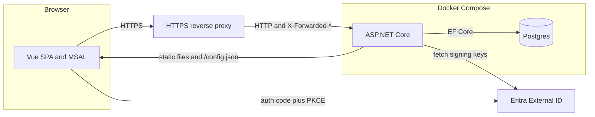
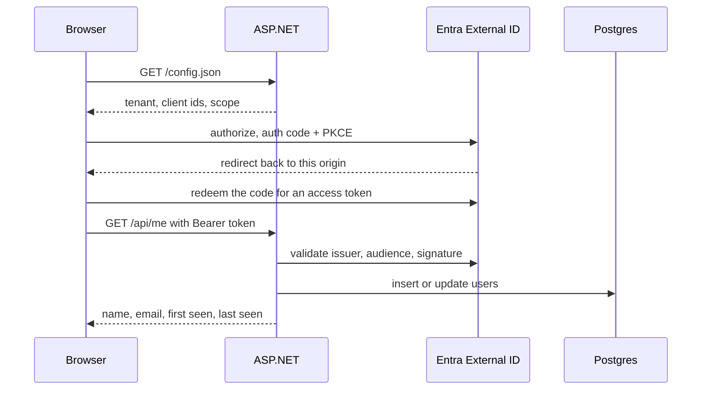

# Gym Bro

Gym Bro is a personal nutrition tracker. The gym log comes later. This repository is the Phase 0 skeleton: a signed-in hello world that proves the whole stack.

You open the web app, sign in with Microsoft Entra External ID, and the page shows your name plus the row a protected API just wrote to Postgres.

## Architecture

The browser is a Vue single-page app. It signs in with MSAL (authorization code + PKCE, no client secret) and calls the API with the access token. ASP.NET Core validates that token, upserts a `users` row, and in production also serves the built Vue files. Postgres is a separate container. TLS stops at a reverse proxy in front of the app (Tailscale serve, or anything else that sets `X-Forwarded-*`).





Sign-in settings are not baked into the JavaScript bundle. The API reads them from the environment and serves them at `/config.json`, so one image works everywhere.

## Layout

| Path | What it is |
| --- | --- |
| `backend/GymBro.Api` | ASP.NET Core minimal API. Serves `/api/*`, `/config.json`, and the built Vue files. |
| `backend/GymBro.Api/Program.cs` | Composition root: configuration, forwarded headers, auth, static files, startup migrations. |
| `backend/GymBro.Api/Auth` | Entra External ID token validation, the `access_as_user` scope check, and claim reading. |
| `backend/GymBro.Api/Users/UserDirectory.cs` | Upsert of the signed-in user, keyed by the token `oid`. |
| `backend/GymBro.Api/Data` | EF Core model and the Postgres migration. |
| `backend/GymBro.Api.Tests` | xUnit tests. The host uses SQLite and a test authentication handler. |
| `frontend` | Vue 3 + Vite + TypeScript. MSAL lives in `src/auth`. |
| `Dockerfile` | Multi-stage build. One runtime image, Node and the SDK are not in it. |
| `docker-compose.yml` | `app` and `postgres`. Every secret and id comes from the environment. |
| `.env.example` | The values you copy into `.env`. `.env` is gitignored. |
| `.github/workflows/tests.yml` | The `tests` job: backend tests, frontend typecheck and build, Docker image build. |

## Endpoints

| Method | Path | Auth | What it does |
| --- | --- | --- | --- |
| `GET` | `/api/health` | anonymous | `{ "status": "ok", "databaseReachable": true }` while the process is up. The flag is false when Postgres cannot be reached. |
| `GET` | `/api/me` | bearer token with scope `access_as_user` | Upserts `users` by `oid` and returns the row, including `firstSeenAt` and `lastSeenAt`. |
| `GET` | `/config.json` | anonymous | Runtime Entra settings for the SPA. `Cache-Control: no-store`. |
| other `/api/*` | | same as `/api/me` | Unknown routes are not anonymous. |

`firstSeenAt` is set on the first request and left alone after that. A later token updates `lastSeenAt`, and updates the name and email when the token actually contains them.

## Entra External ID

Use an **external** tenant (External ID / CIAM), not a workforce tenant. You need two app registrations in that tenant. Neither one gets a client secret.

### 1. API app

1. App registrations → New registration. Name it something like `Gym Bro API`. Supported account type: this tenant only. No redirect URI. Register.
2. Copy the **Application (client) ID**. That is `ENTRA_API_CLIENT_ID`.
3. Expose an API → Application ID URI → accept the default `api://<that-client-id>`. The API builds the scope from that form. A different URI will not match.
4. Add a scope:
   - Scope name: `access_as_user`
   - Who can consent: Admins and users
   - Admin consent display name: `Access Gym Bro as the signed-in user`
   - Admin consent description: `Allows the app to call the Gym Bro API as the signed-in user.`
   - State: Enabled
5. You do not need a secret, a certificate, or a redirect URI on this app.

The API accepts access tokens whose `aud` is either the client id (typical for access token version 2) or `api://<client-id>` (version 1), so you can leave `accessTokenAcceptedVersion` at its default.

### 2. SPA app

1. App registrations → New registration. Name it something like `Gym Bro Web`. This tenant only. Register.
2. Copy the **Application (client) ID**. That is `ENTRA_SPA_CLIENT_ID`.
3. Authentication → Add a platform → **Single-page application**. The platform type has to be SPA. A "Web" redirect URI will not allow the auth-code + PKCE token request from the browser, and the token endpoint will fail CORS.
4. Redirect URIs, exactly, with no path and no trailing slash:
   - `http://localhost:5173` for the Vite dev server
   - `https://<your-production-origin>` for the HTTPS proxy (for example the Tailscale serve URL)
5. Leave the implicit-grant checkboxes (access tokens, ID tokens) **off**. MSAL uses the authorization code flow with PKCE.
6. Do not create a client secret.
7. API permissions → Add a permission → My APIs → `Gym Bro API` → Delegated → `access_as_user` → Add permission → **Grant admin consent**.

The SPA uses `window.location.origin` as the redirect URI. Register whatever origin the browser is actually on.

### 3. Sign-up and sign-in user flow

1. In the external tenant, open User flows (External Identities) → New user flow → **Sign up and sign in**.
2. Email with password is enough for a personal app. Include Display Name if you want a name stored on the user.
3. Create the flow, then open it and add the **Gym Bro Web** app. A SPA that is not on a user flow cannot sign in.

The directory (tenant) id is `ENTRA_TENANT_ID`. The tenant subdomain is the label in `https://<subdomain>.ciamlogin.com`. If that host is `https://contoso.ciamlogin.com/<tenant-id>`, `ENTRA_TENANT_SUBDOMAIN` is `contoso`.

After sign-in the page shows whatever the API stored. `oid` is always there. Name and email show "Not in the token" until the user flow returns them (`name`, `email`, or an email-shaped `preferred_username`). Add those attributes to the user flow and sign in again. The row is updated in place. The first-seen time does not move.

## Configure

```bash
cp .env.example .env
```

Fill in:

| Variable | Meaning |
| --- | --- |
| `ENTRA_TENANT_SUBDOMAIN` | Subdomain only, not the full host. |
| `ENTRA_TENANT_ID` | Directory (tenant) id. |
| `ENTRA_SPA_CLIENT_ID` | Gym Bro Web application id. |
| `ENTRA_API_CLIENT_ID` | Gym Bro API application id. |
| `POSTGRES_PASSWORD` | Database password. Also used by the API. |
| `BIND_ADDRESS` | Host address the app is published on. Default `127.0.0.1`. |
| `BIND_PORT` | Host port. Default `8100`. |

`POSTGRES_HOST=localhost` is for `dotnet run` on the host. Compose overrides the app container's host to `postgres` so the container does not try to talk to itself.

The API refuses to start outside tests if the Entra values or the database password are missing.

## Run locally

Needs the .NET 10 SDK, Node.js 22, and Docker (for Postgres).

```bash
docker compose up -d postgres
dotnet run --project backend/GymBro.Api
```

In another terminal:

```bash
cd frontend
npm install
npm run dev
```

Open <http://localhost:5173>. Vite proxies `/api` and `/config.json` to `http://127.0.0.1:$BIND_PORT` (8100 unless you changed it). The browser only talks to port 5173, which is also the redirect URI.

`dotnet run` listens on `BIND_ADDRESS`:`BIND_PORT` from `.env` when `ASPNETCORE_URLS` is not set. Stop the Compose app container first if it is already bound to that port.

## Run with Docker Compose

```bash
docker compose up --build
```

This builds one app image (Vue build, then `dotnet publish`) and starts Postgres with the named volume `gymbro-postgres`. The app container listens on `0.0.0.0` inside the network. Compose publishes that port on the host at `BIND_ADDRESS:BIND_PORT`, which defaults to `127.0.0.1:8100`. Open that URL on the machine, or put the HTTPS proxy in front of it.

On startup the API applies EF Core migrations, retrying for a few seconds if Postgres is still coming up. `docker compose down` keeps the volume. `docker compose down -v` drops it.

There is no TLS inside the app. Do not turn on `UseHttpsRedirection`. The proxy terminates HTTPS and must send `X-Forwarded-Proto`, `X-Forwarded-Host`, and `X-Forwarded-For`. The app trusts those headers from whoever can connect, which is safe while the publish address is loopback. If you set `BIND_ADDRESS` to a public interface, anyone who can reach it can spoof the original host.

Point the proxy at `http://127.0.0.1:8100`. Register the HTTPS origin it presents (no path, no trailing slash) as a SPA redirect URI, then open that HTTPS URL and sign in.

## Tests

```bash
dotnet test
cd frontend && npm run typecheck && npm test && npm run build
```

Backend tests cover `/api/health`, `/api/me` without a token (401), a token without `access_as_user` (403), the user upsert (first seen stays, last seen and the name move), unknown `/api` routes, `/config.json`, and the claim reader. They do not call Entra or Postgres. The test host sets `ASPNETCORE_ENVIRONMENT=Testing`, uses SQLite, and authenticates with `TestAuthHandler` instead of `Microsoft.Identity.Web`.

CI is `.github/workflows/tests.yml`. The job name is `tests`. It runs on pull requests and on pushes to `main`, and it also builds the Docker image.

New migrations, when you need one:

```bash
dotnet tool restore
dotnet tool run dotnet-ef -- migrations add <Name> --project backend/GymBro.Api --output-dir Data/Migrations
```

## Not in this phase

No foods, meals, or workouts. No accounts other than the Entra user. The `users` table is the only table.
