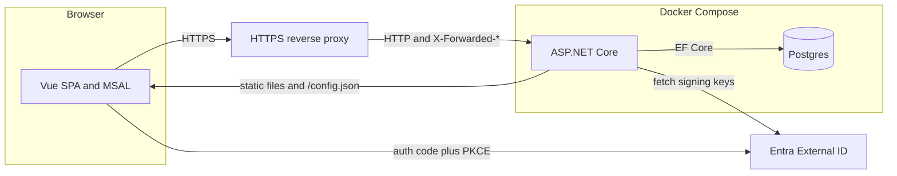
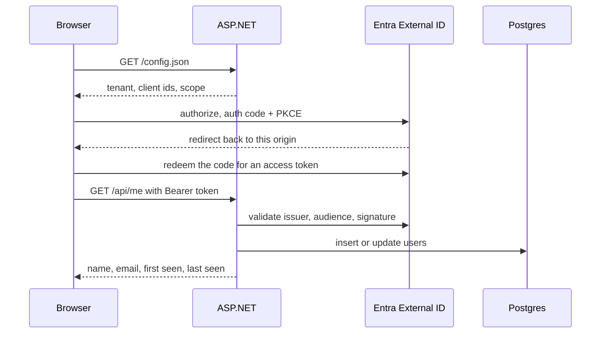

# Gym Bro

Gym Bro is a personal nutrition tracker. Phase 1 starts with profile, targets, and the food-data groundwork. The food log, Today, and Progress screens come in later pull requests.

You open the web app, sign in with Microsoft Entra External ID, and the first visit asks for a profile and a weigh-in before it shows any targets.

## Architecture

The browser is a Vue single-page app. It signs in with MSAL (authorization code + PKCE, no client secret) and calls the API with the access token. ASP.NET Core validates that token, upserts a `users` row, and in production also serves the built Vue files. Postgres is a separate container. TLS stops at a reverse proxy in front of the app (Tailscale serve, or anything else that sets `X-Forwarded-*`).





Sign-in settings are not baked into the JavaScript bundle. The API reads them from the environment and serves them at `/config.json`, so one image works everywhere.

## Layout

| Path | What it is |
| --- | --- |
| `backend/GymBro.Api` | ASP.NET Core minimal API. Serves `/api/*`, `/config.json`, and the built Vue files. |
| `backend/GymBro.Api/Program.cs` | Composition root: configuration, forwarded headers, auth, static files, startup migrations. |
| `backend/GymBro.Api/Auth` | Entra External ID token validation, the `access_as_user` scope check, and claim reading. |
| `backend/GymBro.Api/Users/UserDirectory.cs` | Upsert of the signed-in user, keyed by the token `oid`. |
| `backend/GymBro.Api/Data` | EF Core model and Postgres migrations. Phase 1 adds profiles, weigh-ins, target history, foods, log entries, entry groups, and day status. |
| `backend/GymBro.Api/Nutrition` | Mifflin-St Jeor, macro balance, the calorie floor, and trend weight. |
| `backend/GymBro.Api.Tests` | xUnit tests against Postgres (Testcontainers) and a test authentication handler. |
| `frontend` | Vue 3 + Vite + TypeScript. MSAL lives in `src/auth`. Playwright smoke tests live in `e2e`. Follows the design prototype. |
| `prototype` | Interactive design prototype. Not production code. Fictional data, `localStorage` only. See `prototype/README.md`. |
| `Dockerfile` | Multi-stage build. One runtime image, Node and the SDK are not in it. |
| `docker-compose.yml` | `app` and `postgres`. Every secret and id comes from the environment. |
| `.env.example` | The values you copy into `.env`. `.env` is gitignored. |
| `.github/workflows/tests.yml` | The `tests` job: backend tests, frontend checks, Chromium and WebKit smoke, axe, Docker image build. A separate `prototype` job builds `prototype/`. |

## Endpoints

| Method | Path | Auth | What it does |
| --- | --- | --- | --- |
| `GET` | `/api/health` | anonymous | `{ "status": "ok", "databaseReachable": true }` while the process is up. The flag is false when Postgres cannot be reached. |
| `GET` | `/api/me` | bearer token with scope `access_as_user` | Upserts `users` by `oid` and returns the row, including `firstSeenAt` and `lastSeenAt`. |
| `GET` | `/api/profile` | bearer | Profile, weight, the targets in effect today, and the Matvaretabellen citation. `profile` is null on first run. |
| `PUT` | `/api/profile` | bearer | Saves the profile. Requires a weigh-in on or before today. Upserts today's `target_history` row when something changed. |
| `POST` | `/api/targets/preview` | bearer | Same maths, nothing stored. |
| `GET` | `/api/targets?date=` | bearer | The target row in effect on that date. |
| `PUT` | `/api/weigh-ins/{date}` | bearer | Create or replace that day's weigh-in. One decimal, 30–300 kg. A comma or a point is accepted. `confirm: true` saves a value more than 3.0 kg from the previous day's trend. |
| `GET` | `/api/weigh-ins` | bearer | The caller's weigh-ins. |
| `DELETE` | `/api/weigh-ins/{date}` | bearer | Deletes that day's weigh-in. The trend is computed again; `target_history` is left as it was. |
| `GET` | `/api/weight/trend?date=` | bearer | Trend for that local day (today when `date` is omitted), plus `trendState`, `reasons`, `goalReached`, and `freshStart`. |
| `GET` | `/api/weight/chart?date=&days=` | bearer | Daily series ending on that day. `days` defaults to 30 (1–366). Real weigh-ins are flagged; other days are estimated. `gap: true` and `trendKg: null` mark a fresh-start break (no line across a gap over 28 days). |
| `POST` | `/api/weight/fresh-start` | bearer | `{ "accept": true }` upserts today's `target_history` row and appends `fresh_start` to its `reasons`. `{ "accept": false }` writes nothing. |
| `GET` | `/api/foods/search?q=` | bearer | Local foods only. This never calls Open Food Facts. |
| `POST` | `/api/foods/search/open-food-facts` | bearer | On-demand Open Food Facts search, throttled to 10 a minute. Local matches are always returned. |
| `POST` `/GET` `/PUT` `/DELETE` | `/api/foods` | bearer | Custom foods. Private to the owner. Nutrients are per 100 g/ml, or per serving with no gram weight. Labels over 80 characters are 400. |
| `GET` | `/api/about` | bearer | Food-data credits, including the Matvaretabellen citation. |
| `GET` | `/config.json` | anonymous | Runtime Entra settings for the SPA. `Cache-Control: no-store`. |
| other `/api/*` | | same as `/api/me` | Unknown routes are not anonymous. |

`firstSeenAt` is set on the first request and left alone after that. A later token updates `lastSeenAt`, and updates the name and email when the token actually contains them.

## Entra External ID

Use an **external** tenant (External ID / CIAM), not a workforce tenant. You need two app registrations in that tenant. Neither one gets a client secret.

### 1. API app

1. App registrations → New registration. Name it something like `Gym Bro API`. Supported account type: this tenant only. No redirect URI. Register.
2. Copy the **Application (client) ID**. That is `ENTRA_API_CLIENT_ID`.
3. Expose an API → Application ID URI → accept the default `api://<that-client-id>`. The API builds the scope from that form. A different URI will not match.
4. Add a scope:
   - Scope name: `access_as_user`
   - Who can consent: Admins and users
   - Admin consent display name: `Access Gym Bro as the signed-in user`
   - Admin consent description: `Allows the app to call the Gym Bro API as the signed-in user.`
   - State: Enabled
5. You do not need a secret, a certificate, or a redirect URI on this app.

The API accepts access tokens whose `aud` is either the client id (typical for access token version 2) or `api://<client-id>` (version 1), so you can leave `accessTokenAcceptedVersion` at its default.

### 2. SPA app

1. App registrations → New registration. Name it something like `Gym Bro Web`. This tenant only. Register.
2. Copy the **Application (client) ID**. That is `ENTRA_SPA_CLIENT_ID`.
3. Authentication → Add a platform → **Single-page application**. The platform type has to be SPA. A "Web" redirect URI will not allow the auth-code + PKCE token request from the browser, and the token endpoint will fail CORS.
4. Redirect URIs, exactly, with no path and no trailing slash:
   - `http://localhost:5173` for the Vite dev server
   - `https://<your-production-origin>` for the HTTPS proxy (for example the Tailscale serve URL)
5. Leave the implicit-grant checkboxes (access tokens, ID tokens) **off**. MSAL uses the authorization code flow with PKCE.
6. Do not create a client secret.
7. API permissions → Add a permission → My APIs → `Gym Bro API` → Delegated → `access_as_user` → Add permission → **Grant admin consent**.

The SPA uses `window.location.origin` as the redirect URI. Register whatever origin the browser is actually on.

### 3. Sign-up and sign-in user flow

1. In the external tenant, open User flows (External Identities) → New user flow → **Sign up and sign in**.
2. Email with password is enough for a personal app. Include Display Name if you want a name stored on the user.
3. Create the flow, then open it and add the **Gym Bro Web** app. A SPA that is not on a user flow cannot sign in.

The directory (tenant) id is `ENTRA_TENANT_ID`. The tenant subdomain is the label in `https://<subdomain>.ciamlogin.com`. If that host is `https://contoso.ciamlogin.com/<tenant-id>`, `ENTRA_TENANT_SUBDOMAIN` is `contoso`.

After sign-in the app loads `/api/profile`. With no profile it stays on setup until a profile and a first weigh-in are saved. `oid` is the user key on every row. Name and email are stored when the token contains them (`name`, `email`, or an email-shaped `preferred_username`).

## Configure

```bash
cp .env.example .env
```

Fill in:

| Variable | Meaning |
| --- | --- |
| `ENTRA_TENANT_SUBDOMAIN` | Subdomain only, not the full host. |
| `ENTRA_TENANT_ID` | Directory (tenant) id. |
| `ENTRA_SPA_CLIENT_ID` | Gym Bro Web application id. |
| `ENTRA_API_CLIENT_ID` | Gym Bro API application id. |
| `POSTGRES_PASSWORD` | Database password. Also used by the API. |
| `BIND_ADDRESS` | Host address the app is published on. Default `127.0.0.1`. |
| `BIND_PORT` | Host port. Default `8100`. |
| `OPENFOODFACTS_USER_AGENT` | Product string sent to Open Food Facts. Keep it generic. |
| `MATVARETABELLEN_URL` | Official foods.json used by the import. |

`POSTGRES_HOST=localhost` is for `dotnet run` on the host. Compose overrides the app container's host to `postgres` so the container does not try to talk to itself.

The API refuses to start outside tests if the Entra values or the database password are missing.

## Run locally

Needs the .NET 10 SDK, Node.js 22, and Docker (for Postgres).

```bash
docker compose up -d postgres
dotnet run --project backend/GymBro.Api
```

In another terminal:

```bash
cd frontend
npm install
npm run dev
```

Open <http://localhost:5173>. Vite proxies `/api` and `/config.json` to `http://127.0.0.1:$BIND_PORT` (8100 unless you changed it). The browser only talks to port 5173, which is also the redirect URI.

`dotnet run` listens on `BIND_ADDRESS`:`BIND_PORT` from `.env` when `ASPNETCORE_URLS` is not set. Stop the Compose app container first if it is already bound to that port.

## Run with Docker Compose

```bash
docker compose up --build
```

This builds one app image (Vue build, then `dotnet publish`) and starts Postgres with the named volume `gymbro-postgres`. Data Protection keys use the named volume `gymbro-dataprotection`. The app container listens on `0.0.0.0` inside the network. Compose publishes that port on the host at `BIND_ADDRESS:BIND_PORT`, which defaults to `127.0.0.1:8100`. Open that URL on the machine, or put the HTTPS proxy in front of it.

On startup the API applies EF Core migrations, retrying for a few seconds if Postgres is still coming up. `docker compose down` keeps the volume. `docker compose down -v` drops it.

There is no TLS inside the app. Do not turn on `UseHttpsRedirection`. The proxy terminates HTTPS and must send `X-Forwarded-Proto`, `X-Forwarded-Host`, and `X-Forwarded-For`. The app trusts those headers from whoever can connect, which is safe while the publish address is loopback. If you set `BIND_ADDRESS` to a public interface, anyone who can reach it can spoof the original host.

Point the proxy at `http://127.0.0.1:8100`. Register the HTTPS origin it presents (no path, no trailing slash) as a SPA redirect URI, then open that HTTPS URL and sign in.

## Food data

Open Food Facts is not searched as you type. `GET /api/foods/search` reads the local table. `POST /api/foods/search/open-food-facts` calls Open Food Facts, at most 10 searches a minute from this server, and returns the local rows plus `ok`, `rate_limited`, or `unavailable`. The User-Agent is `OPENFOODFACTS_USER_AGENT`.

Matvaretabellen is imported from the official foods.json, not committed as a dump. On the host:

```bash
dotnet run --project backend/GymBro.Api -- --import-matvaretabellen
```

With the Compose app image, against the Compose database:

```bash
docker compose run --rm app --import-matvaretabellen
```

That one-off container applies migrations, imports, prints the citation, and exits. Run it again for the yearly refresh. The command prints `Matvaretabellen 2026. Mattilsynet. www.matvaretabellen.no`, and the app shows the same line from `/api/about` and the profile payload. Label kilocalories are stored as published. USDA is not used.

## Targets and trend weight

BMR is Mifflin-St Jeor. Daily burn is BMR times the activity factor. The calorie target moves off that burn by the weekly rate times 7,700 divided by 7, and is never below BMR. Protein is grams per kilogram, fat is a percent of the target, and carbs fill the rest (never below 0).

`target_history` has one row per user per effective date. A later change the same day updates that row: the numbers are the latest calculation, and `reasons` (`text[]`) keeps every reason in the order it first applied (`profile_change`, `macro_balance_change`, `weekly_recalculation`, `fresh_start`). The JSON field `reason` is the last of those. `PUT /api/profile`, the weekly job, and a fresh-start accept all use that upsert. Accept appends `fresh_start` and does not drop the reasons already on today's row.

The hosted job adds `weekly_recalculation` to today's row. On Monday that row is dated Monday. If the process was off on Monday, the catch-up merges into the day the job actually runs and does not backdate a Monday row. A second run that week does nothing. A profile created today on a day other than Monday does not also get a weekly reason that same day.

Trend weight is one server series (`TrendWeight.Compute`), from the first real weigh-in through the user's local today. The setup weight is that first weigh-in, and the trend that day is the weigh-in itself. Each later day keeps the previous trend (Part A has no intake step) unless the day has a real weigh-in or a gap reading, in which case the trend moves 10 percent of the way toward that reading (`TrendWeight.SmoothingShare`). A gap of 2 to 28 days is a straight line between the two real weigh-ins. A gap longer than 28 days is a fresh start: that day's trend equals the new weigh-in. Profile, targets, BMR, the weekly job, and the weight API all use this published figure, rounded to two decimal places, half away from zero. The weight stored on a target row is `numeric(5,2)`. Past `target_history` rows are not rewritten when a weigh-in changes.

`trendState` is `normal`, `low_accuracy` (fewer than 2 real weigh-ins in the last 7 days; the weight `reasons` includes `fewer_than_2_weighins_7d`), or `fresh_start` (the latest weigh-in followed a gap longer than 28 days, until the next weigh-in). `freshStart.weeksSincePrevious` is the whole weeks in that gap. `goalReached` is judged on the latest real weigh-in on or before that day (lose: trend at or under the goal, gain: at or over), including later days that only carry the trend. An estimate-only day is not compared on its own. Nothing switches the goal on its own. The profile shows the published kilograms from the first weigh-in, with “trend · low accuracy” when the window has fewer than two weigh-ins.

A new or edited weigh-in more than 3.0 kg from the previous day's trend returns `409` with `code: "confirm_weigh_in"` and `error: "Is 38.6 kg right? That's 45.0 kg below your trend (83.6 kg). Nothing is saved until you choose."`. The kilograms in that sentence are shown to one decimal. `previousTrendKg` stays the full published trend. The first weigh-in is not checked. Sending `confirm: true` saves it. `POST /api/weight/fresh-start` with `accept: true` upserts today's target row and appends `fresh_start` to `reasons`. `accept: false` writes nothing. The weekly job still uses the same trend and the same upsert. `day_status.fasting` defaults to false and is unused until learned burn.

## Custom foods and log references

A custom food can be per serving only: `nutrientBasis` is `per_serving`, the kcal and macro fields are for one serving, and there is no gram weight. `log_entries.grams` stays nullable. Adding a serving weight later stores nutrients per 100 g for future logs (`value * 100 / grams`). Rows already logged keep the snapshot that was copied onto them. Omitted `nutrientBasis` means per 100 g, which is what Matvaretabellen (`source` `mvt`) and Open Food Facts use. Serving and piece labels longer than 80 characters are rejected with 400.

Catalogue foods have no owner, so a foreign key of `(log.user_id, food_id)` cannot point at them. `foods.owner_key` is a stored `COALESCE(user_id, '')` (`''` is the catalogue). `log_entries.food_owner_key` must be `''` or that row's `user_id`. The foreign key is `(food_owner_key, food_id)` → `foods (owner_key, id)`. A null `food_id` skips the key. Groups always have an owner, so `(user_id, group_id)` → `entry_groups (user_id, id)`. Deleting a food or a group sets only `food_id` or `group_id` to null. EF models those relationships as `NO ACTION` because `food_owner_key` and `user_id` are not nullable; the migration SQL uses PostgreSQL's `ON DELETE SET NULL (food_id)` and `ON DELETE SET NULL (group_id)`. A later `migrations add` compares the model to the snapshot, so it will not rewrite that SQL.

## Open Food Facts and response headers

The Open Food Facts client does not follow redirects. A 3xx, a network failure, or a body over 2 MiB comes back as `unavailable`. Every response, including static files and errors, sends a Content-Security-Policy that allows the built SPA and MSAL calls to `https://*.ciamlogin.com` (no script inline or eval; style attributes stay allowed for the sheet drag). Silent renewal needs `frame-src 'self' https://*.ciamlogin.com` and `frame-ancestors 'self'`, with `X-Frame-Options: SAMEORIGIN`, so the hidden iframe can load CIAM and the same-origin redirect page. Responses also send `X-Content-Type-Options: nosniff` and `Referrer-Policy: strict-origin-when-cross-origin`. The Playwright smoke checks those headers on `http://127.0.0.1:8100/api/health` and walks the e2e sign-in flag. It does not complete a real CIAM redirect.

## Data Protection keys

ASP.NET Data Protection keys are stored on disk so a new container does not mint a new key ring. Compose sets `DataProtection__KeysPath=/var/lib/gymbro/keys` and mounts the named volume `gymbro-dataprotection` there. The image creates that directory as root and `chown`s it to the non-root app user before `USER`, so a fresh volume is writable. Development, tests, and the e2e host use `.data/keys` under the content root (gitignored). Sign-in uses bearer tokens, not Data Protection cookies; the keys are still persisted. The first deploy after this change writes a new ring into the volume. Later rebuilds reuse it.

## Deploy

Take a database backup before deploying this release. The migration merges same-day `target_history` rows (latest numbers, every reason kept), adds per-serving nutrient basis, and replaces the food and group foreign keys. A log row that pointed at another person's food or group has that reference cleared so the new keys can be created. Bring the new image up with Compose so `gymbro-dataprotection` is mounted. Do not use `docker compose down -v` if you need the database or the key ring. The first start writes Data Protection keys into the volume; rebuilding the image after that keeps them.

## Tests

```bash
dotnet test
cd frontend && npm run typecheck && npm test && npm run build && npm run e2e
```

Backend tests use Testcontainers Postgres 17 and `TestAuthHandler`. They do not call Entra. The end-to-end smoke test starts the API with `ASPNETCORE_ENVIRONMENT=E2e` and `E2E_AUTH=true` (both are required; that handler is not registered otherwise) and a browser session flag. It needs Postgres on `127.0.0.1:5432` with user, password, and database `gymbro`.

CI is `.github/workflows/tests.yml`. The required job name is `tests`. It runs backend tests, the frontend checks, the Playwright smoke test on Chromium and WebKit (each at 390, 820, and 1440), then the axe spec (`npx playwright test --config e2e/retro.config.ts`) on Chromium and WebKit. The smoke step and the axe step both bind ports 8100 and 5173, so CI runs them one after the other. The Docker image build is last. A separate `prototype` job runs `npm ci && npm run build && node scripts/unit-trend.mjs` in `prototype/` and is not part of the `tests` check.

New migrations, when you need one:

```bash
dotnet tool restore
dotnet tool run dotnet-ef -- migrations add <Name> --project backend/GymBro.Api --output-dir Data/Migrations
```

## Later pull requests

Food logging screens are still placeholders. Logging on a past day will require picking a time, the food sheet will stay open after Add on a phone, and Copy will default to Today. Workouts are out of scope. There is no meal field on a log entry.
